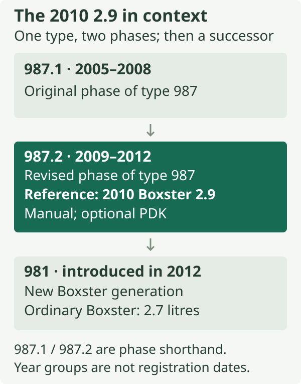
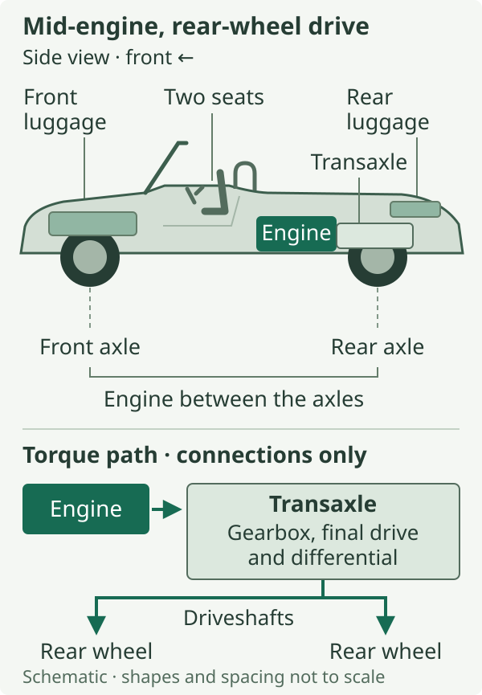
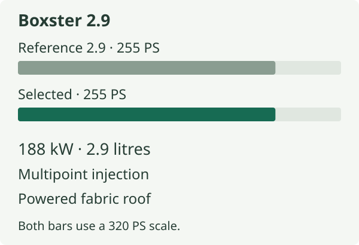

# The 2010 Boxster 2.9 in the 987.2 family

This book starts with one car: the 2010 European/UK Porsche Boxster with the 2.9-litre engine. It is an open two-seater with a folding fabric roof, a six-cylinder engine behind the seats and drive to the rear wheels. A six-speed manual gearbox is the standard reference; the optional seven-speed Porsche Doppelkupplung, usually called PDK, is explained alongside it. The reference defines the model; each car's options are identified separately.[^baseline]

The book follows the connections between systems. Engine torque reaches the road through the gearbox and rear tyres; braking depends on the tyres and suspension as well as the discs. An opening roof changes the demands on structure, sealing, drainage and occupant protection. Start by locating those assemblies and identifying the model they belong to.

.](images/boxster-2-9-front.jpg){alt="A green ordinary 987.2 Boxster photographed from the front with its fabric roof lowered."}

## What 987.2 means

**987** is Porsche's type designation for this generation. In this book, **987.2** means its revised, second-phase form, the ordinary models which Porsche Classic groups as 2009–2012. **987.1** distinguishes the preceding 2005–2008 form. The decimal suffixes are useful shorthand: the broad type number alone does not tell us which engine or transmission is fitted.[^generations]

The revision brought new engines, a standard six-speed manual and optional PDK in place of Tiptronic S. Revised chassis, steering, stability control and styling accompanied those changes. [The yearly timeline](../02-the-yearly-timeline/index.md) dates their introduction.[^facelift]

*The generation map is an identification aid. The detailed sequence of announcements, availability and model years belongs to [the yearly timeline](../02-the-yearly-timeline/index.md).*

The succeeding **981**, introduced during 2012, has a new chassis, longer wheelbase, electromechanical steering and a 2.7-litre direct-injected base engine. Use the generation as well as the registration year when choosing technical information.[^981]

## A roadster arranged around its engine

**Mid-engine** describes the engine's position between the axles. In this car it sits behind the occupants and ahead of the rear axle. **Flat-six** describes its internal arrangement: two opposing banks of three cylinders lie horizontally on either side of the crankshaft. These terms answer different questions. One locates the complete engine in the car; the other describes the engine itself.[^layout]

The layout gives the Boxster a recognisable sequence of spaces. At the front is a luggage compartment. The two seats occupy the central cabin. Behind them are the engine and the folding-roof area, with another luggage compartment towards the rear. The folding roof has its own stowage space, leaving both luggage compartments available.[^luggage]

*Packaging diagram, with the car facing left. The engine location and the two luggage spaces are the point of the drawing; shapes and spacing are schematic.*

The rear boot provides access to oil and coolant filling points. Reaching the engine itself involves separate covers, explained in [body structure and packaging](../04-body-structure-and-packaging/index.md#three-different-spaces-behind-the-seats).[^luggage]

Putting a substantial mass between the axles also matters dynamically. Think of rotating a long object held near its middle: moving heavy parts towards the centre generally makes it easier to turn than placing those parts at the ends. The analogous motion in a car is *yaw*, its rotation in plan as it changes direction. Tyres, road conditions, suspension and driver inputs determine how that layout behaves in practice.

The gearbox and final drive carry engine torque to the rear wheels. The front wheels steer; the rear tyres both guide the car and transmit driving force. The mechanical chapters follow that route from engine to road.

## The ordinary 2.9 and its relatives

In Porsche's catalogue, the ordinary car is simply **Boxster**. This book adds **2.9** when the distinction helps. The **S** is a different engine variant, not a transmission choice or an option package attached to the 2.9. Both ordinary models offered manual and PDK transmissions.[^baseline]

The 2.9 uses multipoint injection into the inlet ports. The S has a larger 3.4-litre engine with direct fuel injection, or **DFI**, into the cylinders. Both belong to the revised generation.[^injection]

::: {.book-diagram data-diagram="family-variant-selector"}

:::

*Select a relative to compare its engine and broad purpose with the reference 2.9. The bars compare published power, rather than acceleration, handling or value.*

The **Boxster Spyder** is a lightweight production derivative with a higher-output 3.4-litre DFI engine. Its roof, body and chassis were developed around weight reduction.[^spyder]

The **Boxster S Black Edition** combines a higher-output 3.4-litre DFI engine with a black colour theme and additional equipment. It retains the powered fabric roof and was limited to 987 cars.[^black]

The Spyder and Black Edition pursue different aims despite sharing a peak-power figure. Each component chapter compares them with the 2.9 where the difference affects that system.

.](images/boxster-2-9-rear.jpg){alt="The ordinary green Boxster seen from behind on a road, showing the two-seat cabin, rear deck and central exhaust outlet."}

## Where the Cayman fits

The **Cayman** is the related fixed-roof coupé. Shared technical material is useful where a source covers both cars, but their specifications and complete assemblies can differ.[^cayman] The [engine chapter](../05-engine-construction-and-valve-gear/index.md#the-s-spyder-black-edition-and-cayman) gives a specific example. Cayman photographs are labelled wherever they illustrate a shared detail.

## Reading this book

The chapters explain the ordinary **2010 European/UK 2.9** first, with the standard manual and optional PDK distinguished where necessary. Options and other derivatives follow the mechanism they change. [Reading an individual car's record](../03-the-2010-boxster-2-9-specification-and-options/index.md#reading-an-individual-cars-record) explains how to compare factory equipment, present components and service history. In the component chapters, identification and ageing focus on the features particular to that system.

Power is given in **kW and PS**. Porsche's English period brochures label their metric DIN horsepower figures “hp”; here those figures are written as PS, without silently treating them as British bhp. Dimensions and capacities retain their units. A quoted performance or weight figure belongs to its stated transmission, equipment and measurement convention.

Keep **announcement date, build date, model year and first registration** separate. A later registration does not automatically mean a later technical specification. Dated UK publications establish equipment availability. North American documents are identified where they support shared mechanical details. Later parts catalogues record service applications and replacements, so a shared listing alone cannot establish identical original parts or complete interchangeability. Component-year sections distinguish a documented change from a gap in the surviving evidence.

The original diagrams simplify shapes, routes and motions so that relationships remain visible. Treat them as explanatory schematics unless a dimension is explicitly sourced. Interactive controls let you isolate a change; they do not reproduce Porsche's complete control software or measured behaviour. Photographs supply real visual context, with the pictured variant and origin identified.

The reading order moves from context to mechanisms: chapters 2–3 establish dates and equipment; 4–10 follow the body and powertrain; 11–13 explain the connection to the road; 14–17 cover the roof, cabin and electrical equipment. Chapter 18 brings the systems together around occupant protection. Cross-references also let you follow one component directly to its options, related models and ageing.

[^baseline]: Porsche, *The Boxster*, January 2010 UK edition, printed pp. 8–10 and 126–127, [original brochure](https://mrsportscars.com/wp-content/uploads/2019/11/Porsche-Boxster-987-Gen-2-Sales-Brochure-UK-US-2010-2011.pdf). Its colophon identifies Edition 01/10; the website filename is not the publication date.

[^generations]: Porsche Classic, [“Model Boxster (type 987)”](https://www.porsche.com/netherlands/nl/service/classic/models/987b/987b/), sections “Boxster (2005–2008)” and “Boxster (2009–2012)”. The decimal suffixes are the book's practical distinction between these phases, not a claim that the sales brochures used them as model names.

[^facelift]: Porsche Netherlands, [“De nieuwe Porsche Boxster en Cayman: krachtiger en zuiniger”, 19 November 2008](https://nieuws.porsche.nl/de-nieuwe-porsche-boxster-en-cayman-krachtiger-en-zuiniger/), sections on powertrains, PDK, chassis and styling.

[^981]: Porsche Netherlands, [“Porsche presenteert nieuwe Boxster”, 12 January 2012](https://nieuws.porsche.nl/porsche-presenteert-nieuwe-boxster/), introduction and engine sections. It announces Dutch dealer arrival for 14 April 2012; that is not used as a universal registration or model-year boundary. Porsche's [2021 family retrospective](https://newsroom.porsche.com/en_US/2021/products/porsche-boxster-25-years-premiere-23382.html), section “Porsche presented the 981 generation Boxster in 2012”, explicitly identifies the type.

[^layout]: Porsche Cars North America, [*2010 Boxster specifications*, pp. 1–2](https://newsroom.porsche.com/dam/jcr:e5abc517-c680-47c0-974f-b84aefde568f/2010-Boxster-Specifications.pdf), mid-mounted horizontally opposed six-cylinder engine, common engine/transmission unit, rear-wheel drive and two-seat roadster. Used for mechanical layout, not UK equipment.

[^luggage]: Porsche, *The Boxster*, January 2010 UK edition, printed pp. 78–79 and 126–127, [original brochure](https://mrsportscars.com/wp-content/uploads/2019/11/Porsche-Boxster-987-Gen-2-Sales-Brochure-UK-US-2010-2011.pdf).

[^injection]: Porsche Cars North America, *2009 Technik Introduction — All Boxster Cayman Models*, edition 2/09, PNA 987 021 09, Fuel and ignition system, printed p. 59 ([viewer p. 65](https://www.manualslib.com/manual/3550487/Porsche-Boxster-2009.html?page=65); [accessible original text](https://www.scribd.com/document/972719474/Boxster-2009)), locates the 2.9's injectors at the individual intake ports; *The Boxster*, January 2010 UK edition, printed pp. 28–29 (PDF p. 12), [original brochure](https://mrsportscars.com/wp-content/uploads/2019/11/Porsche-Boxster-987-Gen-2-Sales-Brochure-UK-US-2010-2011.pdf), describes the S's injection into the combustion chamber.

[^spyder]: Porsche Netherlands, [“Porsche Boxster Spyder: lichtgewicht Roadster voor puristen”, 6 November 2009](https://nieuws.porsche.nl/porsche-boxster-spyder-lichtgewicht-roadster-voor-puristen/), announcement, roof and engine sections; Porsche, *The Boxster Spyder*, January 2010 UK edition, printed pp. 10–17, 24–27 and 41 (technical data, PDF p. 19), [original brochure](https://porschecarshistory.com/wp-content/old/brochures2/93/2010%20987%20Boxster%20Spyder.pdf).

[^black]: Porsche Netherlands, [“Slechts 987 exemplaren: rijk uitgeruste Boxster S Black Edition”, 2 February 2011](https://nieuws.porsche.nl/slechts-987-exemplaren-rijk-uitgeruste-boxster-s-black-edition/), engine, limited-series and announced availability details; Porsche, *Boxster S Black Edition UK price list*, Edition 03/2011, printed p. 10 (PDF p. 6, electrically operated hood), [original price list](https://www.dropbox.com/scl/fi/gtavw6els2231u61qjomr/2011-987-Porsche-Boxster-Black-Edition-Price-List-UK.pdf?rlkey=7n0i52owbntdg7d17dfgyo7nw&dl=0).

[^cayman]: Porsche Netherlands, [19 November 2008 Boxster/Cayman announcement](https://nieuws.porsche.nl/de-nieuwe-porsche-boxster-en-cayman-krachtiger-en-zuiniger/), opening power figures and “Meer onderscheid tussen Boxster en Cayman”.
