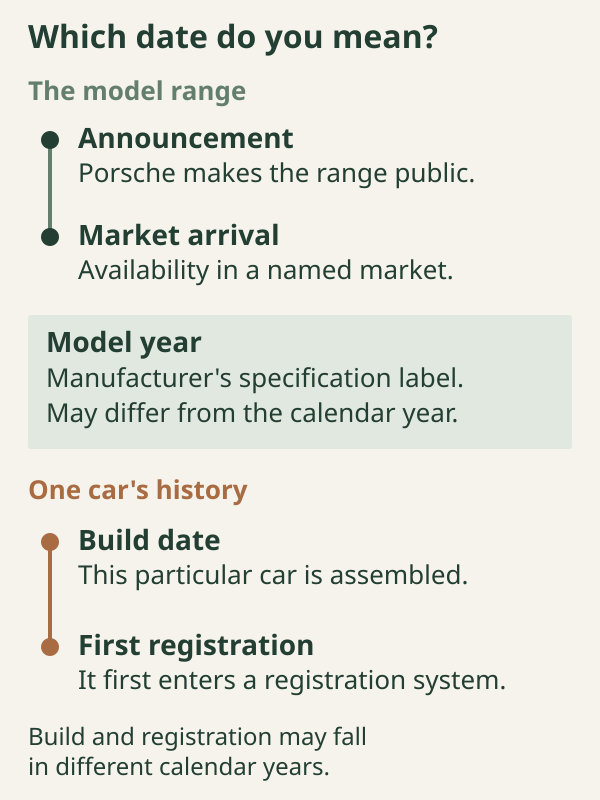
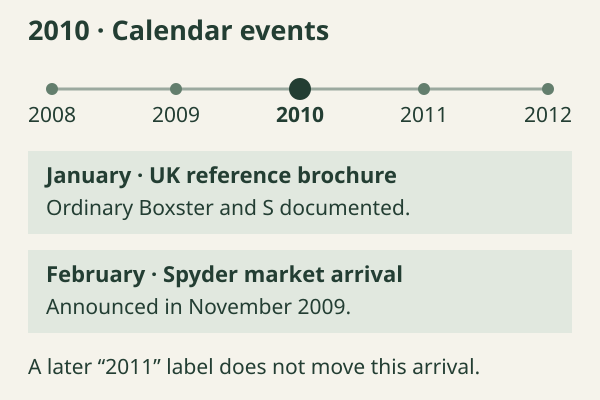

# The yearly timeline

The 2010 Boxster 2.9 sits close to the beginning of the revised 987 range. Its defining mechanical changes arrived for 2009; the later Spyder and Black Edition added different kinds of Boxster around it. The replacement 981 then created a new boundary in 2012. Reading those events in order makes more sense than treating every year in an advertisement as a distinct specification.

This chapter follows calendar events, while the book keeps the European/UK model-year 2010 2.9 as its reference. The full [2010 specification and options chapter](../03-the-2010-boxster-2-9-specification-and-options/index.md) supplies the equipment baseline. Here the question is when that car's design arrived, what subsequently joined the range, and which dates can actually establish a change.

## Five dates that answer different questions

An announcement tells us when Porsche made a product public. An advertised market introduction tells us when it expected customers to be able to buy it. A later report can confirm that availability. None gives the assembly date of an individual car.

**Model year** is a manufacturer's specification label, rather than a promise that assembly, sale and registration all occurred between January and December of that number. **Build date** concerns the particular vehicle. **First registration** records its entry into the registration system. A car held in stock can cross a calendar boundary between those events. An imported car can acquire another registration record without becoming a later technical version.

Brochures add a sixth useful date: publication. The launch catalogue is marked **08/08**, while the ordinary UK catalogue used for this book is **01/10**. Those marks date the documents. They do not turn the facelift into a 2008-model-year car or establish the production day on which an option first appeared.[^timeline-catalogues]

*Use the date that answers the question being asked. The ordering shown for an individual car is illustrative; no particular owner's production or registration dates are assumed.*

::: {.book-diagram data-diagram="timeline-evidence"}

:::

*Select a calendar year, then compare its events with the labels on the evidence. Dates and distinctions are documented in the sources below; the controls do not imply that a complete annual UK specification history has been recovered.*

## Late 2008: the 2.9 is announced

The reference 2.9's story begins before its first market year. Porsche's announcement of **19 November 2008** described the substantially revised Boxster and Cayman. For the Boxster, the new 2.9-litre engine produced 188 kW / 255 PS, and the S moved to 228 kW / 310 PS. Both ordinary models gained a standard six-speed manual, with PDK replacing Tiptronic S as the optional automatic offering.[^timeline-launch]

The outgoing ordinary Boxster was a 2.7-litre car: its contemporary technical table gives 2,687 cm³, 180 kW and a five-speed standard manual. Its optional Tiptronic S also had five speeds. This is the relevant predecessor to the 2010 2.9, even when an earlier car was registered late or advertised simply as a “2009 Boxster”.[^timeline-predecessor]

The announcement belongs in the 2008 calendar column; customer availability belongs in 2009. Porsche SE's contemporary results release confirms that the new Boxster and Cayman had been available **since February 2009**. That later statement is firmer evidence of arrival than a prelaunch catalogue date alone.[^timeline-arrival]

## 2009: the principal revision reaches customers

The range available from February introduced the reference car's new-generation flat-six, six-speed manual and optional seven-speed PDK. The 2.9 uses port injection; the S uses DFI, as introduced in [the family overview](../01-the-2010-boxster-2-9-in-the-987-2-family/index.md#the-ordinary-2.9-and-its-relatives).[^timeline-injection]

The revision also changed the front and rear styling, headlamps and LED rear lamps. Porsche described revised chassis and steering tuning, new wheels, and additional PSM functions for brake precharging and brake assistance. These changes formed part of the launch package.[^timeline-launch]

.](images/2009-launch-boxster-s.jpg){alt="A red facelift Boxster S in side profile in Porsche's contemporary launch photography, showing the revised front bumper and lights and the familiar 987 body proportions."}

Launch availability was not necessarily identical for every option. The early UK catalogue attached these qualifications to its engine, transmission and chassis list:[^timeline-launch-options]

| Launch-catalogue choice | What the catalogue establishes |
| --- | --- |
| Sports exhaust, XLF | Available from April 2009 **at the earliest** |
| Mechanical locking rear differential, 220 | Available from May 2009 **at the earliest**, with manual transmission and 18- or 19-inch wheels |

These are planned earliest dates; the first customer deliveries of the options are not established here. The distinction matters for cars built near launch.

A documented running change followed on **31 August 2009**, when Porsche introduced additional filters for the rear roof-compartment drains. Earlier cars could receive them as a retrofit. This is a production-date boundary within the range, described in [roof drainage](../14-roof-glass-seals-and-drainage/index.md#water-needs-a-way-out).[^timeline-drains]

## 2010: the reference car, then the Spyder

For the ordinary 2.9, the January 2010 UK brochure documents continuity in the headline engine and transmission specification. Its 2,893 cm³ engine remains rated at 188 kW / 255 PS and 290 Nm. Manual and PDK remain the transmission choices; the S retains 228 kW / 310 PS.[^timeline-reference]

The January catalogue also lists the sports steering wheel with separate PDK paddles, option 840, alongside the switch-operated wheel. This establishes its inclusion in that edition; the first UK order and production-fitment dates remain unverified.[^timeline-paddles]

The year's major range addition was the **Boxster Spyder**. Porsche's Dutch release of **6 November 2009** announced market introduction in **February 2010**. That is the release's planned date, rather than a record of first customer delivery. It presented the Spyder as a third production variant beside Boxster and S, expressly distinguishing it from earlier limited-series Boxsters that had used the Spyder name.[^timeline-spyder-arrival]

The Spyder changed the compromise. Its 235 kW / 320 PS 3.4-litre DFI engine accompanied a lighter body and cabin, manually assembled lightweight hood, lower sports suspension and standard mechanical locking differential. Its January 2010 UK brochure lists radio and air conditioning as additions to the stripped basic specification. It was not a new specification applied to all 2.9s.[^timeline-spyder-brochure]

.](images/2010-spyder-rear.jpg){alt="The Boxster Spyder viewed directly from behind, with its twin raised rear-deck forms, open cabin and Spyder script visible."}

Porsche Classic's later model summary heads the Spyder **2011**. Preserve that heading when describing that source, while retaining February 2010 as the date planned in the contemporary Dutch announcement. Neither the November 2009 announcement nor the January 2010 brochure makes the Spyder a European MY2009 or MY2010 car. A retrospective heading, a market-specific model year and a calendar launch date answer different questions.[^timeline-classic]

## 2011: a numbered S derivative

The sources reviewed do not reconstruct a complete 2011 UK specification for the ordinary 2.9. Annual colour, price, software and option changes remain less completely documented.

The dated range event is the **Boxster S Black Edition**. Porsche's Dutch announcement of **2 February 2011** specified planned availability from **March 2011** in that market. Its 235 kW / 320 PS output was higher than the ordinary S's 228 kW / 310 PS; the announcement still made that ordinary-S comparison. The edition was limited to **987 cars worldwide**.[^timeline-black-arrival]

Black Edition meant both a defined appearance and additional equipment. In the UK, the March price list bundled PCM/navigation, Sound Package Plus, bi-xenon lights, automatic climate control and cruise control. PDK, PASM, the locking differential, PCCB, Sport Chrono Plus and sports exhaust remained options. The Black Edition retained the electrically operated hood rather than adopting the Spyder's lightweight roof.[^timeline-black-uk]

The dating distinction is unusually explicit here. Porsche Cars North America's February 2011 release calls the car the **2012 Boxster S Black Edition**. The UK price list instead states that its prices apply to vehicles produced in the model year beginning **1 March 2011**, without supplying a numerical year in that sentence. The US label must therefore remain a US label, rather than becoming a claim that Europe waited until calendar 2012.[^timeline-black-us]

## 2012: identify the outgoing car before reading its specification

The final 987.2 2.9 belongs to the same broad mechanical family as the reference car. Porsche's US 2012 technical sheet still lists the 2.9 with multipoint injection, six-speed manual and optional PDK, alongside S, Black Edition and Spyder. This corroborates the late-range mechanical picture. It does not establish every UK final-year equipment detail or a final build date.[^timeline-final]

The replacement belongs in a separate column. Porsche announced the new Boxster generation in **January 2012**; the Dutch release dated **12 January** gives a planned dealer introduction of **14 April 2012** in that market. It describes a new chassis, longer wheelbase and electromechanical steering, with a 2.7-litre direct-injected base engine rated at 195 kW / 265 PS. These are 981 features, not final-year improvements to the 987.2 2.9.[^timeline-981]

*A generation check comes before an equipment comparison. The diagram compares ordinary base models; it does not describe the S or special editions.*

For a car first registered in 2012, establish the generation, model-year designation, build date and original specification separately. Then select the matching brochure. A document headed “2012 Boxster” may describe the outgoing 987 for one market, while an article published that year describes the incoming 981. Even the return of “2.7” cannot settle the question alone, because the earlier 987.1 base car also used that nominal capacity.

## Reading an individual car's history

Use the timeline to identify the generation and the dated equipment documents that apply. Then compare the build record, present hardware and invoices using [the record-reading method in chapter 3](../03-the-2010-boxster-2-9-specification-and-options/index.md#reading-an-individual-cars-record). A registration, retrofit or later replacement remains part of that individual car's history.

[^timeline-catalogues]: Porsche, *The new Boxster*, UK launch edition, colophon **08/08**, WVK 314 725 09 GB/UK, [original PDF, p. 62](https://porschecarshistory.com/wp-content/old/brochures5/26/2009%20987%20Boxster%20UK.pdf#page=62); *The Boxster*, UK edition **01/10**, WSLB1101000125 GB/UK, [colophon, PDF p. 61](https://mrsportscars.com/wp-content/uploads/2019/11/Porsche-Boxster-987-Gen-2-Sales-Brochure-UK-US-2010-2011.pdf#page=61).

[^timeline-launch]: Porsche Netherlands, [“De nieuwe Porsche Boxster en Cayman: krachtiger en zuiniger”, 19 November 2008](https://nieuws.porsche.nl/de-nieuwe-porsche-boxster-en-cayman-krachtiger-en-zuiniger/), engine, PDK, chassis, PSM and styling sections. The surviving page's final styling paragraph is truncated; no further claim is inferred from its missing text.

[^timeline-predecessor]: Porsche, *Boxster*, edition **05/07**, printed pp. 110–111, [technical table, PDF p. 52](https://xr793.com/wp-content/uploads/2022/01/2008-Porsche-Boxter.pdf#page=52). The archive filename is not its publication date.

[^timeline-arrival]: Porsche SE, *Porsche Posts Substantially Increased Profits*, release header **1 April 2009**, body dateline **31 March 2009**, [p. 2](https://www.porsche-se.com/en/media/press-releases/pdf/porsche-posts-substantially-increased-profits-1#page=2), confirms availability since February 2009.

[^timeline-injection]: Porsche Cars North America, [2010 Boxster technical specifications, p. 1](https://newsroom.porsche.com/dam/jcr:e5abc517-c680-47c0-974f-b84aefde568f/2010-Boxster-Specifications.pdf#page=1), distinguishes sequential multipoint injection on the 2.9 from DFI on the S. Used here for the mechanical distinction, not UK standard equipment.

[^timeline-launch-options]: Porsche, *The new Boxster*, UK 08/08 edition, printed p. 107, [PDF p. 50](https://porschecarshistory.com/wp-content/old/brochures5/26/2009%20987%20Boxster%20UK.pdf#page=50), option numbers and availability footnotes.

[^timeline-reference]: Porsche, *The Boxster*, January 2010 UK edition, printed pp. 126–127, [PDF p. 59](https://mrsportscars.com/wp-content/uploads/2019/11/Porsche-Boxster-987-Gen-2-Sales-Brochure-UK-US-2010-2011.pdf#page=59); compare printed pp. 126–127 in the 08/08 launch edition, [PDF p. 60](https://porschecarshistory.com/wp-content/old/brochures5/26/2009%20987%20Boxster%20UK.pdf#page=60).

[^timeline-paddles]: Porsche, *The Boxster*, January 2010 UK edition, printed pp. 46–47 and 113, [steering-wheel descriptions, PDF p. 21](https://mrsportscars.com/wp-content/uploads/2019/11/Porsche-Boxster-987-Gen-2-Sales-Brochure-UK-US-2010-2011.pdf#page=21) and [option 840, PDF p. 52](https://mrsportscars.com/wp-content/uploads/2019/11/Porsche-Boxster-987-Gen-2-Sales-Brochure-UK-US-2010-2011.pdf#page=52).

[^timeline-spyder-arrival]: Porsche Netherlands, [“Porsche Boxster Spyder: lichtgewicht Roadster voor puristen”, 6 November 2009](https://nieuws.porsche.nl/porsche-boxster-spyder-lichtgewicht-roadster-voor-puristen/), introduction and final historical paragraph. The February 2010 date is prospective in this release.

[^timeline-spyder-brochure]: Porsche, *The Boxster Spyder*, January 2010 UK edition: lightweight concept printed pp. 10–11 / PDF p. 4; manual hood pp. 14–15 / PDF p. 6; engine pp. 24–26 / PDF pp. 11–12; standard lower suspension and differential p. 28 / PDF p. 13; optional climate control and radio pp. 36–40 / PDF pp. 17–19; technical data p. 41 / PDF p. 19. [Original PDF](https://porschecarshistory.com/wp-content/old/brochures2/93/2010%20987%20Boxster%20Spyder.pdf). Colophon, PDF p. 23: WSLB1101000225 GB/UK, edition 01/10.

[^timeline-classic]: Porsche Classic, [Boxster type 987 model summary](https://www.porsche.com/netherlands/nl/service/classic/models/987b/987b/), headings “Boxster (2009–2012)” and “Boxster Spyder (2011)”. This retrospective heading does not change the date planned in the contemporary announcement.

[^timeline-black-arrival]: Porsche Netherlands, [“Slechts 987 exemplaren: rijk uitgeruste Boxster S Black Edition”, 2 February 2011](https://nieuws.porsche.nl/slechts-987-exemplaren-rijk-uitgeruste-boxster-s-black-edition/), engine comparison and prospective March availability in the Netherlands; worldwide limit also stated in the PCNA release below.

[^timeline-black-uk]: Porsche, *Boxster S Black Edition Price List*, UK, Edition **03/2011**, printed pp. 8–17 / PDF pp. 5–9, [original scanned price list](https://www.dropbox.com/scl/fi/gtavw6els2231u61qjomr/2011-987-Porsche-Boxster-Black-Edition-Price-List-UK.pdf?rlkey=7n0i52owbntdg7d17dfgyo7nw&dl=0): electrically operated hood p. 10 / PDF p. 6; equipment pp. 11–13 / PDF pp. 6–7; engine/transmission/chassis options pp. 16–17 / PDF p. 9. Locally archived original inspected; the live Dropbox viewer was unavailable during this audit.

[^timeline-black-us]: Porsche Cars North America, [“Porsche Boxster S Black Edition Has More Features, More Value and More Horsepower”, 2 February 2011](https://www.prnewswire.com/news-releases/porsche-boxster-s-black-edition-has-more-features-more-value-and-more-horsepower-115085449.html), expressly describes the **2012** model. UK price list, printed p. 5 / PDF p. 3, supplies its differently worded model-year/pricing statement.

[^timeline-final]: Porsche Cars North America, [2012 Boxster technical specifications, p. 1](https://newsroom.porsche.com/dam/jcr:f533d37f-82ef-4c9c-90cc-56b43185a8de/2012_Boxster_Specs.pdf#page=1). US figures are not used to rename European PS as SAE horsepower or to reconstruct UK equipment.

[^timeline-981]: Porsche Netherlands, [“Porsche presenteert nieuwe Boxster”, 12 January 2012](https://nieuws.porsche.nl/porsche-presenteert-nieuwe-boxster/), new chassis, steering, engines and planned **14 April** Dutch dealer introduction. The precise day is market-specific and prospective in this source.

[^timeline-drains]: Porsche, Technical Information **29/09 ENU 5393**, *Cabriolet Top Compartment Water Drains*, [workshop-archive reproduction](https://charm.li/Porsche/2011/Boxster%20%28987%29%20F6-2.9L/Repair%20and%20Diagnosis/Technical%20Service%20Bulletins/All%20Technical%20Service%20Bulletins/Body%20-%20Convertible%20Top%20Drain%20Information/), “Information” and “Date of Introduction” paragraphs: additional filters on cars manufactured on or after 31 August 2009, with retrofit provision for earlier cars.
