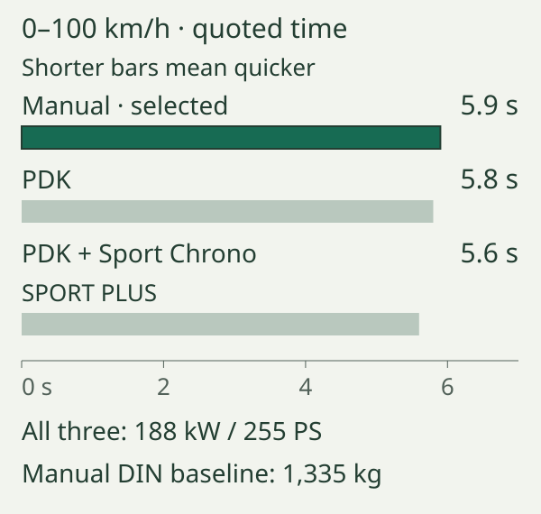
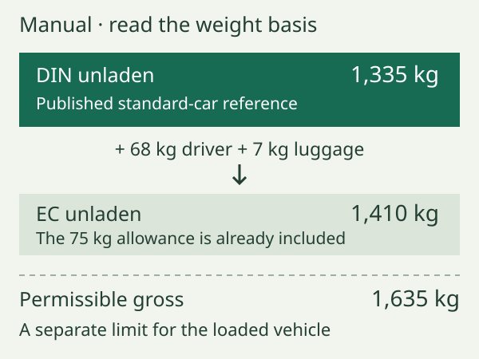
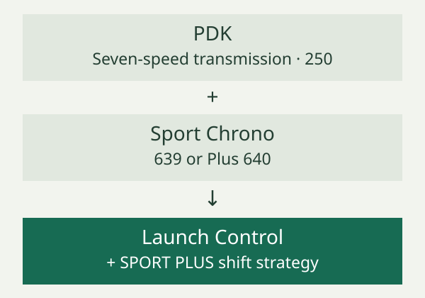

# The 2010 Boxster 2.9 specification and options

A Boxster specification describes two things: the common engineering of the model and the equipment selected for an individual car. The 2010 European 2.9 has one published engine output, whether fitted with the standard six-speed manual gearbox or optional seven-speed PDK. Wheels, suspension, seats, lighting and communication systems can then produce quite different combinations around that foundation.

This chapter is the quick reference for the 2.9, using Porsche's January 2010 UK brochure. It describes the catalogue specification; individual factory records establish which options a car received.[^scope]

.](images/boxster-2-9-period-front.jpg){alt="A green ordinary 987.2 Boxster photographed from the front on a mountain road."}

## The reference specification

The tables collect the 2010 2.9's reference values. [Engine construction and valve gear](../05-engine-construction-and-valve-gear/index.md) explains the machinery behind them.[^engine]

| Common to both transmissions | 2010 European/UK Boxster 2.9 |
| --- | --- |
| Engine | Water-cooled, naturally aspirated flat-six; mid-mounted |
| Capacity | 2,893 cm³ |
| Maximum power | 188 kW / 255 PS at 6,400 rpm |
| Maximum torque | 290 Nm at 4,400–6,000 rpm |
| Compression ratio | 11.5:1 |
| Drive | Rear-wheel drive |
| Standard wheels | Front 7 J × 17; rear 8.5 J × 17 |
| Standard tyres | Front 205/55 ZR 17; rear 235/50 ZR 17 |
| Steering | Hydraulic assistance; variable ratio |
| Turning circle | 11.1 m |
| Brakes | Four-piston aluminium fixed calipers; ventilated, cross-drilled discs |
| Stability system | Porsche Stability Management, with ABS |

These figures come from the technical table, with the injection distinction confirmed by Porsche's technical specifications.[^technical]

| Transmission-dependent figure | Six-speed manual | Seven-speed PDK |
| --- | --- | --- |
| Catalogue status | Standard | Optional |
| Unladen weight, DIN | 1,335 kg | 1,365 kg |
| Unladen weight, EC | 1,410 kg | 1,440 kg |
| Permissible gross weight | 1,635 kg | 1,670 kg |
| 0–100 km/h | 5.9 s | 5.8 s |
| 0–100 km/h, Sport Chrono Sport Plus | No separate figure quoted | 5.6 s |
| Maximum speed | 263 km/h / 163 mph | 261 km/h / 162 mph |
| Combined NEDC consumption | 9.4 l/100 km / 30.1 mpg | 9.1 l/100 km / 31.0 mpg |
| CO₂, NEDC | 221 g/km | 214 g/km |
| Drag coefficient, technical table | 0.29 | 0.30 |

The mpg values use Imperial gallons. The acceleration test is **0–100 km/h**, approximately 0–62 mph; a 0–60 mph time measures a different interval.[^technical]

## What the gearbox changes

The manual gives the driver a clutch pedal and direct responsibility for choosing and engaging six forward ratios. PDK is a dual-clutch transmission with seven forward ratios and automatic or manual selection. Its highest ratio serves economical cruising; Porsche states that maximum speed is reached in sixth. The extra ratio therefore does not mean a higher maximum speed, as the table demonstrates.[^transmission]

The table's quicker PDK times come with the same 188 kW engine. The **5.6-second** figure specifically requires Sport Chrono's Sport Plus functions; ordinary PDK is quoted at **5.8 seconds**.[^chrono]

::: {.book-diagram data-diagram="specification-gearbox-comparison"}

:::

Construction and driver controls are explained in the [manual transmission](../08-manual-transmission-and-clutch/index.md) and [PDK](../09-pdk-transmission/index.md) chapters.

Consumption and CO₂ here are period **NEDC laboratory comparison figures**, not measured expectations for a particular journey. Porsche explicitly says they relate to standard equipment and that options can affect consumption and performance. Use them to compare the catalogue configurations, rather than predict an individual journey.[^technical]

## Dimensions, luggage and the meaning of weight

| Published dimension or capacity | Reference 2.9 |
| --- | --- |
| Length | 4,342 mm |
| Width, body | 1,801 mm |
| Width, including exterior mirrors | 1,952 mm |
| Height | 1,292 mm |
| Wheelbase | 2,415 mm |
| Front/rear luggage volume, VDA | 150 / 130 litres |
| Fuel tank capacity | Approximately 64 litres |

The mirror-inclusive width is the relevant starting point for a narrow entrance, whereas body width describes a different envelope. Wheelbase is the distance between axle centres, not the length of the cabin or luggage space. Published height describes the catalogue car; PASM lowers the suspension by 10 mm, so it is a relevant qualification when comparing equipped cars.[^dimensions]

The luggage figures describe two separate compartments, both available with the roof lowered. Their shape and access are covered in [body structure and packaging](../04-body-structure-and-packaging/index.md#two-boots-with-different-shapes).[^luggage]

Weight needs the same attention to definitions. The table gives 1,335 kg DIN and 1,410 kg EC for the manual. The EC footnote includes **68 kg for a driver and 7 kg for luggage**, accounting for the 75 kg difference. PDK is 30 kg heavier on either quoted unladen basis. These are catalogue comparisons; neither is a weighbridge measurement of a loaded, optioned car.[^technical]

*Three reference points for the manual car. The EC allowance is a convention within its quoted unladen figure; the gross limit describes the permissible loaded vehicle. Diagram: author, using Porsche's technical table.*

Permissible gross weight is a limit for the loaded vehicle, not another estimate of empty weight. Subtracting the manual's DIN figure from its gross figure gives 300 kg; subtracting EC gives 225 kg because the nominal driver and luggage are already counted. Those calculations use brochure values only. Real loading decisions require the individual car's actual specification and applicable vehicle and axle limits. Adding the same 75 kg allowance twice would confuse the comparison.

## Factory options, grouped by purpose

The baseline is already a complete roadster. The brochure describes standard 17-inch wheels, PSM, air conditioning, CDR-30 audio and seats with manual fore/aft and height adjustment plus electric backrests. Automatic climate control, navigation or electric seat memory should therefore be checked individually, rather than assumed from the Porsche badge.[^baseline]

| Group | Useful catalogue examples | What to distinguish |
| --- | --- | --- |
| Transmission and response | [PDK](../09-pdk-transmission/index.md) **250**; Sport Chrono **639** or Plus **640**; [sports exhaust](../07-lubrication-cooling-and-exhaust/index.md) **XLF** | Gearbox, control package and exhaust are separate choices |
| Chassis and traction | [PASM](../11-suspension-and-wheel-geometry/index.md#options-on-the-2010-2.9) **475**; [locking rear differential](../10-differential-driveshafts-and-mounts/index.md) **220**; [18- or 19-inch wheels](../12-steering-wheels-and-tyres/index.md) | Damping, differential action and wheel size change different systems |
| Light and visibility | [Bi-xenon/cornering lights](../16-lighting-electrical-systems-and-security/index.md) **P75**; dimming mirrors/rain sensor **P12**; ParkAssist **635** | Lamp equipment, automatic functions and rear parking aid |
| Weather and touring | [Climate control](../15-cabin-seating-and-climate/index.md) **573**; cruise **454**; [wind deflector](../14-roof-glass-seals-and-drainage/index.md) **551**; hardtop **550** | Standard air conditioning does not establish these extras |
| Seating and trim | [Comfort seats](../15-cabin-seating-and-climate/index.md) **P15**; sports seats **P77**; adaptive sports seats **P01**; buckets **P03**; heating **342** | Seat construction, adjustment and heating are separate questions |
| Audio and communication | [PCM/navigation](../17-audio-navigation-and-communication/index.md) **P23**; Sound Package Plus **490**; BOSE **680**; audio interface **870** | Head unit, speakers and source connections form different layers |

These are selected January 2010 identifiers; the brochure directs buyers to a separate price list for the full order specification. **PCCB was unavailable on the ordinary 2.9** in this catalogue, although offered on the S.[^options]

.](images/boxster-personalised-cabin.jpg){alt="Porsche photograph looking down into a tan Boxster cabin with both doors open, showing personalised interior trim and a manual gear lever."}

## Combinations matter

Options are not independent boxes. **Sport Chrono Plus requires PCM**, adding its display and personalisation functions to the basic Sport Chrono concept. PDK unlocks Sport Chrono's Launch Control and special shift strategy; PCM and PDK are different prerequisites serving different functions. PASM remains a separate suspension choice. A dashboard stopwatch alone does not prove the presence of PDK, PCM or adaptive dampers.[^chrono]

The mechanical differential's January 2010 entry requires **18- or 19-inch wheels**. That means the standard 17-inch baseline cannot simply have this option added without another equipment change. The wording differs from the launch catalogue; [the differential chapter](../10-differential-driveshafts-and-mounts/index.md#changes-in-other-2.9-model-years) compares the two editions.[^differential]

::: {.book-diagram data-diagram="specification-option-links"}

:::

Seat ventilation has several prerequisites, detailed in [cabin, seating and climate](../15-cabin-seating-and-climate/index.md#options-on-the-2010-2.9). BOSE also uses the rear-bulkhead storage-box space. Read the full equipment description alongside the option code.[^comfort]

## Reading an individual car's record

Begin with identity, then equipment. Porsche's contemporary handbook describes a vehicle-data label inside the Maintenance booklet, listing VIN, type, engine/transmission codes, paint/interior identification and optional equipment. The source is the North American handbook; UK equipment availability is checked against the UK catalogue.[^record]

For a UK car, compare the VIN on the documents with the vehicle, then transcribe the data label carefully. Preserve leading zeros and letters: **P75**, **250** and **XLF** are different kinds of identifiers. Match them to a source for the appropriate model, market and date. A generic code decoder may give a plausible name while missing a package condition or a change between generations.

Keep three columns when making a record: **documented factory equipment**, **equipment physically present**, and **later work recorded by invoices**. An original order or VIN-linked factory specification helps establish the first; inspection establishes the second; invoices help explain differences. A replacement wheel, radio or steering wheel can change present appearance without changing the original order. Conversely, absence from a short advertisement is not evidence that an option was absent from the build.

Where the data label is incomplete or missing, seek the surviving original order documents and an authenticated VIN-linked specification through Porsche. Record unresolved items explicitly. This chapter provides enough codes to orient the reader, but it does not assign any undocumented equipment to the owner's car or treat every production identifier as a paid extra.

## Other years and other Boxsters

The 2008-published launch brochure already records the 2.9's 188 kW / 255 PS output and manual/PDK choices. The January 2010 brochure retains them; Porsche's 2012 North American technical sheet corroborates the same underlying engine/transmission combination. This supports continuity of the main mechanical specification, not a claim that every UK colour, package, price or availability condition stayed unchanged through 2012.[^years]

Use the [family introduction](../01-the-2010-boxster-2-9-in-the-987-2-family/index.md#the-ordinary-2.9-and-its-relatives) to distinguish the S, Spyder and Black Edition. Their different engines, chassis and equipment give them separate specifications; component chapters compare only the differences relevant to each system.[^variants]

[^scope]: Porsche, *The Boxster*, UK edition 01/10, publication WSLB1101000125 GB/UK, colophon and printed pp. 126–127, [original brochure](https://mrsportscars.com/wp-content/uploads/2019/11/Porsche-Boxster-987-Gen-2-Sales-Brochure-UK-US-2010-2011.pdf). The host filename's “UK-US-2010-2011” is not the publication's own market/date identification.

[^engine]: Porsche, *The Boxster*, January 2010, printed pp. 26–36; Porsche Cars North America, [2012 Boxster technical specifications, p. 1](https://newsroom.porsche.com/dam/jcr:f533d37f-82ef-4c9c-90cc-56b43185a8de/2012_Boxster_Specs.pdf#page=1), explicitly distinguishing multipoint injection on the 2.9 from DFI on the 3.4 derivatives. US sheet used for mechanical identification only.

[^technical]: Porsche, *The Boxster*, January 2010 UK edition, printed pp. 126–127, including all three footnotes, [scan p. 59](https://mrsportscars.com/wp-content/uploads/2019/11/Porsche-Boxster-987-Gen-2-Sales-Brochure-UK-US-2010-2011.pdf#page=59). The table's explicit manual/PDK drag values are retained rather than the shorter general description elsewhere in the brochure.

[^transmission]: Porsche, *The Boxster*, January 2010 UK edition, printed pp. 42–47, [scan pp. 19–21](https://mrsportscars.com/wp-content/uploads/2019/11/Porsche-Boxster-987-Gen-2-Sales-Brochure-UK-US-2010-2011.pdf#page=19).

[^chrono]: Porsche, *The Boxster*, January 2010 UK edition, printed pp. 56–57, 107 and 127, [original brochure](https://mrsportscars.com/wp-content/uploads/2019/11/Porsche-Boxster-987-Gen-2-Sales-Brochure-UK-US-2010-2011.pdf#page=26). The SPORT PLUS performance condition is footnote 2 to the technical table.

[^dimensions]: Porsche, *The Boxster*, January 2010 UK edition, printed pp. 54 and 127, [original brochure](https://mrsportscars.com/wp-content/uploads/2019/11/Porsche-Boxster-987-Gen-2-Sales-Brochure-UK-US-2010-2011.pdf#page=25).

[^luggage]: Porsche, *The Boxster*, January 2010 UK edition, printed p. 79, [scan p. 37](https://mrsportscars.com/wp-content/uploads/2019/11/Porsche-Boxster-987-Gen-2-Sales-Brochure-UK-US-2010-2011.pdf#page=37).

[^baseline]: Porsche, *The Boxster*, January 2010 UK edition, printed pp. 20–21, 63, 74, 76 and 82, [original brochure](https://mrsportscars.com/wp-content/uploads/2019/11/Porsche-Boxster-987-Gen-2-Sales-Brochure-UK-US-2010-2011.pdf).

[^options]: Porsche, *The Boxster*, January 2010 UK edition, printed pp. 106–118, [scan pp. 49–54](https://mrsportscars.com/wp-content/uploads/2019/11/Porsche-Boxster-987-Gen-2-Sales-Brochure-UK-US-2010-2011.pdf#page=49). Selected codes and availability marks were checked against the original table, not text extraction alone.

[^differential]: Porsche, *The Boxster*, January 2010 UK edition, printed pp. 54 and 107; compare *The new Boxster*, UK edition 08/08, printed p. 107, [launch brochure](https://porschecarshistory.com/wp-content/old/brochures5/26/2009%20987%20Boxster%20UK.pdf). The later catalogue omits the prelaunch manual-only qualifier; this is not an exhaustive build-date applicability list.

[^comfort]: Porsche, *The Boxster*, January 2010 UK edition, printed pp. 74–76, 111 and 117–118, [original brochure](https://mrsportscars.com/wp-content/uploads/2019/11/Porsche-Boxster-987-Gen-2-Sales-Brochure-UK-US-2010-2011.pdf#page=35).

[^record]: Porsche, *Boxster, Boxster S Owner's Manual*, WKD 987 021 10, 5/09, printed p. 274, [PDF p. 276](https://billswebspace.com/Owners_Manual_Boxster_PCNA.pdf#page=276). The handbook calls the label the “vehicle data bank”.

[^years]: Porsche, *The new Boxster*, UK edition 08/08, printed pp. 126–127, [original brochure](https://porschecarshistory.com/wp-content/old/brochures5/26/2009%20987%20Boxster%20UK.pdf); January 2010 table; Porsche Cars North America, [2012 technical specifications](https://newsroom.porsche.com/dam/jcr:f533d37f-82ef-4c9c-90cc-56b43185a8de/2012_Boxster_Specs.pdf).

[^variants]: Porsche, January 2010 ordinary UK brochure, printed pp. 126–127; *The Boxster Spyder*, UK edition 01/10, printed pp. 10–13 and 42–43, [original brochure](https://porschecarshistory.com/wp-content/old/brochures2/93/2010%20987%20Boxster%20Spyder.pdf); Porsche Netherlands, [S Black Edition release, 2 February 2011](https://nieuws.porsche.nl/slechts-987-exemplaren-rijk-uitgeruste-boxster-s-black-edition/). Dutch source used for engine/model identity, not UK package contents.
