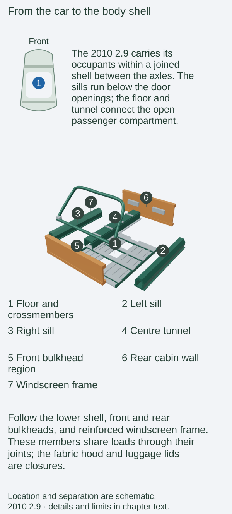
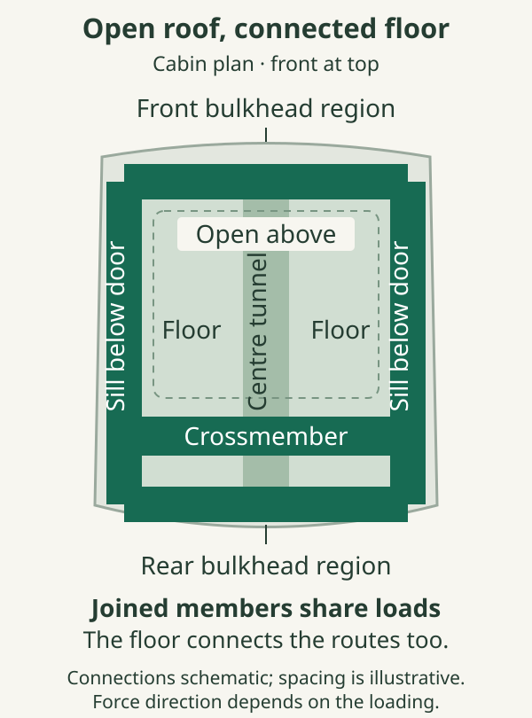
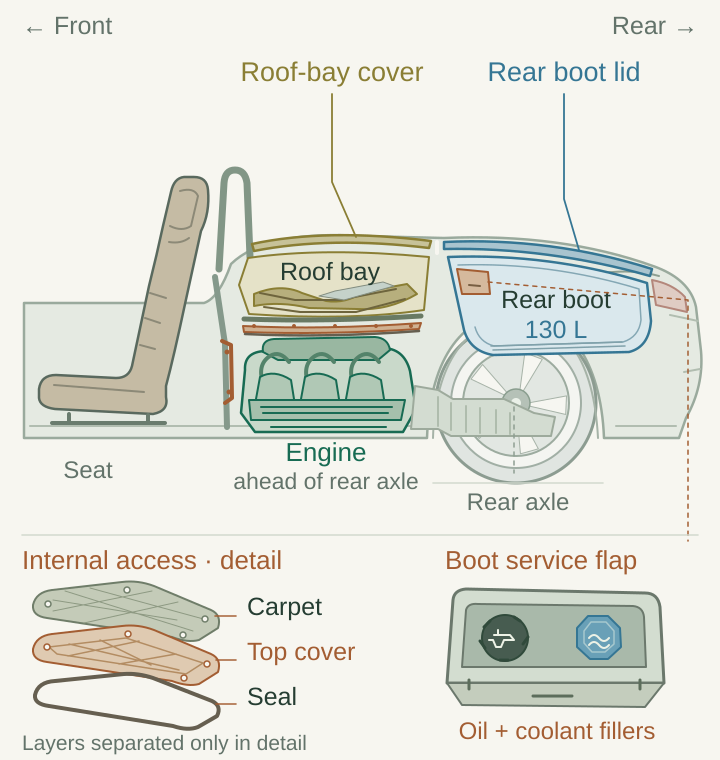
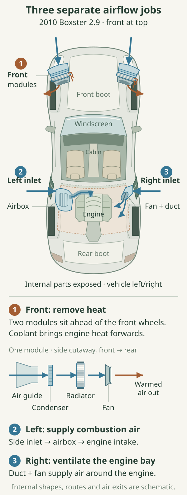

# Body structure and packaging

The Boxster's body has to do several jobs in the same small space. It locates the suspension, supports the occupants and carries loads between the front and rear of the car. It also encloses luggage, machinery and a folding roof. The central difficulty is the large opening above the seats: a roadster must remain a coherent structure while its roof is packed away.

[The opening chapter](../01-the-2010-boxster-2-9-in-the-987-2-family/index.md#a-roadster-arranged-around-its-engine) locates the major components. Here the useful question is how those spaces fit together, and which parts of the body connect them.

Start with the complete car, then expose the lower shell and its front and rear connections. Selecting a region shows how it meets its neighbours; separating the regions makes those relationships easier to see.

::: {.book-diagram data-diagram="body-explorer"}

:::

## A connected shell around an open centre

The 2010 Boxster is a **monocoque**: its load-carrying shell forms the basis of the car, rather than sitting on a separate ladder chassis. Porsche's contemporary specification describes a galvanised steel bodyshell. This concerns the principal structure; the front and rear luggage lids are aluminium.[^shell]

A flat sheet is easy to bend. Folding it into a deep section, joining it to another sheet or connecting it to a crossmember changes how it resists force. In a body shell, the shape, thickness, material and joint all matter. A visibly large outer panel need not be the most important structural member, while a reinforcement hidden beneath trim can connect several heavily loaded regions.

The **sills** run below the door openings. The floor, central tunnel and transverse members connect the sides. Ahead of the occupants, the bulkhead and windscreen-frame region join the front structure to the cabin; behind them, the rear bulkhead closes the passenger compartment against the engine area. Together these provide routes through which loads can spread around the open centre. Porsche's original 987 training material specifically identifies the sill and A-pillar joints, a bulkhead crossmember and an additional upper load path as areas of development.[^structure]

*Original structural concept drawing. The highlighted routes explain connectivity; they are not a stress analysis or a map of every reinforcement.*

Consider one front wheel crossing a bump before the other. The suspension applies an uneven input to the body, tending to twist its front relative to its rear. This is **torsion**. Loading both ends while supporting the body in between also produces bending. A shell that resists these movements gives the suspension more consistent attachment positions. Otherwise some movement intended to occur in springs, dampers and bushes is accompanied by movement of the body itself.

A fixed roof can help form a deep structural enclosure above the floor. The Boxster's fabric hood must fold, so the lower shell and its connections have to support an open passenger compartment. Raising the hood creates a weather enclosure; it does not turn the car into a fixed-roof coupé. Similarly, fitting a removable hardtop does not establish that the roadster has acquired the structural properties of a Cayman.

### Stiffness and occupant protection have different aims

In normal use, the shell should preserve the relationships between its mounting points. In a serious impact, selected regions must instead deform while the passenger compartment manages the loads reaching it. These requirements depend on the complete assembly, not simply on choosing the strongest available steel for every panel.

Porsche describes longitudinal and transverse members in the front deformation zone, rigid side structures, door reinforcements, a reinforced windscreen frame and fixed rollover bars behind the seats. Its material illustration distinguishes several steel categories and aluminium.[^protection] The resulting protection also depends on belts, airbags, seats and their attachments, covered in [occupant protection and system integration](../18-occupant-protection-and-system-integration/index.md).

.](images/porsche-material-zones.jpg){alt="Porsche factory cutaway illustration exposing the front structure, sills, windscreen frame and rollover structures, with material categories shown in colour."}

## Three different spaces behind the seats

The rear half of an ordinary Boxster contains an engine compartment, a roof compartment and a luggage compartment. Their boundaries overlap in side view, which is why a photograph can be misleading. A panel that looks like part of one continuous rear deck may belong to a different opening and mechanism.

The engine sits low behind the cabin. Above it is a removable engine cover beneath trim. The folding hood occupies its own space behind the occupants, under the convertible-top compartment cover. Farther back is the rear boot, reached through its separate luggage lid. The roof cover moves to let the hood fold; opening the rear luggage lid gives access to luggage and the fluid-filling area. Workshop information distinguishes the engine cover and its trim from these exterior panels.[^engine-access]

::: {.book-diagram data-diagram="body-packaging-layers"}

:::

*Select a layer to distinguish storage from service access. The schematic expands the vertical gaps so the boundaries are visible; it does not predict component clearances or show a disassembly sequence.*

This is a packaging trade-off. A low engine helps leave useful space above and behind it, but the surrounding body and roof mechanism limit the directions from which a technician can reach it. Access is divided between removable covers and the underside according to the task. The boot's oil and coolant filling points bring routine checks within reach without exposing the whole power unit.

The cabin's rear boundary also separates people from machinery. Any access cover removed during servicing needs to return with its intended fasteners, seals and insulation. A cover can still appear to fill a hole while failing to make the intended acoustic or weather seal. Leaving trim loose can create a noise quite different from a worn suspension joint or an engine fault.

The roof mechanism's movement and drainage are explained in [roof, glass, seals and drainage](../14-roof-glass-seals-and-drainage/index.md#the-cover-makes-room-for-the-folding-frame). Here the key relationship is physical: its stowage volume belongs to the body package, with room reserved for the folding frame.

## Two boots, with different shapes

Porsche quotes **150 litres at the front and 130 litres at the rear**, with the latter available with the ordinary hood lowered. Both luggage lids are aluminium, and a small service hatch in the rear boot exposes the oil and coolant filling points.[^luggage]

.](images/porsche-two-luggage-compartments.jpg){alt="A red Boxster S with the front and rear luggage lids raised together, showing that the folded roof and two luggage openings occupy separate regions."}

Adding those figures gives 280 litres, but it does not produce one 280-litre cavity. A rigid object has to fit through one opening and into that compartment's depth, width and length. Two smaller bags can exploit the spaces more effectively than one large suitcase of the same total nominal volume. The front boot is a relatively deep well, while the rear offers a different, broader shape.

The luggage floor and lining establish the usable space, not an invitation to fill every hidden recess. A load also has mass: its restraints and the car's permitted weights remain relevant even when there is physical room for more. Inside the cabin, loose objects can move towards the occupants under braking. Practical packing begins with the shape of each compartment and ends with securing what has been put there.

## The body also guides air

Air management has two connected tasks. Some air should pass around the car with little resistance and a controlled distribution of pressure. Some must pass **through** openings to cool components or supply the engine. An intake therefore belongs to a system with a destination and an exit; its area alone cannot describe the flow it delivers.

The radiators are at the front, separated from the engine by much of the car's length. Air enters through the front openings, passes through the heat exchangers and leaves through the surrounding outlet routes below and around the front end. The engine's side openings serve another part of the package. Porsche's 987 training account identifies the left-side route to the air cleaner and the right-side opening for engine-compartment ventilation.[^air] Those left and right references mean the car's sides when facing forward, regardless of steering-wheel position.

*Original functional map. Arrows identify the destination of each air stream; they are not measured streamlines or exact duct routing. Coolant carries heat forward to the radiators; combustion air travels to the engine.*

Keeping these routes separate helps explain the underbody. Its panels provide surfaces over which air can pass while leaving selected cooling and service openings. Porsche's original 987 training account treats underbody panelling and cooling-air guidance as part of the aerodynamic design.[^underbody] A completely sealed underside would conflict with other requirements; an arbitrary collection of missing panels would also change the intended arrangement. The detailed fluid circuits belong to [lubrication, cooling and exhaust](../07-lubrication-cooling-and-exhaust/index.md).

The ordinary car's rear spoiler adds a moving boundary to that airflow. In automatic mode it extends at approximately **120 km/h** and retracts at approximately **80 km/h**. Porsche links it to reducing rear-axle lift and improving high-speed stability.[^spoiler] Different extension and retraction thresholds prevent repeated movement as speed fluctuates around one switching point. Manual control allows it to be raised while stationary, so an extended spoiler in a photograph says little about the speed at which the photograph was taken.

Lift and drag are separate outcomes of pressure acting over the car. Reducing upward lift helps retain tyre loading; it does not establish that a car produces net downforce. A drag coefficient likewise cannot reveal the load on either axle. No axle-lift figures or claimed spoiler downforce are inferred here from the exterior's appearance.

## Options on the 2010 2.9

The optional hardtop attaches above the existing roadster shell. Its construction, attachment and sealing belong to [roof equipment](../14-roof-glass-seals-and-drainage/index.md#choices-for-the-2010-2.9).[^hardtop]

Options affecting ride height and wheel clearance are covered in [suspension](../11-suspension-and-wheel-geometry/index.md) and [steering, wheels and tyres](../12-steering-wheels-and-tyres/index.md).

## Changes in other 2.9 model years

The 2.9 arrived with the facelift's revised front and rear treatment. Porsche's 2009 technical introduction describes its bodyshell technology as essentially the same as the 2005 model for bending and torsional rigidity and side-impact protection.[^facelift-body] That establishes the inherited structural concept at the facelift; it does not establish an unchanged annual body specification throughout the ordinary 987.2 period. No year-by-year change in steel specification, joining method or structural stiffness has been established. The [timeline](../02-the-yearly-timeline/index.md) sets out the supported range changes without making a registration date into a body-construction specification.

## The S, Spyder and Black Edition

The ordinary S shares the two luggage compartments and powered-roof arrangement. Engine, cooling and chassis differences do not make its rear luggage lid an engine-bay bonnet. The Black Edition also keeps the conventional powered hood; its special finish and equipment should not be read as evidence of a Spyder-style rear body.[^black]

The Spyder changes the upper package substantially. Its aluminium doors, large single-piece aluminium rear lid and manually fitted lightweight hood belong to a coordinated weight-reduction programme. The fixed rear spoiler and reshaped deck also change the exterior airflow arrangement.[^spyder] The ordinary car already has aluminium luggage lids, so the comparison is more precise than saying that the Spyder simply replaces every steel lid with aluminium. Its major difference is the form and extent of the rear closure, combined with a different roof system.

Porsche's development account describes the Spyder's rear lid as roughly 1.5 m² and discusses the associated manufacturing and assembly challenge.[^spyder-development] A closure that large must retain its shape, locate consistently and meet its adjoining surfaces. Sharing a vehicle family therefore does not make the upper body panels interchangeable as a simple styling conversion.

## Identification and ageing

Assess body condition by following connections as well as paint. Uneven panel gaps can originate in lid adjustment, hinges, seals or prior repair; they are a reason to investigate, rather than a structural diagnosis by themselves. Evidence at sills, suspension attachment regions, seams and repaired joints needs to be considered together.

Underneath, inspect whether panels and air guides are present and securely retained. Porsche explicitly identifies damaged or missing aerodynamic panels as affecting driving behaviour.[^condition] Around the rear deck, distinguish the boot seal from the roof compartment's drainage system before tracing water. For spoiler operation, use the handbook's stationary controls and fault guidance rather than a road-speed experiment. The most useful record combines the actual body variant, repair history and the parts now fitted.

[^shell]: Porsche Cars North America, [*2010–11 Boxster, S and Spyder specifications*, p. 1, “Body”](https://newsroom.porsche.com/dam/jcr:48fa70bf-243a-4223-ad30-348614762824/2010-11_Boxster_Spyder_Specs.pdf.PDF#page=1). Mechanical body description, not UK equipment evidence. Aluminium ordinary luggage lids: UK brochure, p. 79, below.

[^structure]: Porsche AfterSales Training, *General Servicing & Repair – Sports Cars*, P001, 2007, printed p. 5.4, [archived original training publication](https://souzaweb.com/caymanregister/downloads/54580-General_Porsche_Repair_%28P001_-_Book_5-07%29.pdf). Used for the 987 structural concept, not proof of an unchanged 2010 material specification.

[^protection]: Porsche, *The Boxster*, January 2010 UK edition, printed pp. 66–67, [PDF p. 31](https://mrsportscars.com/wp-content/uploads/2019/11/Porsche-Boxster-987-Gen-2-Sales-Brochure-UK-US-2010-2011.pdf#page=31).

[^engine-access]: Porsche PET **987209**, model life 2009–2012, illustration **807-005**, [PDF pp. 306–308](https://www.porsche-preparation.com/downloaded/pet-porsche/boxster-2009-2012-type-987.pdf#page=306), trim, engine cover and gasket; Porsche workshop information, [2010 2.9 oil-separator procedure, preliminary work](https://workshop-manuals.com/porsche/boxster_(987)/f6-2.9l/powertrain_management/emission_control_systems/oil_separator/component_information/service_and_repair/removing_and_installing_oil_mist__separator/), identifies roof service position and removal of the engine cover. PET is later service evidence, not proof of every originally fitted part suffix.

[^luggage]: Porsche, *The Boxster*, January 2010 UK edition, printed p. 79, [PDF p. 37](https://mrsportscars.com/wp-content/uploads/2019/11/Porsche-Boxster-987-Gen-2-Sales-Brochure-UK-US-2010-2011.pdf#page=37).

[^air]: Porsche, *Boxster, Boxster S Owner's Manual*, MY2010 North American edition, **WKD 987 021 10, 5/09**, printed p. 76, [PDF p. 78](https://billswebspace.com/Owners_Manual_Boxster_PCNA.pdf#page=78), front radiator/fan location; Porsche AfterSales Training P001, printed pp. 2.29 and 5.3, left intake/right ventilation and air-guidance concept. Facelift corroboration: Porsche PET 987209, illustration **801-080**, [PDF pp. 261–262](https://www.porsche-preparation.com/downloaded/pet-porsche/boxster-2009-2012-type-987.pdf#page=261), shows the left air-guide assembly and right fan/duct assembly. Porsche AfterSales Training, *2009 Technik Introduction*, **PNA 987 021 09, 2/09**, printed p. 51 ([viewer p. 57](https://www.manualslib.com/manual/3550487/Porsche-Boxster-2009.html?page=57)), confirms retention of the earlier air cleaner. The diagram generalises outlet regions rather than asserting a measured 2010 flow field.

[^underbody]: Porsche AfterSales Training P001, printed pp. 5.3–5.4. Earlier 987-generation explanation; no pre-facelift lift coefficients or percentage improvements are transferred to the reference car.

[^spoiler]: Porsche, MY2010 owner's manual, printed pp. 67–68, [PDF pp. 69–70](https://billswebspace.com/Owners_Manual_Boxster_PCNA.pdf#page=69).

[^hardtop]: Porsche, *The Boxster*, January 2010 UK edition, printed p. 81, [PDF p. 38](https://mrsportscars.com/wp-content/uploads/2019/11/Porsche-Boxster-987-Gen-2-Sales-Brochure-UK-US-2010-2011.pdf#page=38).

[^facelift-body]: Porsche AfterSales Training, *2009 Technik Introduction – All Boxster/Cayman Models*, **PNA 987 021 09, 2/09**, printed p. 126, [viewer p. 132](https://www.manualslib.com/manual/3550487/Porsche-Boxster-2009.html?page=132). Mechanical body evidence; it does not establish every market's equipment or subsequent annual material specification.

[^black]: Porsche, *Boxster S Black Edition Price List*, UK edition **03/2011**, standard bodyshell equipment, printed p. 10, [PDF p. 6](https://www.dropbox.com/scl/fi/gtavw6els2231u61qjomr/2011-987-Porsche-Boxster-Black-Edition-Price-List-UK.pdf?rlkey=7n0i52owbntdg7d17dfgyo7nw&dl=0).

[^spyder]: Porsche, *The Boxster Spyder*, January 2010 UK edition, printed pp. 16–21, PDF pp. 7–9, [original brochure](https://porschecarshistory.com/wp-content/old/brochures2/93/2010%20987%20Boxster%20Spyder.pdf#page=7); Porsche UK launch material, “The definitive Porsche roadster – the new Boxster Spyder”, [reproduced and explicitly attributed to Porsche UK by AUSmotive, 26 March 2010](https://www.ausmotive.com/2010/03/26/porsche-boxster-spyder-image-gallery.html), aluminium single-piece rear lid and doors.

[^spyder-development]: Porsche Engineering, *Magazine 1/2010*, “Hats off! Boxster Spyder – The development of a Derivative”, printed p. 20, [original magazine, PDF p. 20](https://porschecarshistory.com/wp-content/old/Porsche_engineering/PE-01.2010.pdf#page=20).

[^condition]: Porsche, MY2010 owner's manual, printed p. 3, [PDF p. 5](https://billswebspace.com/Owners_Manual_Boxster_PCNA.pdf#page=5).
