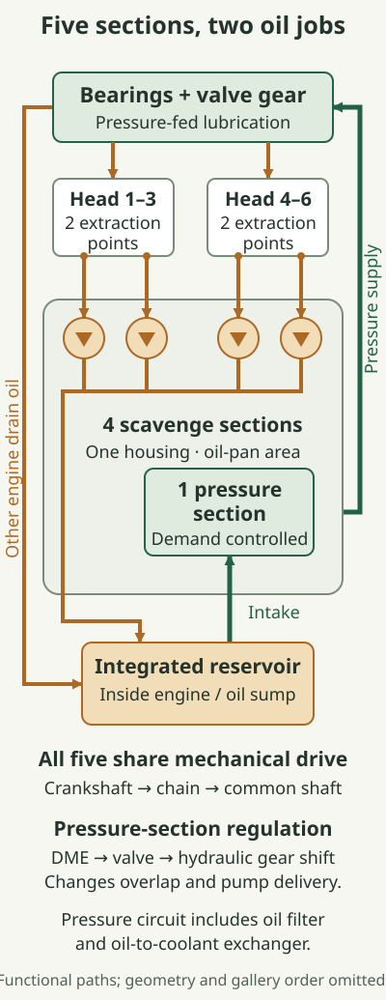
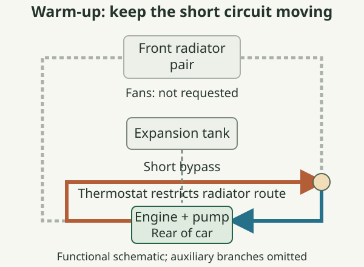
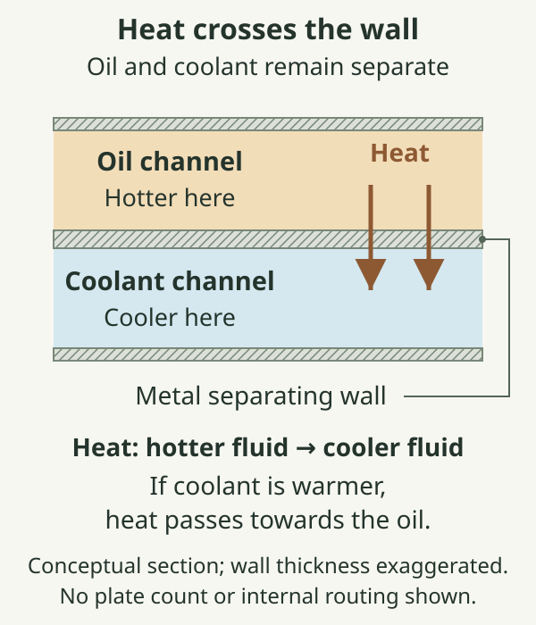
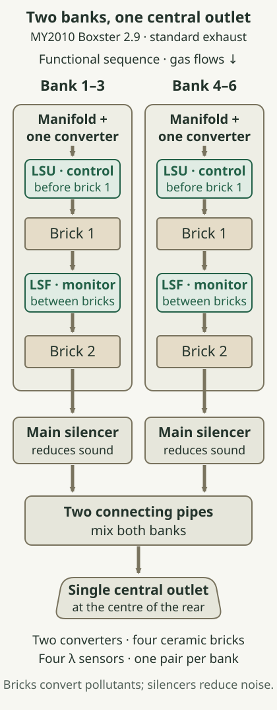

# Lubrication, cooling and exhaust

The 2010 Boxster 2.9 manages heat in three connected ways. Oil separates moving surfaces and carries heat away from them. Coolant collects heat from the engine and releases it through radiators at the front of the car. Exhaust gas carries another substantial share of the combustion heat through catalysts and silencers to the central outlet. The machinery that produces this heat is described in [engine construction and valve gear](../05-engine-construction-and-valve-gear/index.md); this chapter follows what leaves it.

::: {.book-diagram data-diagram="fluids-explorer"}

:::

## Oil collection and pressure supply

Porsche calls the 2.9's system **integrated dry-sump lubrication**. Its oil reservoir is within the engine assembly, below the working machinery. Returning oil is actively collected from the cylinder heads rather than being left entirely to gravity. The January 2010 brochure identifies four return pumps and a fifth pump supplying the lubricating points.[^fluid-integrated]

The distinction between those jobs matters. A **scavenge pump** brings used oil back towards the reservoir. A **pressure pump** draws from the collected supply and delivers oil into the lubrication circuit. Collecting a plentiful volume somewhere in the engine would be of little use if the pressure pump could not draw it reliably during braking or cornering. Conversely, ample pressure at the pump cannot compensate indefinitely for oil remaining elsewhere.

Each head has two extraction points served by two scavenge pumps. All five pumps are grouped in the oil-pan area and share a shaft; their drive comes from the crankshaft through a chain. This compact arrangement serves the flat engine's widely separated heads while retaining the reservoir within the engine. Porsche also introduced a separating sheet-metal panel between crankcase and oil pan.[^fluid-pumps]

Oil delivered under pressure reaches bearing surfaces and the oil-fed mechanisms described in [engine construction and valve gear](../05-engine-construction-and-valve-gear/index.md). In a rotating plain bearing, relative motion draws oil into the narrowing clearance, creating a load-carrying film. Continuous supply replenishes that film and removes heat. The oil then returns to the collection system for another circuit. Pressure, flow, temperature and the physical condition of the bearing all contribute to the result; a level reading answers only one of those questions.

The pressure pump varies its delivery to suit demand. The engine management uses speed, load, oil temperature and the expected change in engine speed to position a control valve. Hydraulic force moves one pump gear axially, changing its overlap with the fixed gear. Less overlap reduces delivery and the work needed to drive the pump. The controller can therefore provide the required supply without making the pump deliver its maximum volume throughout gentle running.[^fluid-demand]

“Electronically controlled” describes the regulation: the crankshaft still provides the mechanical drive. The four scavenge sections retain their separate return function. These distinctions explain how a five-pump system can also be described as having a demand-controlled oil pump.

The [crankcase-ventilation separator](../06-air-fuel-ignition-and-engine-control/index.md#crankcase-ventilation-and-oil-separation) recovers oil mist from blow-by before gases return to the intake. It serves a different flow from these liquid-oil pump circuits.

## Reading the oil level

The level is checked through the on-board computer. For this generation, Porsche specifies a stationary, horizontal car, an idling engine and oil at operating temperature, at least **60 °C**. After selecting the oil menu, the driver waits for the measurement to finish. A sloping surface or a different engine state changes where the oil lies and makes comparisons less meaningful.[^fluid-level]

The segmented display represents the permitted level band, rather than the engine's entire oil quantity. Its top mark is a limit, not an invitation to add an extra margin. Equally, the oil-pressure warning and the level display concern different conditions: sufficient oil in the reservoir does not prove that the pressure circuit is working correctly.

A later Porsche bulletin covering model years 2009–2012 explains that an oil-level warning can remain after topping up until the prescribed confirmation measurement is performed. Porsche issued it because functioning level sensors were being replaced unnecessarily. Follow the car's measurement process before interpreting the continued message as a failed sensor.[^fluid-confirm]

## Moving heat to the front

The mid-mounted engine and front-mounted radiators are joined by long coolant pipes and flexible connections. The principal radiator modules sit behind the left and right front openings, where they can receive outside air. Porsche's parts drawings distinguish these modules, their fans, supply and return connections, and the separate centre-radiator installation.[^fluid-pet-cooling]

.](images/porsche-boxster-s-system-layout.jpg){alt="Porsche's period cutaway places the radiator installation at the front and the engine, rear silencers and coolant expansion tank towards the rear. This is the brochure's Boxster S illustration, used to show the shared mid-engine packaging rather than to identify the reference car's options. © Porsche AG."}

The coolant pump creates circulation. Coolant absorbs heat while passing through the engine's internal jackets, travels towards the radiators, releases heat through their tubes and fins, then returns towards the pump. Air passing through the fins receives that heat. Moving coolant and moving air are therefore two parts of the same transfer process: a clear coolant passage alone cannot compensate for blocked airflow.

Inside the engine, Porsche uses cross-flow cooling to distribute coolant across the cylinder heads. The new generation received revised passages, including additional cooling around the exhaust-valve seat area, where gas leaving the combustion chamber imposes a high local heat load. The pump is a separate, belt-driven module attached outside the crankcase on the bank 1–3 side.[^fluid-engine-cooling]

The **thermostat** regulates access to the radiator circuit as the engine warms. Restricting that long circuit during warm-up allows a shorter circulation path to bring the engine towards its working temperature. Opening the radiator path then increases heat rejection. This is progressive regulation, with an intermediate state as well as the simplified closed and open states used in teaching diagrams. The general thermostat principle is a temperature-sensitive expansion element moving a valve against a spring.[^fluid-thermostat]

::: {.book-diagram data-diagram="fluid-cooling-path"}

:::

A thermostat's opening temperature is not a promise that every part of the engine will stay at that exact temperature. Heat production, radiator capacity, air temperature and airflow still influence the operating balance.

The electric radiator fans support airflow through the front modules, particularly when road speed supplies little of it. The engine-compartment blower has a different task: it ventilates the enclosed engine space. Porsche's handbook locates these separately and explains that the engine-compartment blower can continue running, or restart, after shutdown as the compartment temperature is monitored.[^fluid-fans]

The **expansion tank**, accessible through the rear luggage-compartment service flap, accommodates the coolant's changing volume and provides the checking and filling point. The liquid expands as it warms; the pressurised system and its cap maintain a controlled operating environment. Check the marked tank level with the engine cold and the car level. A hot cap can release pressurised coolant, so its apparent accessibility does not make hot opening appropriate.[^fluid-tank]

The long circuit also makes trapped air relevant after work. Air occupies space that should contain coolant and can interrupt effective heat transfer. Correct filling and bleeding consequently belong to the repair procedure, not to guesswork based on a single temperature-gauge observation.

## Where oil and water exchange heat

The engine includes an oil-to-coolant heat exchanger. Separate passages bring the two fluids close together across metal walls. Heat crosses those walls; the liquids remain separate. Porsche's engine-lubrication catalogue identifies the exchanger with the oil-conducting housing and filter assembly.[^fluid-exchanger]

Calling the component an oil cooler describes an important operating role, but heat always follows the temperature difference. When the coolant is warmer, it can help warm the oil; when the oil is warmer, heat passes towards the coolant and ultimately the radiators. Neither fluid has to match the other's temperature. Oil and coolant warm different masses, follow different paths and experience different heat inputs, so a settled coolant gauge does not establish that all the oil is equally warm.

## Exhaust collection, treatment and silencing

Each cylinder bank releases pulses into its exhaust manifold. The complete system balances several requirements: getting the gas out of the cylinders, converting pollutants, containing noise and fitting hot components around the rear power unit. Porsche's technical introduction describes two gas-treatment paths which meet through connecting pipes at the silencers before discharging centrally.[^fluid-exhaust-route]

Each bank has one main catalytic-converter assembly integrated with its manifold, containing **two ceramic monoliths**, or substrate bricks. The gas passes through **upstream oxygen sensor → first brick → downstream oxygen sensor → second brick → main silencer**. There are four oxygen sensors in total: two per bank. Distinguishing the bricks from the complete assemblies avoids mistaking this arrangement for four separate converter units.[^fluid-exhaust-route]

These sensors connect the physical exhaust route to the [mixture-feedback system](../06-air-fuel-ignition-and-engine-control/index.md#mixture-feedback-checking-the-result) explained in the preceding chapter.

A catalyst provides active surfaces on which reactions convert pollutants; it needs a suitable working temperature. A silencer instead manages pressure waves and sound. Its chambers and passages change how pulses travel and interact, while the gas continues towards the outlet. The connecting pipes let the two banks communicate acoustically as well as combine their discharge. These functions explain why simply judging an exhaust by the size of its visible end misses most of the system.

.](images/porsche-boxster-s-exhaust.jpg){alt="The standard Boxster S exhaust pictured by Porsche shows two manifold/catalyst assemblies, two rear silencers, connecting pipes and twin central outlets. Porsche describes the 2.9 system as matching the S apart from its tailpipe. © Porsche AG."}

The standard 2.9 has a single shaped stainless-steel outlet; the S has twin outlets. The 2.9's technical account expressly says that its exhaust otherwise matches the S system. The 2.9 also has the [secondary-air warm-up system](../06-air-fuel-ignition-and-engine-control/index.md#cold-running-and-emissions) described in engine control.[^fluid-base-exhaust]

## Options on the 2010 2.9

The UK catalogue offers a **sports exhaust system** for a more pronounced sound. Its switch is shown in the handbook, with an illuminated indicator when selected. Porsche's later parts catalogue distinguishes sports-tailpipe code **XLS** from sports-exhaust code **XLF**: appearance and switchable silencing are distinct equipment questions.[^fluid-exhaust-option]

The factory sports system uses flaps associated with the silencers. Porsche's parts documentation identifies the change-over valve, vacuum lines and vacuum unit. In this arrangement an electrical command controls a pneumatic path; a pressure difference moves an actuator and its linkage, which positions the flap. Altering the acoustic route changes the exhaust note. The button therefore commands a system containing electrical control, small-bore hoses and mechanical movement.[^fluid-valves]

Optional PDK brings a further oil-to-coolant exchanger for its clutch and hydraulic circuit. This is separate from the engine-oil exchanger. The gearbox's heat becomes another load for the cooling system; [PDK](../09-pdk-transmission/index.md) explains its oil circuits. Centre-radiator fitment should be checked against the installed configuration rather than inferred from the model badge alone.[^fluid-pdk]

## Changes in other 2.9 model years

The five-pump system, demand control and revised cooling arrived with the 2009 engine generation. Sports exhaust was advertised for **April 2009 at the earliest**.[^fluid-years] See the [annual matrix](../19-reference-atlas-and-index/index.md#annual-equipment-matrix) for the dated evidence beyond this reference arrangement.

## The S, Spyder and Black Edition

The S shares the five-pump lubrication, revised cooling principles and basic exhaust arrangement. Its twin tailpipe distinguishes the standard exhaust outlet from the 2.9’s single outlet.[^fluid-pumps][^fluid-base-exhaust]

The Spyder and Black Edition both offer sports exhaust as an option. Their higher rated output is a separate engine specification; the sources do not establish a different pump count, reservoir or thermostat calibration for these derivatives.[^fluid-special]

## Identification and ageing

For cooling, follow the complete chain from front air passages and radiator faces through pipes, connections, pump and tank. For a sports exhaust, inspect the control hoses and linkages as well as the silencers; replacement tailpipe trim alone does not identify the switchable system.

Leaks, obstructed fins, deteriorated connections and immobile mechanisms affect different parts of these chains. Diagnose the observed symptom against the relevant circuit: an oil-level message, pressure warning, coolant loss and unusual exhaust sound are different starting points.

[^fluid-integrated]: Porsche, *The Boxster*, January 2010 UK edition, printed pp. 32–33, [original brochure, PDF p. 14](https://mrsportscars.com/wp-content/uploads/2019/11/Porsche-Boxster-987-Gen-2-Sales-Brochure-UK-US-2010-2011.pdf#page=14).

[^fluid-pumps]: Porsche Cars North America, *2009 Technik Introduction — All Boxster/Cayman Models*, **PNA 987 021 09, edition 2/09**, printed Engine pp. 20–21, [viewer p. 26](https://www.manualslib.com/manual/3550487/Porsche-Boxster-2009.html?page=26) and [p. 27](https://www.manualslib.com/manual/3550487/Porsche-Boxster-2009.html?page=27). The viewer includes six pages of front matter before the printed numbering. [Accessible copy of the Porsche-authored original](https://www.scribd.com/document/972719474/Boxster-2009). This PCNA-edited training edition is used for mechanisms, with UK equipment availability established separately.

[^fluid-demand]: Porsche, *2009 Technik Introduction*, printed Engine pp. 21–22, [viewer p. 27](https://www.manualslib.com/manual/3550487/Porsche-Boxster-2009.html?page=27) and [p. 28](https://www.manualslib.com/manual/3550487/Porsche-Boxster-2009.html?page=28).

[^fluid-level]: Porsche, *Boxster, Boxster S Owner's Manual*, MY2010 PCNA edition **WKD 987 021 10, 5/09**, printed pp. 157–158, [PDF pp. 159–160](https://billswebspace.com/Owners_Manual_Boxster_PCNA.pdf#page=159). Used for the generation's measurement conditions, not UK equipment availability.

[^fluid-confirm]: Porsche Cars North America, Technical Information **8/11 ENU 1709**, revised 15 May 2012, pp. 1–3, [NHTSA-hosted original](https://static.nhtsa.gov/odi/tsbs/2012/MC-10109302-9999.pdf). Applies to listed Boxster/Cayman and 911 models, MY2009–2012.

[^fluid-pet-cooling]: Porsche, *Boxster 2009–2012 PET*, 19 July 2018 snapshot, illustrations **105-000, 105-010, 105-015 and 105-017**, [original catalogue](https://www.porsche-preparation.com/downloaded/pet-porsche/boxster-2009-2012-type-987.pdf). Later service-parts evidence for components and relationships; the centre radiator has configuration qualifiers.

[^fluid-engine-cooling]: Porsche, *2009 Technik Introduction*, printed Engine pp. 23–24, [viewer p. 29](https://www.manualslib.com/manual/3550487/Porsche-Boxster-2009.html?page=29) and [p. 30](https://www.manualslib.com/manual/3550487/Porsche-Boxster-2009.html?page=30).

[^fluid-thermostat]: Thermostat installation: PET illustration **105-000**. General operating principle: MAHLE, [“A cool guide to thermostats”](https://workshop-heroes.mahle.com/en/article/guide-to-thermostats). MAHLE's generic examples are not used as Porsche temperature calibrations.

[^fluid-fans]: Porsche, *2010 Owner's Manual*, printed p. 198, [PDF p. 200](https://billswebspace.com/Owners_Manual_Boxster_PCNA.pdf#page=200).

[^fluid-tank]: Porsche, *2010 Owner's Manual*, printed p. 197, [PDF p. 199](https://billswebspace.com/Owners_Manual_Boxster_PCNA.pdf#page=199).

[^fluid-exchanger]: Porsche, *Boxster 2009–2012 PET*, illustration **104-005**, item 12, heat exchanger **9A1 107 451 00**, [PDF pp. 60–61](https://www.porsche-preparation.com/downloaded/pet-porsche/boxster-2009-2012-type-987.pdf#page=60). The diagram explains heat transfer, not the exchanger's internal geometry.

[^fluid-exhaust-route]: Porsche, *2009 Technik Introduction*, printed Fuel and ignition system pp. 53–54: [gas sequence, viewer p. 59](https://www.manualslib.com/manual/3550487/Porsche-Boxster-2009.html?page=59) and [one converter with two monoliths per bank, viewer p. 60](https://www.manualslib.com/manual/3550487/Porsche-Boxster-2009.html?page=60). Sensor count corroborated by PET **202-000**, items 5 and 6, two of each.

[^fluid-base-exhaust]: Porsche, *2009 Technik Introduction*, printed Fuel and ignition system p. 60, [viewer p. 66](https://www.manualslib.com/manual/3550487/Porsche-Boxster-2009.html?page=66).

[^fluid-exhaust-option]: Porsche, *The Boxster*, 01/10 UK, printed p. 38 / PDF p. 17 and p. 107 / PDF p. 49; *2010 Owner's Manual*, printed p. 55, [PDF p. 57](https://billswebspace.com/Owners_Manual_Boxster_PCNA.pdf#page=57). Codes XLS and XLF: later PET **202-000 and 202-005**, PDF pp. 105–108; these listings identify the equipment distinction, not original UK orderability.

[^fluid-valves]: Porsche, *Boxster 2009–2012 PET*, **202-005**, items 11, 18 and 19, [PDF pp. 107–108](https://www.porsche-preparation.com/downloaded/pet-porsche/boxster-2009-2012-type-987.pdf#page=107). A related contemporary Cayman instruction, Porsche **28/09 ENU 2601**, 22 September 2009, describes DME-commanded muffler flaps and vacuum lines; [archived Porsche instruction](https://charm.li/Porsche/2009/Cayman%20S%20%28987%29%20F6-3.4L/Repair%20and%20Diagnosis/Technical%20Service%20Bulletins/All%20Technical%20Service%20Bulletins/Exhaust%20System%20-%20Sports%20System%20Installation%2FConversion/), introduction and work steps 3–4. Its Cayman-specific map and installation details are not assigned to the Boxster here.

[^fluid-pdk]: Porsche, *2009 Technik Introduction*, printed Transmission p. 96, [viewer p. 102](https://www.manualslib.com/manual/3550487/Porsche-Boxster-2009.html?page=102); PET **105-017** for centre-radiator configuration listing.

[^fluid-years]: Porsche, *The new Boxster*, August 2008 UK launch edition, printed pp. 32–33 / PDF p. 15 and p. 107 / PDF p. 50, [original brochure](https://porschecarshistory.com/wp-content/old/brochures5/26/2009%20987%20Boxster%20UK.pdf).

[^fluid-special]: Porsche, *The Boxster Spyder*, January 2010 UK, printed p. 38 / PDF p. 18, [brochure](https://porschecarshistory.com/wp-content/old/brochures2/93/2010%20987%20Boxster%20Spyder.pdf); *Boxster S Black Edition* UK price list, Edition 03/2011, printed pp. 16–17 / PDF p. 9, [original price list](https://www.dropbox.com/scl/fi/gtavw6els2231u61qjomr/2011-987-Porsche-Boxster-Black-Edition-Price-List-UK.pdf?rlkey=7n0i52owbntdg7d17dfgyo7nw&dl=0).
