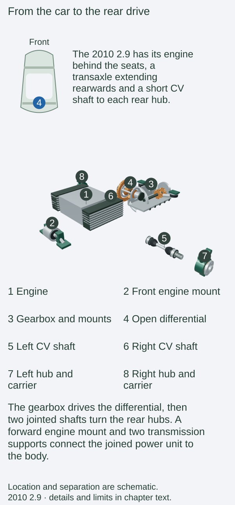
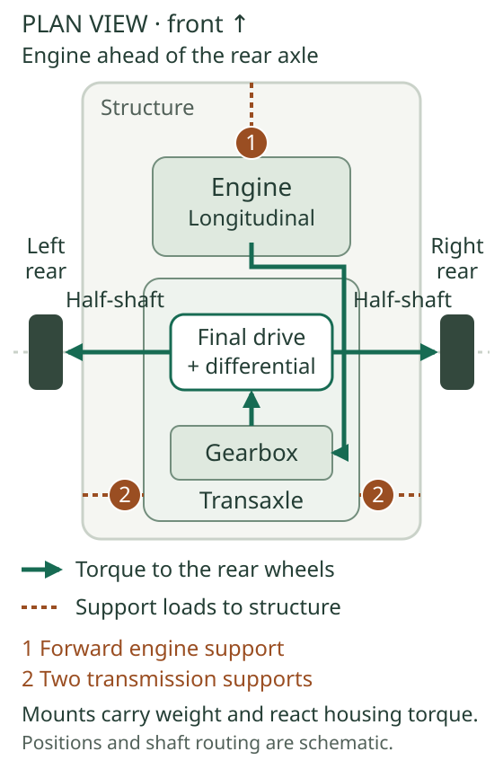
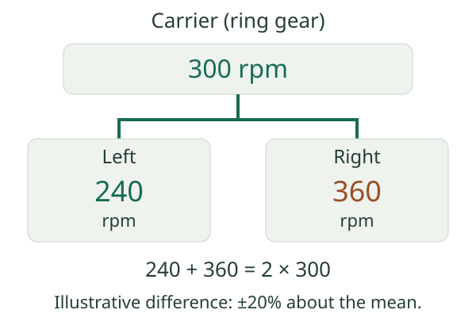
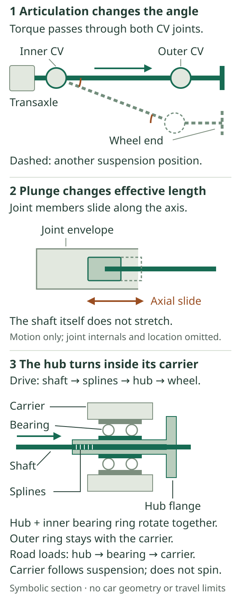

# Differential, driveshafts and mounts

The gearbox supplies one rotating output, but the Boxster has two driven rear wheels. Between them lies the differential: a gear assembly which carries torque to both wheels while allowing their speeds to differ. The short driveshaft on each side then carries that torque to a wheel which moves with the suspension. Mounts support the combined engine and transmission while allowing controlled movement relative to the body.

These relationships apply to the reference 2010 2.9 with its standard six-speed manual, and to the optional seven-speed PDK. Their internal transmission arrangements differ; both must ultimately drive two independently suspended rear wheels.[^drive-layout]

Start with the rear power unit in the complete car, then follow the drive sideways to the hubs. The cutaway keeps the supports visible so their connection to the body can be distinguished from the rotating drive path.

::: {.book-diagram data-diagram="drivetrain-explorer"}

:::

## From gearbox to rear wheels

The **transaxle** combines the gearbox and final drive in one assembly behind the engine. The selected gear ratio establishes the relationship between engine speed and the gearbox's output. The **final drive** supplies another, fixed reduction before torque reaches the wheels. Changing from second to third changes the selected ratio; it does not exchange the final-drive gears. The manual and PDK chapters explain the steps before this point.[^drive-layout]

The [ratio explorer](../08-manual-transmission-and-clutch/index.md#ratios-exchange-speed-for-torque) calculates the combined reduction. Here the next task is to distribute that drive between wheels whose speeds may differ.

In Porsche's PDK training cutaway, a pinion drives a large ring gear through a **hypoid** final drive. This turns the drive across the car and reduces its speed. The ring gear is attached to the differential carrier. The carrier's bearings locate it in the transmission casing; output flanges connect the differential to the two driveshafts.[^final-drive]

*Torque travels through the power unit, then sideways to the wheels. The mounts connect the power unit to the structure; they are not part of the rotating drive path. Positions and proportions are schematic.*

## How the open differential makes a corner possible

Inside a conventional **open differential**, two side gears connect to the left and right outputs. Smaller bevel pinions mesh with both side gears and are carried around by the differential carrier. Think of two simultaneous movements: the whole carrier rotates with the ring gear, and its small pinions can also rotate on their own cross-axis.[^final-drive]

On a straight road, equally sized tyres following equal paths need the same wheel speed. Both side gears can turn together with the carrier, with no relative rotation of the small pinions. In a bend, the outside wheel travels farther than the inside wheel. The pinions turn on their cross-axis, allowing one side gear to advance relative to the carrier while the other falls behind by the same amount.

For a symmetrical differential, the carrier speed is the average of the output speeds:

**Carrier speed = (left output speed + right output speed) ÷ 2.**

A carrier turning at 300 rpm can therefore accompany outputs turning at 240 and 360 rpm. The same average also permits 0 and 600 rpm. That second case helps explain a spinning wheel, but the equation alone cannot tell us which wheel will spin: road grip, load, braking and inertia determine the actual behaviour.

The ideal open differential also delivers **equal torque** to the two outputs. Equal torque can accompany unequal speeds. Power is torque multiplied by angular speed, so the faster output receives more power when the output torques are equal. A differential is therefore easiest to understand by keeping speed, torque and power as separate quantities.[^open-principles]

### Why unequal grip limits both sides

Suppose one tyre can react only 100 Nm at its wheel before slipping, while the other could react 600 Nm. An ideal open differential in a steady, unbraked condition can sustain about 100 Nm at each output: 200 Nm in total. The high-grip tyre has unused capacity, because the differential cannot sustain a large left-to-right torque difference through its freely moving bevel gears.

These are wheel-torque limits, not engine-torque figures. They already represent the combined effects of normal load, road friction and tyre radius. A real car also has bearing friction, rotating inertia and control interventions. Once a wheel accelerates into spin, a static torque balance no longer describes the whole event.

::: {.book-diagram data-diagram="drivetrain-open-differential"}

:::

*Explore the speed relationship, then select unequal grip to see the steady open-differential torque limit. The two views answer different questions: the speed slider prescribes a kinematic example; the grip slider sets a torque ceiling. They do not simulate tyre slip or predict the car's acceleration.*

## Mechanical limited slip and brake intervention

The optional **mechanically locking rear differential** adds friction discs to the differential assembly. These resist relative movement between the outputs and carrier, permitting a difference between left and right output torque. That helps exploit the better-loaded or higher-grip tyre when accelerating out of a bend. It still allows the different wheel speeds that cornering needs; it is not a permanently solid axle.[^final-drive]

Porsche documents locking values of **22% under drive and 27% on overrun** for this plate-type arrangement. The drive and overrun conditions load the locking mechanism differently. These figures describe its locking characteristic, rather than assigning a fixed percentage of engine torque to a particular wheel. Actual torque at either tyre depends on operating load, grip and the differential's friction behaviour. The interactive figure deliberately models the simpler open unit instead of inventing a map for this hardware.[^lock-values]

**PSM's automatic brake differential (ABD)** acts through another route. Braking a spinning rear wheel provides additional resistance on that side, enabling the open differential to sustain more torque at the opposite output. Some of the supplied power then becomes heat in the applied brake. PSM can also regulate engine output through its traction-control functions. The brake chapter covers the sensors, hydraulic control and broader stability response.[^abd]

Mechanical limited slip works inside the transaxle; ABD applies wheel-brake torque. They can coexist. Porsche describes the mechanical option as reducing the frequency of PSM intervention in demanding driving. Neither creates extra tyre grip: each helps manage how available engine torque uses the grip that exists.[^abd]

## Driveshaft joints, plunge and the hub

Each rear driveshaft, often called a **half-shaft**, connects a transmission output to its wheel hub. Suspension travel changes the shaft's angle, and the distance between its effective joint centres also varies. Small power-unit movements on the mounts add another changing relationship. A rigid shaft fixed at both ends would impose unwanted loads on the transmission and wheel bearings.

**Constant-velocity joints** transmit rotation across an angle without the cyclic speed variation of a single ordinary universal joint. Articulation accommodates the changing angle; a sliding or **plunging** joint accommodates the length change. These are distinct freedoms. The balls and tracks inside the joint carry torque, while the joint geometry allows movement. These are the two freedoms illustrated below.[^cv]

*Articulation changes the shaft angle; plunge accommodates changing joint-centre distance. The dashed position is an illustrative suspension movement. No actual joint angle or travel limit is implied.*

Flexible boots retain the joint grease and exclude dirt and water. The folded boot must survive repeated flexing, so its condition matters as much as whether the shaft looks straight. Porsche's parts illustration distinguishes shaft assembly, joint, bellows, clips, grease and wheel hub. The outer shaft end engages the hub through splines, and a retaining nut secures the assembly.[^pet-shafts]

.](images/porsche-driveshaft-and-hub.png){alt="Porsche's exploded parts illustration of a rear driveshaft, splined wheel hub, joint, flexible boots and retaining hardware."}

The hub rotates with the wheel and brake disc, supported by its wheel bearing in the stationary wheel carrier. The bearing carries road loads while the splined shaft delivers driving torque. A noisy bearing and a worn CV joint belong to different parts of this chain, even when the driver's impression is simply a noise from a rear corner. Suspension links locate the wheel carrier, as explained in the [suspension chapter](../11-suspension-and-wheel-geometry/index.md).

## Mounts support, isolate and locate

The engine and gearbox are bolted together, so their supports control the movement of one power unit. A forward engine support and supports at the transmission end carry its weight and react its tendency to roll under torque. Porsche's catalogue separates the engine bracket and mounting console from the transmission supports, with gearbox-specific listings.[^mounts]

A mount needs compliance to reduce vibration transmitted into the body, but sufficient stiffness to restrain movement during acceleration, gear changes and overrun. As engine torque changes, the housing reacts in the opposite direction to the rotating drive. The supports deform slightly and carry that reaction into the structure. Their damping helps prevent the power unit continuing to oscillate after the load changes.

.](images/porsche-engine-support.png){alt="Porsche's engine-support illustration showing the mounting console, central compliant support, bracket and stops as separate parts."}

More restraint can sharpen the perceived response to torque changes, while passing more vibration into the cabin. Excess movement can affect refinement and place greater demands on connected hoses, exhaust joints and driveshaft articulation. These relationships explain the engineering compromise without prescribing an aftermarket mount. The period equipment examined here establishes no electronically controlled dynamic mounts or Porsche Torque Vectoring option for the reference 2.9; those later system names are not used to describe its supports or ABD.

## Options on the 2010 2.9

The January 2010 UK catalogue offers the mechanical differential as **option 220**, requiring **18- or 19-inch wheels**. The reference 2.9's standard 17-inch wheels therefore do not satisfy that ordering condition. Larger wheels alone do not establish that the differential was ordered. Consult the car's build evidence as described in the [specification and options chapter](../03-the-2010-boxster-2-9-specification-and-options/index.md).[^option-2010]

## Changes in other 2.9 model years

The August 2008 launch brochure schedules option 220 for **May 2009 at the earliest**, with manual transmission and 18/19-inch wheels.[^option-launch] The January 2010 description retains the wheel condition but omits the manual-only qualifier. That establishes a wording change; the evidence does not date an eligibility change or the first delivery.

No annual redesign of the 2.9’s differential, shafts or mounts is established. The later parts catalogue distinguishes gearbox-specific applications and replacements.[^pet-shafts]

## The S, Spyder and Black Edition

The ordinary **Boxster S** retains the same broad rear-wheel-drive arrangement, with the mechanical differential offered as an option in the January 2010 UK table. Its higher engine torque does not make limited slip standard. The parts catalogue separately lists Boxster and S shaft applications.[^option-2010]

The **Spyder** has the mechanical locking differential as standard, integrated with its particular sports chassis. The **Boxster S Black Edition** retains it as an extra-cost UK option despite its standard 19-inch Spyder-design wheels. These two derivatives therefore need different answers to “does it have the factory locking differential?”[^derivatives]

## Identification and ageing

Confirm the differential and shaft application against the installed transaxle. A hand-rotation test alone is inconclusive: brake drag and the condition of a plate differential can influence what a raised wheel does.

During inspection, useful observations include grease thrown from a damaged boot, deterioration around mounts, fluid leakage at output seals, and whether a noise follows road speed, cornering load or a change between drive and overrun. A clonk can involve more than one clearance in the torque path. Those observations guide diagnosis; they do not identify a failed part on their own. Joint fasteners, hub retention and supported power-unit work require the correct workshop information for the installed components.

[^drive-layout]: Porsche, *The Boxster*, January 2010 UK edition, printed pp. 42–47 and 126–127, [original brochure](https://mrsportscars.com/wp-content/uploads/2019/11/Porsche-Boxster-987-Gen-2-Sales-Brochure-UK-US-2010-2011.pdf). See also the [manual transmission](../08-manual-transmission-and-clutch/index.md) and [PDK](../09-pdk-transmission/index.md) chapters.

[^final-drive]: Porsche AfterSales Training, *2009 Technik Introduction — All Boxster Cayman Models*, PCNA edition 2/09, PNA 987 021 09, printed Transmission p. 86, [viewer p. 92](https://www.manualslib.com/manual/3550487/Porsche-Boxster-2009.html?page=92); [accessible original text](https://www.scribd.com/document/972719474/Boxster-2009). Its PDK illustration identifies ring gear, differential pinions, shaft bevel gears, carrier and discs; accompanying text identifies hypoid drive and standard/optional differentials. Its construction detail is not assumed to describe the manual gearbox.

[^open-principles]: MathWorks, [“Differential”](https://www.mathworks.com/help/sdl/ref/differential.html), “Ideal Fundamental Constraints”, gives the equal-and-opposite output speeds relative to the carrier for equal bevel-gear ratios. S. E. Chocholek (Gleason Corporation), *The development of a differential for the improvement of traction control*, IMechE paper C368/88 (1988), §§2.1–2.2, [archived reproduction, PDF pp. 1–2](https://www.flashoffroad.com/features/Torsen/Torsen_white_paper.pdf), explains power, equal output torque and the twice-low-grip-side torque ceiling of a conventional open differential. These are general engineering principles; the numerical examples here are the author's idealised calculations, not Porsche limits or a claim that this car uses a Torsen differential.

[^lock-values]: *2009 Technik Introduction*, printed Transmission p. 86; Porsche, *Boxster S Black Edition Price List*, UK edition 03/2011, printed pp. 16–17, [original scan](https://www.dropbox.com/scl/fi/gtavw6els2231u61qjomr/2011-987-Porsche-Boxster-Black-Edition-Price-List-UK.pdf?rlkey=7n0i52owbntdg7d17dfgyo7nw&dl=0), explicitly describes multi-disc locking under traction (22%) and overrun (27%). Neither source supplies a complete torque/preload map.

[^abd]: Porsche, *The Boxster*, January 2010 UK, printed pp. 54 and 63–64, [brochure](https://mrsportscars.com/wp-content/uploads/2019/11/Porsche-Boxster-987-Gen-2-Sales-Brochure-UK-US-2010-2011.pdf). ABD and ASR are described within standard PSM. System detail: [brakes and stability systems](../13-brakes-and-stability-systems/index.md).

[^cv]: GKN Automotive, [“Constant velocity joints”](https://www.gknautomotive.com/en/aftermarket/portfolio/constant-velocity-joints/) and [“Sideshafts”](https://www.gknautomotive.com/en/aftermarket/portfolio/sideshafts/), manufacturer explanations of articulation, plunge and joint arrangements; its [aftermarket portfolio](https://www.gknautomotive.com/aftermarket/portfolio), “Constant velocity joints” and “Driveshaft boots”, explicitly explains equal rotational speed across the joint and sealing against lubricant loss and contamination. General principles only; no GKN product type, supplier identity or published generic travel limit is assigned to this car.

[^pet-shafts]: Porsche, *Boxster 2009–2012 PET*, model 987209, issue 19 July 2018, plates 501-000 and 501-005, PDF pp. 181–182 and 187–188, [catalogue](https://www.porsche-preparation.com/downloaded/pet-porsche/boxster-2009-2012-type-987.pdf#page=187). Later service-catalogue evidence of assemblies and application distinctions, not a claim of unchanged original production parts.

[^mounts]: Same Porsche PET, plates 109-000, 306-000 and 370-000, PDF pp. 96–97, 117–118 and 127–128, [catalogue](https://www.porsche-preparation.com/downloaded/pet-porsche/boxster-2009-2012-type-987.pdf#page=96). Manual and PDK transmission supports have separate plates. General isolation and reaction-force explanation is schematic; no stiffness, damping rate or displacement is claimed.

[^option-2010]: Porsche, *The Boxster*, UK edition 01/10, printed pp. 54 and 107, [brochure](https://mrsportscars.com/wp-content/uploads/2019/11/Porsche-Boxster-987-Gen-2-Sales-Brochure-UK-US-2010-2011.pdf#page=49). Both ordinary models show option 220 with the 18/19-inch wheel condition; the manual-only/future-date footnote is absent.

[^option-launch]: Porsche, *The new Boxster*, UK edition 08/08, printed pp. 54 and 107, [launch brochure](https://porschecarshistory.com/wp-content/old/brochures5/26/2009%20987%20Boxster%20UK.pdf#page=50). The option-table footnote says available from 05/2009 at the earliest with manual transmission.

[^derivatives]: Porsche, *The Boxster Spyder*, UK edition 01/10, printed pp. 28–29 / PDF p. 13, [brochure](https://porschecarshistory.com/wp-content/old/brochures2/93/2010%20987%20Boxster%20Spyder.pdf#page=13); *Boxster S Black Edition Price List*, UK edition 03/2011, printed pp. 8–9 / PDF p. 5 (standard wheels) and pp. 16–17 / PDF p. 9 (optional differential), [scan](https://www.dropbox.com/scl/fi/gtavw6els2231u61qjomr/2011-987-Porsche-Boxster-Black-Edition-Price-List-UK.pdf?rlkey=7n0i52owbntdg7d17dfgyo7nw&dl=0).
