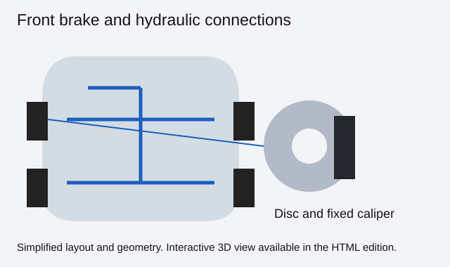
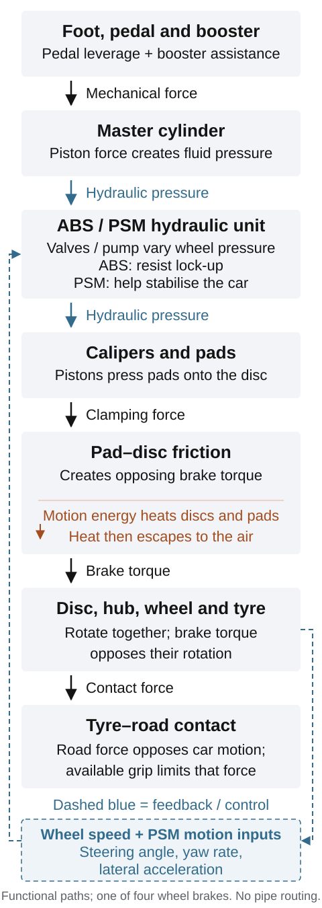
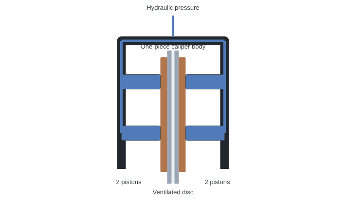
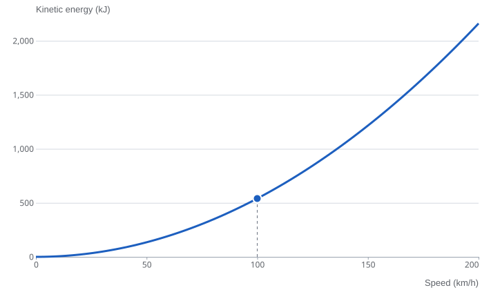

# Brakes and stability systems

Braking turns motion into heat. In the 2010 Boxster 2.9, pressing the pedal starts a chain of events: hydraulic pressure rises, pads clamp the discs, and contact with the road supplies the force that slows the car. Alongside that physical chain, electronic systems monitor the wheels and the car's movement, adjusting individual brakes when necessary.

## The brakes on the 2010 Boxster 2.9

The reference car has a hydraulic, power-assisted braking system with cast-iron discs at all four wheels. Its black calipers are fixed aluminium monobloc units with four pistons each. The discs are internally ventilated and cross-drilled. The basic arrangement is the same whether the car has the six-speed manual gearbox or optional PDK.[^hardware]

| Component | Reference specification |
| --- | --- |
| Front discs | 318 mm diameter × 28 mm nominal thickness |
| Rear discs | 299 mm diameter × 20 mm nominal thickness |
| Calipers | Four-piston aluminium monobloc fixed calipers, front and rear |
| Original caliper finish | Black anodised |
| Stability control | Porsche Stability Management, or PSM, fitted as standard |
| Parking brake | A hand lever operating the rear-wheel parking brakes through cables |

The disc dimensions are **new-disc dimensions**, not replacement limits. A worn disc must be assessed against the specification for that particular part.[^hardware]

Most of the visible hardware sits behind the wheels. The master cylinder and brake-fluid reservoir are at the front of the car, while rigid pipes and flexible hoses connect the hydraulic system to the wheel brakes. Flexible sections allow the wheels to steer and move with the suspension without asking a rigid pipe to bend repeatedly.

::: {.book-diagram data-diagram="brake-explorer"}

:::

## How a stop happens

### From your foot to hydraulic pressure

The pedal acts as a lever. A brake booster adds assistance, reducing the effort needed from the driver's leg. The master cylinder then turns that applied force into pressure in the brake fluid.

The underlying principle is simple: force acting on a piston of a given area creates pressure. That pressure reaches the caliper pistons through the brake lines. At the wheels, piston area turns pressure back into force, pressing the pads against the discs. The system uses a small amount of fluid movement to produce substantial clamping force.

The Boxster has two hydraulic circuits, divided between the front and rear axles. This provides a degree of redundancy, although losing either circuit seriously reduces the system's capability. The driver's connection to the brakes remains hydraulic and mechanical; the electronics add control of pressure within that system.[^handbook]

Pressure transmission depends on having the correct fluid in a sound, properly bled circuit. Liquid compresses very little under these conditions. Air or vapour compresses much more readily, using up pedal movement before the pads receive the expected clamping force.

### What the four-piston caliper does

A fixed caliper is mounted firmly around the disc, with pistons on both sides. When pressure rises, the pistons push the two pads against opposite faces of the rotating disc. The caliper body carries the reaction forces.

*Monobloc* describes a body made as one main piece. Its stiffness helps limit the deformation that would otherwise absorb fluid movement and soften the relationship between pressure and clamping force. Four pistons describe the arrangement of the actuators; braking performance also depends on their area, the pads, disc geometry, cooling and tyres.[^calipers]

The pads contain the friction material. Their formulation influences how readily the brakes bite, how friction changes with temperature, and how much noise, dust and wear they produce.[^friction] As the lining wears, the pistons rest progressively farther out to maintain the small working clearance. The fluid level in the reservoir can consequently fall slightly during normal pad wear.[^handbook]

::: {.book-diagram data-diagram="caliper-pressure"}

:::

### From clamping force to heat

Friction between pad and disc produces a torque opposing wheel rotation. When the car rolls forwards under braking, the road exerts a rearward force on the tyres, slowing the car; the tyres push forwards on the road. The disc absorbs much of the resulting heat before releasing it to the surrounding air and neighbouring components.

The energy involved rises quickly with speed. Using a deliberately rounded example of a 1,400 kg car, its straight-line kinetic energy at 100 km/h is about **540 kilojoules**. At 200 km/h it is about **2,160 kilojoules**: four times as much. These are illustrative calculations using one-half mass times speed squared, rather than measured Boxster stopping-test results. They leave out rotating components, aerodynamic drag and other losses.

::: {.book-diagram data-diagram="braking-energy"}

:::

A harder stop releases that energy in less time. Repeated stops add heat before the previous heat has escaped. This is why a braking system needs both the ability to generate torque and the thermal capacity to keep doing so.

The Boxster's ventilated discs have an air gap and internal passages between their friction faces. Rotation moves cooling air through these passages. Cross-drilling adds holes through the friction surfaces; it is a different feature from internal ventilation. The car also directs cooling air towards its brakes.[^brochure]

### Why the front and rear brakes differ

Deceleration transfers load towards the front axle. The front tyres can then support a greater share of braking force, while the rear tyres become more lightly loaded. The brake system must work with this changing balance.

The reference car's larger front discs form part of that arrangement. Increasing the effective radius at which a pad acts increases its leverage on the wheel. Disc mass and construction also affect heat absorption and cooling, so diameter alone gives an incomplete description of a brake.

The tyre's available grip sets another limit. Once a wheel is close to locking, applying still more hydraulic pressure cannot simply turn into proportionally more useful road force. The next layer of the system addresses that problem.

## ABS and PSM

ABS and PSM use related hardware for different jobs. ABS manages wheel slip while braking. PSM considers the movement of the whole car and can use individual brakes to influence its direction.

### ABS keeps the wheels controllable

Each wheel has a speed sensor. During braking, the control system watches for a wheel slowing towards lock-up. Valves in the hydraulic unit can hold or reduce pressure at that wheel, then allow pressure to rise again as it recovers. The cycle repeats as conditions change.[^abs]

A rotating tyre retains the ability to generate steering force. By regulating wheel slip, ABS helps preserve directional control during heavy braking. It still works within the grip available from the tyres and road.

This regulation can be felt as a rapid pulse through the pedal and heard as hydraulic activity. It is a normal feature of ABS intervention. Porsche's handbook instructs the driver to maintain firm, continuous pedal pressure during an emergency stop rather than pump the pedal.[^handbook]

### PSM watches the car's direction

Porsche Stability Management compares the intended course with the car's actual movement. Steering input indicates the requested direction. Wheel speeds, sideways acceleration and the rate at which the car rotates around its vertical axis help describe what it is doing. That rotation is called *yaw*.

An individual brake can create a turning influence on the car. If the vehicle's movement departs from the intended path, the controller can use such an intervention, together with engine-torque control, to help stabilise it. The underlying principle is shared with electronic stability systems more generally.[^stability]

Imagine the car turning into a bend and the rear beginning to rotate farther than intended. PSM can select an appropriate wheel brake to oppose that rotation. The driver may notice a flashing control light, hydraulic noise or a reduction in engine response. The precise intervention depends on the situation; there is no single wheel that PSM always brakes in every slide.

PSM also provides **anti-slip regulation (ASR)** to limit driven-wheel spin, and **automatic brake differential (ABD)** to brake a spinning driven wheel. The [drivetrain chapter](../10-differential-driveshafts-and-mounts/index.md#mechanical-limited-slip-and-brake-intervention) explains ABD’s torque-transfer effect and the separate mechanical locking differential.[^brochure]

### Preparing for an urgent stop

The facelift's braking electronics introduced two useful assistance functions. **Prefilling**, also described as precharging, prepares the brakes when a very rapid release of the accelerator suggests that braking may follow. It brings the pads into light contact with the discs, taking up clearance before the driver asks for substantial braking.

**Brake assist** recognises an emergency braking application from the speed and force of pedal actuation. The PSM hydraulic unit then supplies additional pressure for maximum deceleration, supplementing the ordinary vacuum brake booster. Prefilling concerns readiness; brake assist concerns the pressure generated during the stop. Both act through the hydraulic system, subject to the PSM and Sport-mode conditions below.[^assistance]

These functions should also be understood separately from hill-start assistance. The **Drive-Off Assistant** can briefly retain brake pressure while the driver changes from braking to moving off on a suitable incline. It is provided with manual and PDK transmissions. The hold lasts approximately two seconds at most, with release related to moving off. The handbook specifies a stationary car, engine running, sufficient brake pressure and a gradient of around 5% or more, with a gear selected for travel up the slope; the manual car also requires the clutch pedal depressed.[^hill]

### The parking brake has its own job

The hand lever pulls cables leading to the rear wheels. There, separate parking-brake shoes act against drum surfaces inside the rear disc assemblies. This lets the car remain held without maintaining hydraulic pressure at the ordinary disc-brake pads.[^parking]

The handbrake, [PDK parking lock](../09-pdk-transmission/index.md#the-selector-and-steering-wheel-controls) and temporary hill hold are three separate ways of restraining movement. Each has its own mechanism and operating conditions.

## Options on the 2010 2.9

PSM and ABS are standard. Optional Sport Chrono is **639**, or **640** in Plus form with PCM.[^options]

For this chapter, the relevant change is the control strategy. Selecting Sport mode raises the threshold for PSM intervention, allowing more movement before it intervenes. The iron-disc brake dimensions remain unchanged; [chapter 18](../18-occupant-protection-and-system-integration/index.md#options-on-the-2010-2.9) connects the equipment-dependent mode changes.[^options]

With **PSM OFF**, ABS and ABD remain available. Stability intervention returns during braking when either front wheel enters ABS regulation; with Sport mode selected, both front wheels must enter that range. The handbook says the additional braking functions are deactivated with PSM off, with emergency reactivation linked to PSM intervention. The technical introduction also specifies that selecting SPORT with Sport Chrono Package Plus deactivates the additional hydraulic brake assist. The ordinary vacuum booster remains a separate source of pedal assistance.[^modes]

**Porsche Ceramic Composite Brake (PCCB)** was an S option, unavailable on the ordinary 2.9 in the UK catalogue. Its hardware is compared below.[^options]

## Changes in other 2.9 model years

The important starting point is the 2009 facelift. The 2.9 adopted 318 mm front discs, replacing the smaller 298 mm front-disc specification of the preceding ordinary Boxster. The revised PSM added prefill and brake-assist functions. These changes were already part of the car used as this chapter's 2010 reference.[^introduction]

| Model year | Relationship to the 2010 reference |
| --- | --- |
| 2009 | Introduced the facelift's larger ordinary-model front brakes and revised assistance functions. |
| 2010 | The reference specification: 318 × 28 mm front and 299 × 20 mm rear iron discs. |
| 2011 | The North American technical sheet retains 318/299 mm diameters and four-piston fixed calipers; this corroborates the broad design rather than every UK detail. |
| 2012 | The North American sheet retains four-piston fixed calipers and gives rounded 12.5/11.8-inch diameters, without thicknesses. |

These later US descriptions do not establish every UK running change. Match replacement components to the VIN and fitted equipment; detailed supplier, part-number and software changes are not resolved by these tables.[^later]

## The S, Spyder and Black Edition {#where-else-the-system-appears}

The 2.9 shares its general braking architecture with the more powerful 987.2 models. The following comparison covers their standard iron brakes.

| Model | Front disc | Rear disc | Caliper colour |
| --- | --- | --- | --- |
| Boxster 2.9 | 318 × 28 mm | 299 × 20 mm | Black |
| Boxster S | 318 × 28 mm | 299 × 24 mm | Red |
| Boxster Spyder | 318 × 28 mm | 299 × 24 mm | Red |
| Boxster S Black Edition | 318 × 28 mm | 299 × 24 mm | Red |

The notable dimensional difference between the ordinary 2.9 and S is at the **rear**: the S disc is 4 mm thicker. The front disc's nominal diameter and thickness are the same. Extra thickness can provide additional thermal capacity, but matching dimensions alone do not prove that all calipers, pads or complete assemblies are interchangeable.[^hardware]

Porsche's technical introduction also lists the corresponding Cayman 2.9 and Cayman S with these ordinary-model and S disc dimensions. This is another shared application of the design within the 987 family.[^hardware]

The Spyder's dimensions are specified in its German price list. It also asks its brakes to slow a lighter basic vehicle; braking depends on mass as well as engine output. The UK Black Edition price list independently specifies the same nominal disc dimensions as the S, while its brochure confirms red four-piston monobloc calipers. These dimensions establish the broad hardware specification, without proving that every part is interchangeable.[^special]

### What PCCB changes

The S could be ordered with ceramic-composite discs and yellow calipers; PCCB also appears as an option in the Spyder and UK Black Edition catalogues. The ordinary UK catalogue describes 350 mm discs at both axles, six-piston front calipers and four-piston rear calipers. This is a complete brake-system specification, involving the appropriate discs, calipers and pads.[^pccb]

Lighter discs reduce rotating mass and [unsprung mass](../11-suspension-and-wheel-geometry/index.md#compliance-and-unsprung-mass). Ceramic-composite material also changes thermal and wear behaviour, requiring the matching discs, pads and calipers.

## Identification and ageing {#identifying-the-fitted-version}

### Identifying the fitted version

Caliper paint is only an initial clue. A previous owner may have repainted a caliper, fitted replacement discs or changed the complete system. Disc part numbers and the correct dimensional specification provide stronger evidence. A visible outer wear lip also makes an improvised measurement a poor substitute for a proper inspection.

### Ageing and wear {#ageing-and-wear}

Brake components age in different ways. Pads lose friction material, discs lose thickness, fluid takes up moisture, and exposed metal can corrode. A car with little annual mileage can therefore still need attention to its braking system.

Light surface rust on an iron disc after rain or washing is different from established corrosion, heavy pitting or an uneven working surface. Porsche's handbook specifically notes that cast-iron discs can corrode during extended parking. The condition of both friction faces matters; a wheel can conceal much of the inner face.[^handbook]

Heat introduces another distinction. **Friction fade** concerns a loss of useful friction as the pad/disc interface becomes too hot.[^friction] **Fluid boiling** creates compressible vapour in a system that relies on liquid pressure transmission. Different mechanisms can therefore produce different pedal sensations during reduced braking performance.[^fluid]

Brake fluid is hygroscopic: it absorbs moisture over time, lowering its boiling point. That makes fluid age relevant even when the pads remain thick. Fluid specification and replacement timing should follow the maintenance requirements for the car and its use.[^fluid]

Seals and flexible hoses also deserve attention as the car ages. Leakage, restricted movement or a piston that fails to release properly can affect pressure or leave a pad dragging. Uneven wear is useful evidence of a problem, but it does not by itself identify which component caused it.

The parking brake has separate shoes, cables and adjustment. Fresh rear disc pads therefore say little about its condition. Similarly, a wheel-speed signal fault can affect electronic assistance while leaving the visible discs and pads apparently sound. Mechanical braking hardware and electronic brake control need to be considered together.

[^hardware]: Porsche Cars North America, *2009 Technik Introduction — All Boxster/Cayman Models*, PNA 987 021 09, edition 2/09, brake-system descriptions, printed p. 119 ([Porsche-authored text reproduced on Scribd](https://www.scribd.com/document/972719474/Boxster-2009)). This separates front and rear disc thicknesses. The UK catalogue independently confirms the diameters, caliper construction and colours: *The Boxster*, edition 01/10, printed pp. 22 and 61 (PDF pp. 9 and 28).

[^handbook]: Porsche, *Boxster, Boxster S Owner's Manual*, North American MY2010 edition, WKD 987 021 10, 5/09, printed pp. 55–59, 63–65 and 202–203 (PDF pp. 57–61, 65–67 and 204–205): parking brake, axle-split hydraulic circuits, corrosion, ABS, PSM and fluid level. [Original handbook PDF](https://billswebspace.com/Owners_Manual_Boxster_PCNA.pdf).

[^calipers]: Brembo, [“Brake caliper technology and operation”](https://www.bremboparts.com/europe/en/support/car/insights/brake-caliper-technology-and-operation-324333), general explanation of caliper construction and operation.

[^brochure]: Porsche, *The Boxster*, edition 01/10, UK publication WSLB1101000125, printed pp. 60–64 (PDF pp. 28–30): brake construction, cooling and PSM functions. [Original UK catalogue PDF](https://mrsportscars.com/wp-content/uploads/2019/11/Porsche-Boxster-987-Gen-2-Sales-Brochure-UK-US-2010-2011.pdf).

[^abs]: Bosch Mobility, [“Antilock braking system”](https://www.bosch-mobility.com/en/solutions/braking-systems/antilock-braking-system/), general operating principle of wheel-speed monitoring and hydraulic pressure regulation.

[^stability]: Porsche, *The Boxster*, January 2010 UK edition, printed pp. 63–64 (PDF pp. 29–30); Bosch Mobility, [“Electronic stability program”](https://www.bosch-mobility.com/en/solutions/braking-systems/electronic-stability-program/), general explanation of steering-angle, wheel-speed and vehicle-motion inputs. Current Bosch product specifications are not being assigned to the 2010 car.

[^assistance]: Porsche Cars North America, *2009 Technik Introduction*, edition 2/09, printed pp. 120–121, PSM, enhanced braking readiness and brake assist ([original Porsche text](https://www.scribd.com/document/972719474/Boxster-2009)). See also the January 2010 UK catalogue, printed p. 64 (PDF p. 30), and MY2010 North American handbook, printed p. 63 (PDF p. 65).

[^hill]: Porsche Cars North America, *2009 Technik Introduction*, edition 2/09, Drive-Off Assistant, printed p. 122 ([original Porsche text](https://www.scribd.com/document/972719474/Boxster-2009)); MY2010 North American handbook, printed p. 173 (PDF p. 175), for the gradient and operating conditions.

[^parking]: Porsche, *Boxster 2009–2012 PET parts catalogue*, 987209, revision 19 July 2018, illustrations 603-005 (PDF pp. 207–208) and 701-005 (PDF pp. 225–228): separate shoes, actuating parts and left/right cables. [Original PET catalogue](https://www.porsche-preparation.com/downloaded/pet-porsche/boxster-2009-2012-type-987.pdf#page=207). The MY2010 North American handbook, printed p. 55 (PDF p. 57), confirms mechanical cable operation to the rear wheels. Porsche workshop instruction WM 468320, [S-labelled archive reproduction](https://charm.li/Porsche/2010/Boxster%20S%20%28987%29%20F6-3.4L/Repair%20and%20Diagnosis/Brakes%20and%20Traction%20Control/Parking%20Brake%20System/Parking%20Brake%20Shoe/Service%20and%20Repair/), requires rear-disc removal to reach the shoes; PET establishes the base-model application. PET is later service-parts evidence, not an original-fitment audit.

[^options]: Porsche, *The Boxster*, January 2010 UK edition, printed pp. 56–57 and 106–107 (PDF pp. 26 and 49): Sport Chrono codes 639/640, PCM dependency, and PCCB option applicability.

[^modes]: Porsche, *The Boxster*, UK edition 01/10, printed pp. 56 and 64 (PDF pp. 26 and 30); MY2010 North American handbook, printed p. 64 (PDF p. 66); *2009 Technik Introduction*, printed p. 121, specifically names PSM OFF and SPORT with Sport Chrono Package Plus for hydraulic brake-assist deactivation. These conditions do not remove ordinary vacuum assistance.

[^introduction]: Porsche Cars North America, *2009 Technik Introduction*, edition 2/09, brake-system comparison, printed p. 119, and PSM additions, printed pp. 120–122. [Original Porsche text](https://www.scribd.com/document/972719474/Boxster-2009).

[^later]: Porsche Cars North America, [2011 technical specifications](https://newsroom.porsche.com/dam/jcr:6e750179-ddfd-40cb-a969-d1cc825d4717/2011_Boxster_Spyder_Specifications.pdf) and [2012 technical specifications](https://newsroom.porsche.com/dam/jcr:f533d37f-82ef-4c9c-90cc-56b43185a8de/2012_Boxster_Specs.pdf), PDF pp. 2 and 1 respectively, standard-brake descriptions and disc diameters (the 2012 sheet uses rounded inches). These corroborate the broad hardware specification; they are not evidence of every UK running change.

[^special]: Porsche, *Boxster Spyder Preisliste*, German edition 08/2010, printed pp. 48–49, specifies 318 × 28 mm front and 299 × 24 mm rear discs. [Original European price list](https://auto-preisliste.de/wp-content/uploads/2025/10/2010-08_preisliste_porsche_boxster-spyder.pdf). The red finish is listed on printed pp. 8–9. Porsche Cars Great Britain, *Boxster S Black Edition Price list*, edition 03/2011, LGB 200 105 85, printed p. 42 (PDF p. 22), gives the Black Edition's disc diameters and thicknesses; its UK brochure, printed p. 13 (PDF p. 7), confirms red four-piston monobloc calipers. [UK price list](https://www.dropbox.com/scl/fi/gtavw6els2231u61qjomr/2011-987-Porsche-Boxster-Black-Edition-Price-List-UK.pdf?rlkey=7n0i52owbntdg7d17dfgyo7nw&dl=1); [UK brochure](https://www.dropbox.com/scl/fi/4apbqs3um5jdfryqy51ns/2011-987-Porsche-Boxster-Black-Edition-Brochure-UK.pdf?rlkey=tw7xw4lemnstkgus30glszqao&dl=1). The Spyder's lower basic weight is documented in its [UK brochure, printed p. 41 / PDF p. 19](https://porschecarshistory.com/wp-content/old/brochures2/93/2010%20987%20Boxster%20Spyder.pdf#page=19), compared with the ordinary UK catalogue, printed p. 127 (PDF p. 59).

[^pccb]: Porsche, *The Boxster*, January 2010 UK edition, printed pp. 62–63 and 107 (PDF pp. 29 and 49): PCCB dimensions, piston counts and S applicability; *2009 Technik Introduction*, printed p. 119, identifies yellow PCCB calipers. The UK Spyder brochure, printed p. 31 (PDF p. 14), and UK Black Edition price list, printed pp. 16–17 (PDF p. 9), independently list PCCB as an option.

[^friction]: AP Racing, [“Pad Characteristics”](https://apracing.com/race-car/brake-pads/pad-characteristics), definitions of bite, fade, wear, noise and effective temperature range; general material behaviour, not a specification of the Boxster's original pad compound.

[^fluid]: Porsche MY2010 North American handbook, printed p. 203 (PDF p. 205), moisture absorption and replacement according to the separate maintenance booklet. Ferodo, *Technical Tips — Vapour Lock No. 1*, explanation of fluid moisture absorption, boiling and compressibility. [Original technical leaflet](https://www.ferodo.com/content/dam/marketing/emea/ferodo/pdf/technicaltips/brakeefficiency/Technical-tip-Vapour-Lock_N1.pdf).
