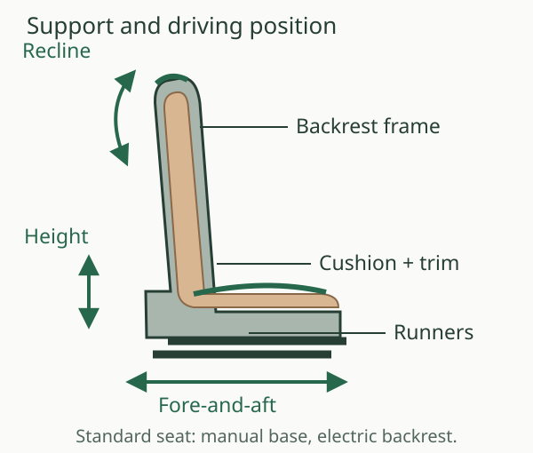
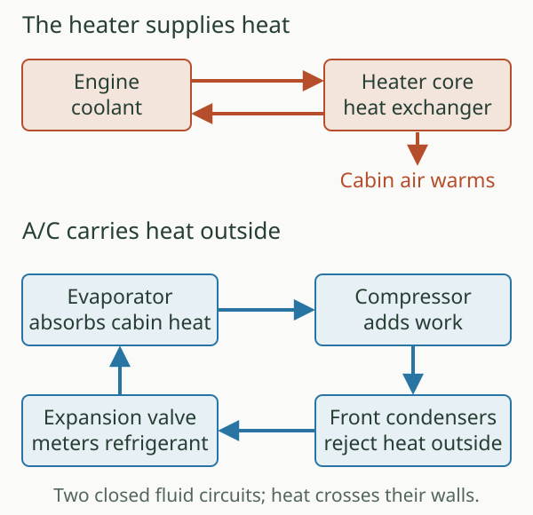
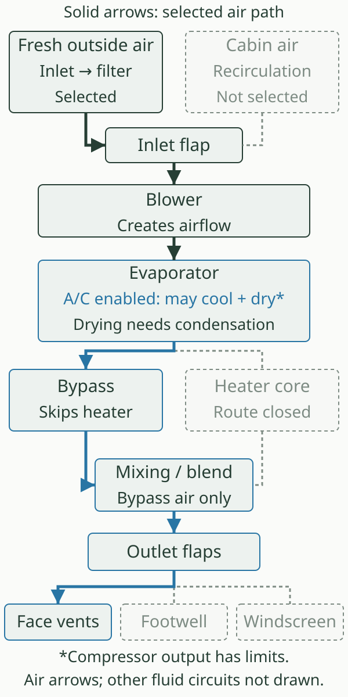

# Cabin, seating and climate

The seat fixes the driver's relationship to the pedals, steering wheel and instruments. The ventilation system then manages the air around that position: where it comes from, where it goes, how much heat it carries and how much moisture it can remove. These are related parts of comfort, but they work by different mechanisms.

The reference 2010 UK Boxster 2.9 has seats with manual fore-and-aft and height adjustment, electrically adjusted backrests and Alcantara seat centres. Air conditioning is standard; automatic climate control is optional. The switches and displays for these standard functions differ from the fully electric seat and automatic climate options below.[^baseline]

.](images/porsche-optioned-cabin.jpg){alt="Porsche's period photograph of a tan Boxster cabin, with the seats, steering wheel, dashboard vents and centre-console controls visible."}

## A seat is a support structure

A seat has a load-bearing frame, a suspended cushion, shaped foam and a covering. The cushion spreads the occupant's weight; the backrest supports the trunk; raised side bolsters resist sideways movement. Softness and support are separate qualities. A soft centre can still sit between firm bolsters, while changing the bolster shape changes where the body receives lateral support.

The base of the seat travels on longitudinal runners. Moving it changes pedal reach. Height adjustment changes the eye position, headroom and the angle at which the legs approach the pedals. Backrest inclination changes shoulder position and steering reach. These adjustments interact, which is why setting one extreme and compensating with the others rarely produces a relaxed position.

The standard seat and optional ordinary sports seat share the basic adjustment pattern. A hand lever releases the fore-and-aft runner lock; a pumping lever changes height; an electric switch changes backrest angle. The integrated head restraint moves with the backrest rather than having a separate height adjustment. The sports seat adds firmer upholstery and more pronounced side support.[^seat-operation]

Start with pedal reach, then use seat height, backrest angle and the steering column's height and longitudinal adjustment to bring the controls to a comfortable relationship. Porsche's handbook describes a slightly bent leg with the manual car's clutch depressed, and shoulders remaining against the backrest when establishing steering reach. Make these adjustments while stationary, and check that the seat runner and column locks have engaged.[^seat-operation]

This is also where the two transmissions alter the cabin's use: the manual driver needs full clutch travel, while a PDK car has no clutch pedal. The seat's restraint and airbag functions are covered in [Occupant protection and system integration](../18-occupant-protection-and-system-integration/index.md).

## Electric adjustment, bolsters and the bucket shell

The **comfort seat with driver memory** adds electric movement for longitudinal position, height, backrest, cushion inclination and lumbar support. Lumbar adjustment changes the backrest's supporting curvature, rather than simply reclining the whole backrest. Memory can recall the driver's position and exterior mirrors. It is useful when different drivers need repeatable positions.[^seat-options]

The **adaptive sports seat** combines that adjustment system with electrically adjustable side bolsters in the cushion and backrest. The occupant can change lateral support without moving the entire seat nearer the wheel. The brochure excludes those bolster positions from the driver's stored memory settings.[^seat-options]

The **sports bucket seat** takes another route. A shaped glass/carbon-fibre-reinforced backrest shell provides deep side support with less reliance on a broad range of adjustments. It retains manual longitudinal movement and a folding backrest. Folding provides access behind the seat; it is a different movement from choosing a continuously adjustable driving recline. The handbook excludes the bucket from its ordinary height and backrest-angle setting instructions.[^seat-options]

.](images/porsche-sports-bucket-seat.jpg){width=180px alt="The optional folding sports bucket seat, with a deeply shaped shell, raised cushion bolsters and exposed mounting structure beneath."}

## Heat and air at the seat surface

Seat heating puts electrical heat close to the occupant, rather than waiting for the entire cabin to warm. The available system has two settings. Seat ventilation uses a different mechanism: fans draw air from the occupant-facing perforations through permeable material in the cushion and backrest, then discharge it into the cabin. That movement carries away warm, moist air from the contact area.[^ventilation]

The ventilated seat therefore depends on air movement, breathable layers and the surrounding cabin conditions. It has no separate refrigerant evaporator inside the cushion. Heating and ventilation can operate together: warmth at the contact surface and removal of moisture are compatible goals. Porsche's technical introduction describes a temperature eligibility threshold of approximately 15°C at both the seat and interior sensors, and the handbook specifies operation with the engine running.[^ventilation]

A blocked perforated surface or impermeable seat cover defeats the intended route. The three ventilation settings vary fan operation; they are separate from the two heating settings. The option prerequisites are listed below, because the presence of leather alone does not establish that the fans are fitted.

## Two heat circuits, one stream of cabin air

The heater obtains warmth from the engine's **coolant circuit**. Hot coolant passes through a small heat exchanger in the front heater unit. Air passing across its fins gains heat, while the coolant carries on around its own closed circuit. Air-routing flaps determine the heating contribution. Coolant remains inside the metal passages: it is the heat, rather than the fluid itself, that reaches the cabin air.[^hardware]

This connects cabin heating to engine warm-up. Immediately after a cold start, the coolant has little spare heat to give away. Raising blower speed moves more air, but cannot instantly make the heat exchanger hot. The engine-side circuit is introduced in [Lubrication, cooling and exhaust](../07-lubrication-cooling-and-exhaust/index.md).

Air conditioning transfers heat in the opposite useful direction. Refrigerant evaporates in the cabin unit's **evaporator**, absorbing heat from the passing air. The engine-driven compressor raises the refrigerant's pressure; the front condensers reject heat to outside air; an expansion valve meters the returning refrigerant into the low-pressure side. The compressor adds work to this cycle, so the condensers reject both the heat removed from the cabin and the energy supplied to drive the process.[^hardware]

Cooling air can also remove moisture. When the evaporator surface is below the air's dew point, water condenses on it and drains away. The resulting air can then receive heat from the heater. Warm air from the vents and a working air-conditioning compressor can consequently occur together, particularly when dry air is useful for clear glass. Water under the car after air-conditioning operation can be normal condensate.[^air-operation]

## Choosing the air route

Fresh air enters near the base of the windscreen, ahead of the cabin. A filter traps airborne material before it reaches the occupants. The blower supplies the pressure difference that moves air through the unit and ducts; outlet flaps distribute it towards the central and side vents, footwells and windscreen. The dashboard vents also have local direction and opening controls.[^air-operation]

**Recirculation** changes the inlet route. It uses cabin air again and interrupts the outside-air supply. That is useful briefly when outside air is unpleasant, or when reducing the cooling task in a hot cabin. Occupants continue adding moisture through breathing and wet clothing, however. Reusing that air without sufficient drying can encourage condensation on cold glass. Fresh air, heat, air movement and available evaporator drying each address a different part of the problem.

::: {.book-diagram data-diagram="cabin-air-route"}

:::

The diagram separates these choices so their roles are visible. Its demisting preset selects fresh air, windscreen delivery, heater contribution and available A/C drying. It explains the principle rather than reproducing every interlock of the Porsche control panel. It does not calculate cabin temperature, humidity or a time to clear the glass.

The standard **manually controlled air conditioning** lets the driver set temperature contribution, blower and distribution. Its temperature display uses bars. Optional **automatic climate control** adds a selected cabin temperature and uses temperature and solar sensing to regulate the response. In AUTO, it controls air quantity and distribution as conditions change; the driver can still intervene. A temperature target is therefore a request to the controller, rather than a promise that the vent air will always emerge at that temperature.[^climate]

Demisting needs the air to reach the glass. Strong airflow from an incorrectly aimed face vent cannot replace the windscreen outlets. Porsche directs the driver to end recirculation if the windows fog and use the windscreen demisting function. Compressor operation also has temperature and engine-load limits; “A/C selected” does not mean continuous cooling under every condition.[^air-operation]

## Options on the 2010 2.9

The January 2010 UK catalogue offers these choices.[^option-codes]

| Choice | Code | Relevant effect or dependency |
| --- | --- | --- |
| Comfort seats with driver memory | P15 | Electric adjustment and driver-position memory |
| Sports seats | P77 | Firmer upholstery and larger side bolsters; basic manual/electric adjustment pattern |
| Adaptive sports seats with driver memory | P01 | Electric adjustment and variable cushion/backrest bolsters |
| Sports bucket seats | P03 | Shaped composite backrest; heating and ventilation unavailable |
| Seat heating | 342 | Two settings on compatible seats |
| Seat ventilation | 541 | Standard or comfort seats; requires heating, automatic climate control and part- or full-leather interior |
| Automatic climate control | 573 | Temperature and solar sensing; automatic cabin regulation |
| Heated steering wheel | 345 | Requires heated seats; unavailable with the sports steering wheel with gearshift paddles |

The ventilation row combines the full seat description with the abbreviated option-table conditions.[^seat-options]

## Changes in other 2.9 model years

The 2009 technical introduction documents seat ventilation as part of the facelift generation. The January 2010 UK catalogue establishes the reference combination of seats and climate choices. The sources inspected here do not establish a separate ordinary 2.9 seat or heater redesign for 2011 or 2012. Later service-catalogue coverage supports the general architecture, but is not a complete annual UK ordering history.[^years]

## The S, Spyder and Black Edition

The **S** uses the same seat and climate option families in the January 2010 UK table.[^option-codes]

The **Spyder** starts with sports bucket seats and omits air conditioning as part of its lighter specification. Its January 2010 UK brochure lists sports seats P77 and automatic climate control 573 as alternatives/additions. Heated seats 342 require **both sports seats and automatic climate control**.[^spyder]

The **Boxster S Black Edition** instead includes automatic climate control in the UK March 2011 price list. The same standard-equipment section specifies partial-leather seats with manual longitudinal and height adjustment and electric backrests.[^black]

## Identification and ageing

An AUTO button and numeric temperature selection identify the automatic climate panel; the standard control uses a temperature bar display. Seat-side switches, memory controls and the shape of the shell help identify the adjustment system; perforations and an attractive retrim alone cannot prove factory ventilation.

Ageing separates airflow faults from temperature faults. A restricted filter or duct can reduce the air reaching every outlet. A blower problem changes delivery; a distribution-flap problem can send air to the wrong destination; a refrigeration or heater problem can leave plenty of air at the wrong temperature. Seat runners, adjustment drives, foam, perforated trim and fans have their own wear paths. Identifying which quantity has changed—position, airflow, heat or moisture removal—makes the original mechanism a useful guide to understanding the car today.

[^baseline]: Porsche, *The Boxster*, UK edition 01/10, printed pp. 74–76 and 110–111, [original brochure](https://mrsportscars.com/wp-content/uploads/2019/11/Porsche-Boxster-987-Gen-2-Sales-Brochure-UK-US-2010-2011.pdf#page=35).

[^seat-operation]: Porsche, *Boxster, Boxster S Owner's Manual*, WKD 987 021 10, 5/09, printed pp. 32–33 and 38–39, [2010 manual](https://billswebspace.com/Owners_Manual_Boxster_PCNA.pdf#page=34). North American manual used for mechanism and operation, rather than UK standard-equipment status. Sports-seat upholstery/support: UK 01/10 brochure, printed p. 74.

[^seat-options]: Porsche, UK 01/10 brochure, printed pp. 74–75; adjustment exclusions corroborated by the 5/09 owner's manual, printed pp. 32–33. Bucket seat folding is distinct from adjustable driving recline.

[^ventilation]: Porsche, *2009 Technik Introduction — All Boxster Cayman Models*, printed Heating and air conditioning p. 152 / [viewer p. 158](https://www.manualslib.com/manual/3550487/Porsche-Boxster-2009.html?page=158), explains inward airflow through the perforations, permeable mat, ducts and discharge to the cabin. Owner's manual, printed pp. 37–38, supplies two heating settings, three ventilation settings and engine-running qualification.

[^hardware]: Porsche, *PET 987209*, model life 2009–2012, snapshot 19 July 2018: heating supply/return illustration 813-000; heater unit, heat exchanger, evaporator and expansion valve 813-005, [PDF pp. 429–431](https://www.porsche-preparation.com/downloaded/pet-porsche/boxster-2009-2012-type-987.pdf#page=429); refrigerant circuit and two condensers 813-025, PDF pp. 438–440. Later parts evidence identifies the architecture, not every original part suffix. Compressor belt drive: UK 01/10 brochure, printed p. 39.

[^air-operation]: Porsche, owner's manual 5/09, printed pp. 106–112 and 211, [air-conditioning chapter](https://billswebspace.com/Owners_Manual_Boxster_PCNA.pdf#page=108): fresh-air inlet, filter, distribution, recirculation, demisting, drying, condensate and compressor limitations. General heat-transfer explanations and diagram routes are educational schematics.

[^climate]: Porsche, UK 01/10 brochure, printed p. 76; owner's manual 5/09, printed pp. 106–111. The standard panel's temperature bars differ from automatic climate control's temperature target and AUTO function.

[^option-codes]: Porsche, UK 01/10 brochure, printed pp. 73–76 and 110–111, [option table](https://mrsportscars.com/wp-content/uploads/2019/11/Porsche-Boxster-987-Gen-2-Sales-Brochure-UK-US-2010-2011.pdf#page=51). Ventilation prerequisites are stated in full on p. 75; steering-wheel heating exclusion on p. 73.

[^years]: Porsche, *2009 Technik Introduction*, Heating and air conditioning section; UK brochure 01/10; PET 987209 model-life coverage. No complete 2011–2012 ordinary-model UK order-guide sequence was established.

[^spyder]: Porsche, *The Boxster Spyder*, UK edition 01/10, printed pp. 10–11, 32–35 and 38–39, [original brochure](https://porschecarshistory.com/wp-content/old/brochures2/93/2010%20987%20Boxster%20Spyder.pdf#page=18). Seat-heating dependency is explicit in the option table.

[^black]: Porsche, *Boxster S Black Edition Price List*, UK edition 03/2011, printed pp. 12–13 / PDF p. 7, [original price list](https://www.dropbox.com/scl/fi/gtavw6els2231u61qjomr/2011-987-Porsche-Boxster-Black-Edition-Price-List-UK.pdf?rlkey=7n0i52owbntdg7d17dfgyo7nw&dl=0). The scanned original was inspected visually.
