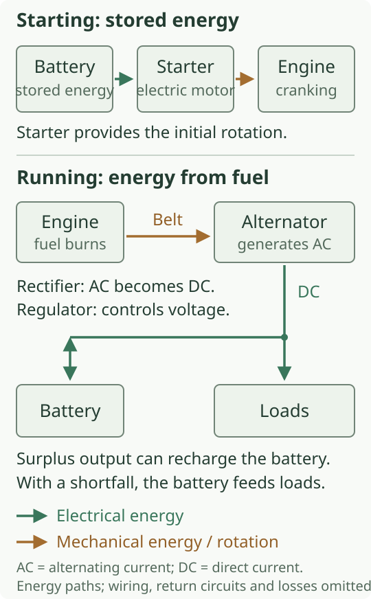
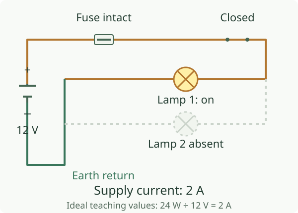
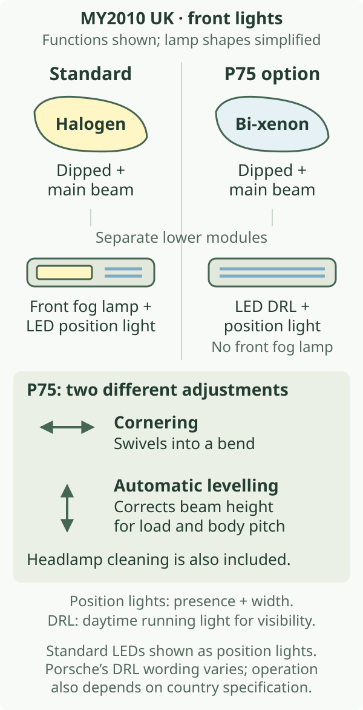

# Lighting, electrical systems and security

The Boxster's electrical system has two overlapping tasks. It delivers energy to motors, lamps and heaters, and carries information between switches, sensors and controllers. A headlamp needs both a usable power supply and an instruction to illuminate. A starter needs substantial electrical power. Starting the engine also requires authorisation.

The reference 2010 2.9 uses a conventional 12-volt system with a battery, a separate starter and an engine-driven alternator. Halogen headlamps are the starting specification; bi-xenon lighting is an option. These distinctions matter when identifying the equipment on a surviving car.[^supply][^lamps]

::: {.book-diagram data-diagram="electrical-explorer"}

:::

## Stored energy, starting and charging

The battery stores energy chemically. Its positive and negative terminals establish a voltage difference; a complete circuit allows current to flow through a load. The Boxster's battery sits under a cover in the front luggage-compartment area, while the engine and starter are behind the cabin. Cables and earth connections therefore join components separated by much of the car's length.[^battery]

During starting, the starter's electric motor turns the engine through its engagement with the flywheel drive. This provides the rotation needed for the engine to begin its own combustion cycles. The ignition key requests starting through a control circuit; a separate high-current path supplies the motor.[^starter]

Once the engine runs, the alternator converts mechanical rotation into electrical energy. Its internal rectification supplies direct current to the vehicle, and regulation controls its output voltage. The accessory belt drives the Boxster's alternator, along with other engine accessories. Available alternator output must supply the operating loads and replenish energy removed from the battery.[^supply]

The battery remains part of the working system after starting. It can support the loads when demand exceeds the alternator's available output. Repeated short trips, cold starting and electrical use while parked can leave less charge than a longer journey restores. Porsche's manual specifically draws attention to roof and audio operation with the engine stopped.[^battery]

Battery **capacity**, expressed in ampere-hours, describes stored charge under specified conditions. Starting ability also depends on temperature, internal condition and the resistance of the entire high-current path. A battery can light a small cabin lamp yet struggle to turn the engine: the starter demands much more current. Capacity and present state of charge are related questions, but they are not interchangeable measurements.

## A circuit needs a return path

A typical load receives power through protected wiring and a switching device, then returns current to battery negative through wiring and the car's earth connections. The body and engine provide useful parts of that return network. An earth is an electrical connection, rather than a place where current disappears.

Voltage is measured in **volts (V)**, current in **amperes (A)** and power in **watts (W)**. For a steady direct-current example, **power = voltage × current**. At an ideal 12 V, a 24 W load draws 2 A. Adding another identical load in parallel raises the supply current to 4 A while each branch still receives 12 V. These are teaching values, not the Boxster's lamp ratings.

::: {.book-diagram data-diagram="electrical-current-path"}

:::

The interactive circuit deliberately makes a broken earth as effective as an open feed. In a real connection, corrosion may add resistance without making a complete break. Some supply voltage is then lost across that resistance when current flows, leaving less across the intended load. A connection can consequently behave acceptably with a small load and poorly with a large one.[^earth]

Fuses protect circuits against excessive current caused by faults or overloads. A fuse element opens the circuit when its operating conditions are exceeded; it does not restore a damaged wire or identify the original fault. The owner's manual locates the fuse panel in the driver's footwell and supplies the assignment on its cover. The specified fuse rating is matched to the protected circuit.[^fuses]

## Controllers carry decisions as well as current

Many operations are mediated by electronic controllers. A switch can report a request; a controller checks the relevant conditions and operates an output. A door contact, for example, conveys the state of a latch, whereas a lock actuator converts electrical energy into movement. A timed interior lamp combines an input, a decision and a power output.

Controllers also exchange information. Porsche's contemporary engine-management diagram explicitly shows a **CAN interface** connecting functions including transmission control, the immobiliser, instruments and climate control. A data message can carry an engine-speed value or an operating request without carrying the energy needed to run a motor. The receiving module still needs power and an earth.[^network]

This explains why a fault can cross apparent system boundaries. Several warnings may share an underlying supply or communication problem, while a single failed lamp can have an entirely local cause. The number of warnings alone does not establish the number of failed components. Entertainment connections are covered separately in [Audio, navigation and communication](../17-audio-navigation-and-communication/index.md).

## Halogen, bi-xenon and the front light modules

Headlamps shape light onto the road. Dipped beam provides a controlled distribution for ordinary night driving; main beam extends illumination when conditions allow. In a halogen lamp, current heats a filament until it emits light. A gas-discharge xenon lamp produces light through an electrical arc and requires its associated control equipment. **Bi-xenon** describes xenon lighting serving both dipped- and main-beam functions.[^xenon]

The reference car's standard arrangement combines halogen main headlamps with separate front modules above the outer air intakes. The direction indicators sit within the main headlamp assemblies. The lower modules combine front fog lamps and LED **position lights**. Position lights identify the car's presence and width; their job differs from lighting the road.[^lamps][^lamp-wording]

The optional **P75** package adds bi-xenon headlamps, dynamic cornering lights and dedicated LED daytime running lights. It includes headlamp cleaning, and the bi-xenon system has automatic beam-height adjustment. With this arrangement, the front auxiliary modules provide position lights and LED daytime running lights in place of the standard front fog lamps.[^xenon]

Daytime running lights help other people see the car during daylight. They do not substitute for dipped beam in darkness, and their presence does not establish that all rear lights are illuminated. Porsche's manual distinguishes the switch arrangements for halogen and bi-xenon cars and cautions that daytime-light operation varies by country.[^daylight]

.](images/porsche-front-lights.jpg){alt="A red Boxster has bi-xenon main headlamps above separate illuminated LED front modules."}

Dynamic cornering swivels the beam horizontally towards a bend using steering angle and vehicle movement. Automatic levelling corrects beam height as load and body pitch change. Porsche quotes up to **15°** of cornering swivel.[^xenon]

## Rear lamps and everyday visibility

LED rear lighting is a characteristic 987.2 change. Light-emitting diodes produce light electronically rather than by heating a filament. Their fast response is useful for a brake-light signal, and they allow the rear light signature to be formed from numerous small sources. The rear clusters combine several distinct functions within one housing; “LED rear lights” should not be read as a statement that every light source in that housing uses the same technology.[^rear]

.](images/porsche-boxster-s-rear-lights.jpg){alt="The rear of a red Boxster S shows illuminated rear light signatures, one on each side of the luggage lid."}

The car also coordinates interior and exterior convenience lighting. Welcome Home illumination provides a temporary pool of light when entering or leaving; it is a timed operating mode, rather than a separate kind of bulb. The brochure describes adjustment of its delay through PCM with Sport Chrono Package Plus. A lamp that stays on briefly after locking can therefore be following a commanded delay.[^convenience]

## Keys, locks, immobiliser and alarm

The key combines a mechanical blade, a radio remote and an immobiliser transponder. Those functions answer different questions. The blade fits the lock; the remote requests locking or luggage-compartment release; the transponder supplies an authorised code for starting. The immobiliser prevents an unauthorised starting request from becoming permission to run the engine.[^security]

Central locking operates the locks together. An alarm adds surveillance and a warning response. Contact monitoring detects changes at protected openings, while optional radar-based interior surveillance monitors the cabin with the hood closed. Porsche's manual states that passenger-compartment monitoring is switched off with the convertible hood open. Lock status and surveillance coverage therefore need to be considered separately.[^security]

For the ordinary 2.9, the January 2010 catalogue lists alarm and interior surveillance as option **534**. It lists the S's exterior alarm as standard, with interior surveillance optional. Tracking-system preparation **674** is separate and specified in conjunction with the alarm system. The brochure describes wiring, a higher-capacity battery and a tilt sensor to support subsequent installation of the tracking system.[^security-options]

## ParkAssist and distance sensing

Optional **ParkAssist, 635**, uses ultrasonic sensors in the rear bumper. Selecting reverse enables the rear parking aid; reflected sound pulses let the system estimate distance to detected obstacles. As a detected obstacle gets closer, the warning intervals shorten. This is a distance warning for the driver, with steering and braking still under the driver’s control.[^parkassist]

A pulse travels out and its echo travels back, so distance depends on half the sound’s round-trip travel. Small, angled or sound-absorbing objects may return a poor echo, and the sensing field has blind regions. Clean sensor faces and an audible warning are consequently part of useful operation; an absence of beeps cannot establish that the whole path is clear. The brochure establishes UK option availability, while the handbook explains the sensing limits.[^parkassist]

## Wipers and mirrors

The standard windscreen wipers offer adjustable intermittent operation as well as continuous speeds. A motor and linkage sweep the blades across the glass; the blades' rubber edges displace water. The washer system supplies fluid through two heated, filtered nozzles. Clear glass depends on the condition of the blades and glass as well as the control system.[^wipers]

Option **P12** combines automatically dimming interior/exterior mirrors with a rain sensor. The sensor allows wiping frequency to respond to wetting of the windscreen rather than a fixed interval. Optical rain sensing works by sending light into the glass and detecting the change in returned light when water is present. This describes the sensing principle, without attributing later combined camera or headlamp-control functions to the 987.[^rain]

The dimming mirrors respond to light measured at the interior mirror, reducing glare and returning towards their normal state as conditions change. They are separate from mirror heating, which helps clear moisture. The ordinary manually dipped interior mirror provides its anti-glare change through the driver's lever.[^mirrors]

## Options on the 2010 2.9

The electrical options chiefly change lighting performance, convenience or surveillance coverage. The January 2010 catalogue identifies these relevant packages:[^option-table]

| Option | Effect relevant to this chapter |
| --- | --- |
| P75 | Bi-xenon, dynamic cornering and LED daytime running lights |
| P12 | Automatically dimming mirrors and rain sensor |
| 534 | Alarm system with interior surveillance for the ordinary Boxster |
| 674 | Tracking-system preparation in conjunction with the alarm; tracker installation remains separate |
| 608 | HomeLink programmable remote control for compatible external equipment |
| 635 | Rear ultrasonic ParkAssist with acoustic distance warning |

## Changes in other 2.9 model years

The new front modules, optional dynamic cornering and LED rear-light concept belong to the 2009 introduction.[^lamps][^rear] The [annual matrix](../19-reference-atlas-and-index/index.md#annual-equipment-matrix) separates this documented arrangement from unresolved later UK equipment/programming changes.

## The S, Spyder and Black Edition

The S offers the same standard halogen and optional P75 bi-xenon arrangements. Its exterior alarm is standard, as described above.[^lamps][^security-options]

The January 2010 Spyder brochure describes minimal LED position lights in its front intakes and lists bi-xenon with dynamic cornering as option **P74**. It also lists a lightweight lithium-ion battery as **191** and P12 dimming mirrors/rain sensor. These choices belong to the Spyder’s specification.[^spyder]

The March 2011 UK **Boxster S Black Edition** price list includes bi-xenon with dynamic cornering, LED position lights/DRLs, automatically dimming mirrors with rain sensor and an alarm in its standard specification.[^black]

## Identification and ageing

Identify the lamp units and their associated controls. Confirm levelling, cornering operation and cleaning equipment when identifying P75; a replacement LED bulb alone does not reproduce that complete system.

With age, battery condition, cable connections, earths, water entry and previous accessory wiring can affect several systems together. [Roof, glass, seals and drainage](../14-roof-glass-seals-and-drainage/index.md) explains how water is meant to leave the car. A dry-looking cabin surface does not establish the condition of concealed connections.

Porsche documents timed load shutdown and a remote-control standby change after prolonged parking. These behaviours help explain why a parked car is not electrically inert, but they are not a universal parasitic-current test specification. Record supply state and fault information alongside those timed behaviours.[^standby]

[^supply]: Porsche, *The Boxster*, January 2010 UK edition, printed p. 39, [brochure](https://mrsportscars.com/wp-content/uploads/2019/11/Porsche-Boxster-987-Gen-2-Sales-Brochure-UK-US-2010-2011.pdf#page=17). General alternator mechanism: DENSO, [“Alternator troubleshooting”, 31 March 2022](https://www.denso-am.eu/news/alternator-troubleshooting), “Alternator overview”. Rectification: DENSO, [*Starters & Alternators Technical Manual*](https://assets.denso-am.eu/production/attachments/Starter-Alternator-Manual-English.pdf), “Rectification”. The 12 V system is confirmed by Porsche's manual, printed p. 255 (PDF p. 257). DENSO explains general mechanisms, not the Boxster's alternator rating or control calibration.

[^battery]: Porsche, *Boxster, Boxster S Owner's Manual*, WKD 987 021 10, 5/09, printed pp. 249–252 (PDF pp. 251–254), [archived Porsche manual](https://billswebspace.com/Owners_Manual_Boxster_PCNA.pdf#page=251). This is the North American manual; used for shared construction and battery/load principles, not UK standard-equipment assignments. The battery's location is stated on printed p. 249 and illustrated on printed p. 252.

[^starter]: Porsche PET **987209**, snapshot 19 July 2018, illustration **902-005**, [PDF pp. 519–522](https://www.porsche-preparation.com/downloaded/pet-porsche/boxster-2009-2012-type-987.pdf#page=519), identifies the distributor-to-engine cable, starter/alternator wire set and body-to-engine earth line. General engagement and high-current principles: DENSO, [“Rotating electrics”, FAQs](https://www.denso-am.eu/products/rotating-electrics). The schematic does not reproduce a supplier-specific starter or the harness routing.

[^earth]: HELLA, [*Earth (31) – troubleshooting*, pp. 1–2](https://www.hella.com/techworld/en/ti/pdf/earth-31-troubleshooting/earth-31-troubleshooting.pdf#page=1). General explanation of contact resistance and voltage loss, not Porsche diagnostic limits.

[^fuses]: Porsche owner's manual, WKD 987 021 10, printed pp. 245–247 (PDF pp. 247–249), [electrical system and fuses](https://billswebspace.com/Owners_Manual_Boxster_PCNA.pdf#page=247).

[^network]: Porsche, *The Boxster*, January 2010 UK, printed pp. 34–35, [engine-management diagram](https://mrsportscars.com/wp-content/uploads/2019/11/Porsche-Boxster-987-Gen-2-Sales-Brochure-UK-US-2010-2011.pdf#page=15). The chapter does not infer a complete bus topology from this functional illustration.

[^lamps]: Porsche, *The Boxster*, January 2010 UK, printed pp. 64–65 and 106, [lighting section](https://mrsportscars.com/wp-content/uploads/2019/11/Porsche-Boxster-987-Gen-2-Sales-Brochure-UK-US-2010-2011.pdf#page=30). Porsche, *2009 Technik Introduction — All Boxster Cayman Models*, printed Electrics and electronics p. 158, [viewer p. 164](https://www.manualslib.com/manual/3550487/Porsche-Boxster-2009.html?page=164), identifies the standard front fog lamps, LED position lights and main-headlamp indicators. Full Porsche text is also [archived on Scribd](https://www.scribd.com/document/972719474/Boxster-2009), PNA 987 021 09, 2/09; market qualifications apply.

[^xenon]: Porsche, *2009 Technik Introduction*, printed Electrics and electronics pp. 159–162, [viewer pp. 165–168](https://www.manualslib.com/manual/3550487/Porsche-Boxster-2009.html?page=165), particularly [gas-discharge principle on viewer p. 166](https://www.manualslib.com/manual/3550487/Porsche-Boxster-2009.html?page=166). UK brochure printed p. 65 documents cleaning, cornering inputs and maximum swivel. Automatic levelling is also described in the owner's manual, printed p. 79 (PDF p. 81), [manual](https://billswebspace.com/Owners_Manual_Boxster_PCNA.pdf#page=81).

[^daylight]: Porsche owner's manual, printed pp. 78–80 (PDF pp. 80–82), [separate bi-xenon and halogen switch descriptions](https://billswebspace.com/Owners_Manual_Boxster_PCNA.pdf#page=80). Country qualifiers are retained; US on-board-computer DRL settings are not presented as a UK control prescription.

[^lamp-wording]: The January 2010 UK brochure's design overview, printed p. 17, calls the standard front LEDs daytime running lights; the detailed lighting section, pp. 64–65, calls them position lights and assigns LED DRLs to the bi-xenon package. *2009 Technik Introduction*, printed p. 158, supports the detailed distinction adopted here. Country-specific coding and individual equipment remain relevant.

[^rear]: Porsche, *2009 Technik Introduction*, printed Electrics and electronics pp. 163–164, [viewer pp. 169–170](https://www.manualslib.com/manual/3550487/Porsche-Boxster-2009.html?page=169); UK brochure printed pp. 64–65; owner's manual printed p. 266 (PDF p. 268), [LED and long-life light units](https://billswebspace.com/Owners_Manual_Boxster_PCNA.pdf#page=268).

[^convenience]: Porsche, *The Boxster*, January 2010 UK, printed p. 77, [Welcome Home lighting](https://mrsportscars.com/wp-content/uploads/2019/11/Porsche-Boxster-987-Gen-2-Sales-Brochure-UK-US-2010-2011.pdf#page=36).

[^security]: Porsche owner's manual, printed p. 15 (PDF p. 17) and pp. 19–26 (PDF pp. 21–28), [keys and immobiliser](https://billswebspace.com/Owners_Manual_Boxster_PCNA.pdf#page=17) and [alarm/passenger-compartment monitoring](https://billswebspace.com/Owners_Manual_Boxster_PCNA.pdf#page=27). The manual has separate instructions for cars with and without an alarm.

[^security-options]: Porsche, *The Boxster*, January 2010 UK, printed pp. 78–79 and 110, [anti-theft protection](https://mrsportscars.com/wp-content/uploads/2019/11/Porsche-Boxster-987-Gen-2-Sales-Brochure-UK-US-2010-2011.pdf#page=37) and [option table](https://mrsportscars.com/wp-content/uploads/2019/11/Porsche-Boxster-987-Gen-2-Sales-Brochure-UK-US-2010-2011.pdf#page=51).

[^wipers]: Porsche, *The Boxster*, January 2010 UK, printed p. 77; owner's manual printed pp. 82–83 (PDF pp. 84–85), [wiper controls](https://billswebspace.com/Owners_Manual_Boxster_PCNA.pdf#page=84).

[^rain]: Porsche, *The Boxster*, January 2010 UK, printed pp. 77 and 106. General optical principle: HELLA, [“How rain-light sensors can provide comfort and safety”](https://www.hella.com/techworld/ae/lounge/functions-of-rain-sensors-light-sensors/), “The rain sensor”. Its later sensor generations and additional functions are not claimed for the 987.

[^mirrors]: Porsche owner's manual, printed pp. 29–31 (PDF pp. 31–33), [manual and automatic anti-glare mirrors](https://billswebspace.com/Owners_Manual_Boxster_PCNA.pdf#page=31).

[^option-table]: Porsche, *The Boxster*, January 2010 UK, printed pp. 106 and 110, [exterior and interior option tables](https://mrsportscars.com/wp-content/uploads/2019/11/Porsche-Boxster-987-Gen-2-Sales-Brochure-UK-US-2010-2011.pdf#page=49).

[^spyder]: Porsche, *The Boxster Spyder*, January 2010 UK, unnumbered front-design spread (PDF p. 8) and printed pp. 38–39 (PDF p. 18), [brochure](https://porschecarshistory.com/wp-content/old/brochures2/93/2010%20987%20Boxster%20Spyder.pdf#page=18).

[^black]: Porsche Cars Great Britain, *Boxster S Black Edition — Price List*, Edition 03/2011, printed pp. 11–12 (PDF pp. 6–7), [original UK scan](https://www.dropbox.com/scl/fi/gtavw6els2231u61qjomr/2011-987-Porsche-Boxster-Black-Edition-Price-List-UK.pdf?rlkey=7n0i52owbntdg7d17dfgyo7nw&dl=0). Read visually: the scan has no useful extracted text.

[^standby]: Porsche owner's manual, printed p. 246 (PDF p. 248), [load switch-off and remote standby](https://billswebspace.com/Owners_Manual_Boxster_PCNA.pdf#page=248). These are source-dated operating behaviours, rather than a measured sleep-current limit for every car.

[^parkassist]: Porsche, *The Boxster*, UK 01/10, printed p. 78 and option table p. 106, [original PDF pp. 37 and 49](https://mrsportscars.com/wp-content/uploads/2019/11/Porsche-Boxster-987-Gen-2-Sales-Brochure-UK-US-2010-2011.pdf#page=37): rear sensors, reverse activation, acoustic warning and code 635. Porsche MY2010 North American handbook, printed pp. 70–71 / PDF pp. 72–73: four ultrasonic sensors, sensing limits and cleaning. General pulse/echo mechanism: [HELLA, Ultrasound-based parking aid](https://www.hella.com/techworld/en/technical/car-electronics-and-electrics/ultrasound-based-parking-aid-park-distance-control-pdc/); no modern automatic parking or sensor fusion assigned to 987.2.
