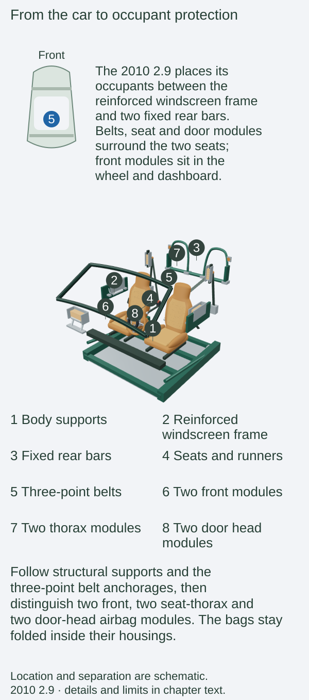
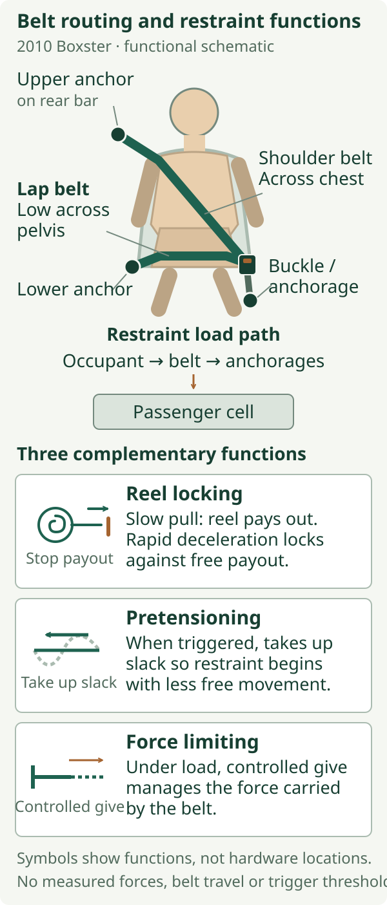
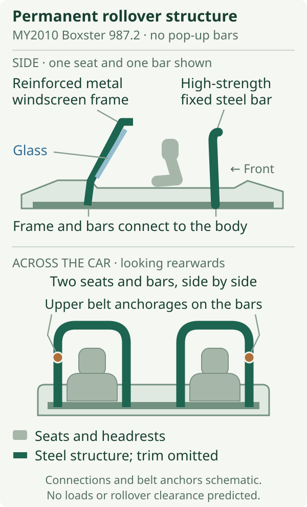

# Occupant protection and system integration

A Boxster works as a whole because its parts share loads, information and responsibilities. The tyres connect it to the road; the suspension keeps those connections controlled; the engine and transmission supply driving torque; the brakes remove energy. Around the occupants, the body, seats, belts and airbags form another connected system. Understanding those relationships brings the individual mechanisms in this book back into one car.

The 2010 European/UK 2.9 has an open passenger compartment, yet its protection does not depend on the fabric hood becoming a structural roof. It combines a reinforced windscreen frame and permanent rear rollover bars with three-point belts, pretensioners, force limiters and six airbags. The detail matters: its side head airbags are in the **doors**, while its thorax airbags are in the **seats**.[^uk-restraints]

::: {.book-diagram data-diagram="protection-explorer"}

:::

## Space for the occupants, time to slow them

The [body chapter](../04-body-structure-and-packaging/index.md#stiffness-and-occupant-protection-have-different-aims) explains the shell’s load paths and deformation zones. Preserving the passenger compartment provides space; the restraints must also manage the occupants’ continued motion.[^uk-restraints]

A person initially continues moving when the surrounding car slows. The restraint system must apply forces to bring that person towards the car's changing speed, while controlling contact with the interior. The belt starts that connection across the pelvis and upper body. An airbag supplies an additional, broader contact surface in the directions for which it is designed. The seat and its attachments provide support and locate the occupant relative to all of them.

[Seat adjustment](../15-cabin-seating-and-climate/index.md#a-seat-is-a-support-structure) establishes that relationship between occupant, belt, steering wheel and dashboard. Sound anchorages and clear deployment space complete the connection.

## Three belt functions

The ordinary three-point belt allows slow movement through an inertia-reel retractor and locks against rapid deceleration. The shoulder section crosses the upper body and the lap section bears low across the pelvis. The reel's normal locking action is one function; crash pretensioning and force limiting add two more.[^belt-handbook]

A **pretensioner** removes slack when triggered, bringing the belt into useful engagement earlier in the event. A **force limiter**, also called a load limiter, manages belt tension as loading rises. These functions work together: the first reduces free movement before restraint begins; the second controls the force transmitted through the belt as it restrains the occupant.[^belt-principles]

*Three complementary functions, rather than three user-selected settings. Arrows show the relationship between occupant restraint and anchorage; their lengths do not represent measured forces or belt travel.*

Porsche's period handbook describes the pretensioners as single-use devices and links their fault indication to the airbag warning light. An apparently tidy belt after a collision is therefore only part of the evidence: webbing, retractors, buckles, anchorages and the triggered components all matter.[^belt-handbook]

## Front, thorax and head airbags

The ordinary Boxster and S have two front airbags, one in the steering-wheel centre and one in the passenger side of the dashboard. Porsche Side Impact Protection, **POSIP**, adds two bags on each side: a thorax bag in the outer seat bolster and a head bag in the door. That makes six in total. The UK brochure gives approximately eight litres for each of the POSIP bags and explicitly describes their protection with the hood open.[^uk-restraints]

.](images/porsche-posip-2010.jpg){alt="Porsche factory illustration of an open red 987.2 Boxster with its front and side airbags inflated, showing the different locations around the two seats."}

An airbag is folded inside its module until the restraint controller commands its inflator. Gas fills the bag quickly enough to place that additional surface between the occupant and the relevant interior area. Its role supplements the belt. Occupant position matters because inflation itself happens rapidly and needs clear space.[^airbag-principles]

Deployment is selected according to the event. Porsche's handbook relates front-airbag triggering to a sufficiently severe frontal collision, and side-airbag triggering to a corresponding impact on that side. The assessment concerns impact direction and severity; it cannot be reduced to one road-speed threshold. The crash-sensing system also has diagnostic functions, separate from the PSM system's ordinary observation of vehicle motion.[^airbag-handbook]

The 2010 UK brochure describes child-seat preparation through Porsche Tequipment: an ISOFIX fixing bracket and a key switch for deactivating the passenger airbag, with sports bucket seats excluded. That is the relevant catalogue evidence for this book. The North American handbook additionally describes passenger-seat weight sensing under US regulations; that market-specific logic is not assigned to the UK reference car.[^child]

## Permanent rollover structure

At the front of the cockpit, a steel reinforcement is integrated into the windscreen frame. Behind the seats stand high-strength steel rollover bars. The upper belt anchorages attach to these bars. These are permanent structural members: the 987.2 arrangement illustrated here has no sensor-triggered extension or deployable rear hoops.[^uk-restraints]

*The front frame and rear bars are present before an event begins. This is a location diagram, with the hood omitted; it does not calculate clearance, roof strength or the result of an overturn.*

The soft top and its supporting bows provide weather enclosure. Opening or closing it does not assemble or withdraw the steel rollover structure. The fixed bars also explain why the wind deflector described in the [roof chapter](../14-roof-glass-seals-and-drainage/index.md) can use the space between and around them: the removable deflector is an aerodynamic accessory carried by an existing structure.

## One bend connects the chassis

Consider a 2010 2.9 approaching a bend under braking. Deceleration shifts wheel loading forwards while the tyres provide the forces that slow and turn the car. Springs, dampers, bushes and wheel geometry govern how those contact patches are supported; the driver turns the front carriers through the steering linkage. The [shared grip budget](../12-steering-wheels-and-tyres/index.md#slip-and-the-shared-grip-budget) explains why additional braking demand leaves less capacity for cornering in the simplified picture.

As braking reduces and drive is applied, torque reaches the rear contact patches through the manual or PDK transmission, final drive, differential and joints. The outside rear wheel follows a longer path than the inside one, which the differential accommodates. PSM can request individual braking and engine-torque treatment if its observations call for correction. These are connected actions: a control request changes a mechanism’s output, and the tyres still have to produce the road forces. The example explains responsibilities without predicting an intervention for a particular bend.

## Requests, decisions and physical action

Driving control has a different timescale and purpose from crash restraint. A useful way to follow it is through three questions: **what is observed, which controller makes the request, and what physical part acts?** Electrical messages carry information; the eventual force still comes from combustion, clutch friction, tyre contact or hydraulic pressure.

The accelerator is an example. Its position is a sensor input expressing the driver's demand. DME, the engine-management system, turns that demand into engine control using its other inputs and operating limits. The throttle, injectors and ignition then affect engine torque. The [engine-control chapter](../06-air-fuel-ignition-and-engine-control/index.md#the-accelerator-asks-for-torque) follows that process within the 2.9.[^pedal]

With optional PDK, a shift involves cooperation between the transmission controller and DME. Clutch and gear-selection actions change the torque route through the gearbox, while coordinated engine-torque treatment helps the handover. With the standard manual gearbox, the driver's clutch and lever movements provide the corresponding mechanical selection and engagement. Both routes end at the final drive and tyres, but their control arrangements differ.[^pdk-control]

PSM adds another request source. Its motion information includes wheel speed, steering angle, lateral acceleration and yaw rate. When correction is required, it can act through individual wheel braking and engine-torque reduction. Thus an unchanged accelerator position does not guarantee unchanged delivered torque. The detailed [ABS and PSM explanation](../13-brakes-and-stability-systems/index.md#abs-and-psm) covers the wheel-pressure control; the point here is that the brake and engine controllers cooperate.[^psm-control]

::: {.book-diagram data-diagram="protection-system-scenarios"}

:::

*Select a situation and transmission to follow the information and action. This is a functional map, not a wiring diagram, measured timing sequence or prediction of which intervention a particular real event will trigger.*

## Options on the 2010 2.9

PSM and the ordinary restraints are standard. **Sport Chrono 639** and **Sport Chrono Plus 640** change equipment-dependent functions; neither increases the 2.9’s rated 188 kW / 255 PS. Plus requires PCM, while PDK and PASM remain separately ordered equipment.[^modes]

| Function | Manual + Sport Chrono | PDK + Sport Chrono | Additional equipment |
| --- | --- | --- | --- |
| Sharper accelerator characteristic and harder limiter response in Sport | Yes | Yes | Engine-control change; [chapter 6](../06-air-fuel-ignition-and-engine-control/index.md#options-on-the-2010-2.9) |
| Later PSM intervention threshold in Sport | Yes | Yes | Standard PSM; [chapter 13](../13-brakes-and-stability-systems/index.md#options-on-the-2010-2.9) retains OFF/reactivation conditions |
| Performance-focused shift programme | Driver still selects gears | Yes | PDK; [chapter 9](../09-pdk-transmission/index.md#options-on-the-2010-2.9) |
| Sport Plus and Launch Control | No | Yes | PDK and Sport Chrono |
| PASM Sport programme request | If PASM fitted | If PASM fitted | Separate PASM 475; its button can select the damping programme independently |
| PCM performance display and personal memory | Plus only | Plus only | PCM and Sport Chrono Plus 640 |

The stopwatch identifies a visible part of the package, not every dependency. PASM varies damping; it does not change spring rate or raise/lower the body on demand. The [brake-mode conditions](../13-brakes-and-stability-systems/index.md#options-on-the-2010-2.9) distinguish ordinary vacuum assistance from the additional hydraulic brake assist and explain PSM OFF.[^psm-control]

## Changes in other 2.9 model years

The launch and January 2010 UK catalogues document this restraint layout.[^years] Later UK sensor/component/software changes remain U in the [annual matrix](../19-reference-atlas-and-index/index.md#annual-equipment-matrix).

## The S, Spyder and Black Edition

The ordinary S shares the UK brochure's restraint description with the 2.9. The Spyder's lighter specification retains door side-impact protection, rollover bars and an airbag system; its standard sports bucket seats contribute to the weight reduction. Its brochure also describes PSM and optional Sport Chrono.[^variants]

The Black Edition's UK specification retains front airbags, POSIP, belt pretensioners and force limiters. Its black-finished rollover bars are a visual treatment of the familiar arrangement. PDK, PASM and Sport Chrono Plus remain options.[^black]

## Identification and ageing

Seat changes deserve particular attention because the original seats contain thorax airbags. Check the installed seats, steering wheel and diagnostic condition together. A warning lamp is evidence of a reported fault; an extinguished lamp is not a structural survey or a complete history of previous repairs. Porsche directs airbag faults and work on restraint components to qualified service personnel.[^airbag-handbook]

The same distinction applies throughout this book. A part name identifies a design, while inspection establishes the condition of the example in front of you. A mode changes a controller's instructions, while tyres, springs, dampers and brakes still produce the forces. A belt and airbag depend on the body and seat that locate them. Read together, the Boxster's mechanisms describe one chain of physical relationships: from the driver's request, through controlled torque and wheel forces, to the structure and restraints surrounding the people who made the journey.

[^uk-restraints]: Porsche, *The Boxster*, January 2010 UK edition, printed pp. 66–67, [original brochure, PDF p. 31](https://mrsportscars.com/wp-content/uploads/2019/11/Porsche-Boxster-987-Gen-2-Sales-Brochure-UK-US-2010-2011.pdf#page=31). Covers ordinary Boxster and S; fixed-bar construction, belt anchorage and POSIP locations are explicit.

[^belt-handbook]: Porsche, *Boxster, Boxster S Owner's Manual*, MY2010 North American edition, WKD 987 021 10, 5/09, printed pp. 42–43, [original manual, PDF p. 44](https://billswebspace.com/Owners_Manual_Boxster_PCNA.pdf#page=44). Used for general belt function and single-use pretensioner/fault information; US reminder timings and passenger recognition are not adopted as UK equipment.

[^belt-principles]: NHTSA, *Occupant Protection Issues Among Older Drivers and Passengers, Volume II: Appendices*, DOT HS 810 939, April 2008, printed p. 40, [PDF p. 48](https://www.nhtsa.gov/sites/nhtsa.dot.gov/files/810939.pdf#page=48), “Belt Force Limiters” and “Belt Pretensioners”. Controlled yielding: NHTSA, *Effectiveness of Pretensioners and Load Limiters for Enhancing Fatality Reduction by Seat Belts*, DOT HS 811 835, November 2013, printed pp. 1–2, [archived original, PDF pp. 7–8](https://www.automotivesafetycouncil.org/wp-content/uploads/2017/01/Seat-Belt-Load-Limiter-Report.pdf#page=7). Generic functions, not Porsche internal design or calibration.

[^airbag-principles]: NHTSA, [“Air Bags”, “Protection” and “Air Bag Deployment”](https://www.nhtsa.gov/vehicle-safety/air-bags). General module/inflator and supplementary-restraint principles; current vehicle equipment is not transferred to the 987.2.

[^airbag-handbook]: Porsche, *MY2010 Owner's Manual*, printed pp. 44–45 and 48, [PDF p. 46](https://billswebspace.com/Owners_Manual_Boxster_PCNA.pdf#page=46). Crash-sensing/diagnostic module, directional deployment, warning indication and professional service. Its passenger-weight system is expressly US-regulation equipment.

[^child]: Porsche, *The Boxster*, January 2010 UK edition, printed p. 67, [PDF p. 31](https://mrsportscars.com/wp-content/uploads/2019/11/Porsche-Boxster-987-Gen-2-Sales-Brochure-UK-US-2010-2011.pdf#page=31). North American distinction: *MY2010 Owner's Manual*, printed pp. 44–49.

[^pedal]: Bosch Mobility, [“Accelerator-pedal module”, operating principle](https://www.bosch-mobility.com/en/solutions/air-management/accelerator-pedal-module/), generic demand-to-torque explanation. Porsche, *2009 Technik Introduction — All Boxster/Cayman Models*, PNA 987 021 09, 2/09, printed p. 58, [archived original text](https://www.scribd.com/document/972719474/Boxster-2009) ([alternative viewer p. 64](https://www.manualslib.com/manual/3550487/Porsche-Boxster-2009.html?page=64)), identifies the 2.9's ME 7.8.2 controller and PDK communication. This is the Porsche Cars North America training edition, with market qualifications.

[^pdk-control]: Porsche, *2009 Technik Introduction*, printed pp. 72–74 and 102, [archived original text](https://www.scribd.com/document/972719474/Boxster-2009) ([alternative viewer pp. 78–80](https://www.manualslib.com/manual/3550487/Porsche-Boxster-2009.html?page=78) and [p. 108](https://www.manualslib.com/manual/3550487/Porsche-Boxster-2009.html?page=108)); *The Boxster*, January 2010 UK edition, printed pp. 42–45, [PDF pp. 19–20](https://mrsportscars.com/wp-content/uploads/2019/11/Porsche-Boxster-987-Gen-2-Sales-Brochure-UK-US-2010-2011.pdf#page=19).

[^psm-control]: Porsche, *MY2010 North American Owner's Manual*, printed pp. 63–65, [PDF pp. 65–67](https://billswebspace.com/Owners_Manual_Boxster_PCNA.pdf#page=65), including PSM OFF conditions and emergency reactivation; *2009 Technik Introduction*, printed pp. 120–121, [archived original text](https://www.scribd.com/document/972719474/Boxster-2009) ([alternative viewer pp. 126–127](https://www.manualslib.com/manual/3550487/Porsche-Boxster-2009.html?page=126)), distinguishes hydraulic brake assist from vacuum boosting and specifically names SPORT with Sport Chrono Package Plus for assist deactivation. No wider claim about code 639 calibration is made.

[^modes]: Porsche, *The Boxster*, January 2010 UK edition, printed pp. 54–57, 107 and 126–127, [original brochure](https://mrsportscars.com/wp-content/uploads/2019/11/Porsche-Boxster-987-Gen-2-Sales-Brochure-UK-US-2010-2011.pdf). Codes 475, 639 and 640 are in the UK option table. The interaction shows standard modes; it does not model these calibrations.

[^years]: Porsche, *The new Boxster*, UK launch edition 08/08, printed pp. 66–67, [original brochure](https://porschecarshistory.com/wp-content/old/brochures5/26/2009%20987%20Boxster%20UK.pdf); January 2010 UK edition, printed pp. 66–67.

[^variants]: Porsche, *The Boxster Spyder*, January 2010 UK edition, printed pp. 18–19, 28–31 and 34–35, [original brochure](https://porschecarshistory.com/wp-content/old/brochures2/93/2010%20987%20Boxster%20Spyder.pdf). No assertion that every restraint part or calibration is identical to the ordinary car.

[^black]: Porsche, *Boxster S Black Edition Price List*, edition 03/2011, printed pp. 12–13 and 16–17, [original UK price list, scan pp. 7 and 9](https://www.dropbox.com/scl/fi/gtavw6els2231u61qjomr/2011-987-Porsche-Boxster-Black-Edition-Price-List-UK.pdf?rlkey=7n0i52owbntdg7d17dfgyo7nw&dl=0). The scanned safety list on p. 12 explicitly specifies black-painted rollover bars and the POSIP locations.
