# Reference atlas and index

Use this appendix alongside the component chapters. The **2010 European/UK Boxster 2.9** remains the first reference: standard equipment and factory options are separated, while other years and derivatives are explicitly identified. The tables collect evidence rather than assigning options to a particular owner’s car.

## Annual equipment matrix

**S** means standard, **O** optional, **N** unavailable and **U** unverified for the stated market/date. A catalogue’s presence in a column establishes its published specification; it does not date the first delivery. **US corroboration** supports the named broad mechanical feature only. It cannot turn a U into a confirmed UK equipment entry.

| System | 2010 UK 2.9 reference · 01/10 catalogue | 2009 introduction evidence | 2011 ordinary UK 2.9 | 2012 ordinary UK 2.9 |
| --- | --- | --- | --- | --- |
| Engine | S · 2,893 cm³, port injection, 188 kW / 255 PS | Same headline specification in launch catalogue | U · annual UK component revisions | U · UK details; US sheet corroborates capacity/output/injection |
| Gearbox | S · six-speed manual; O · seven-speed PDK | Six-speed/PDK replace base five-speed/Tiptronic choices | U · annual UK ordering changes | U · UK details; US sheet corroborates transmission choices |
| Brakes | S · 318 × 28 mm front; 299 × 20 mm rear iron discs | Larger 318 mm base front discs and added PSM assistance functions | U · UK running details; US sheet corroborates 318/299 mm diameters | U · UK running details; US sheet corroborates rounded diameters |
| Suspension | S · passive struts; O · PASM 475, 10 mm lower | Revised tuning; PASM offered | U · detailed UK component/calibration history | U · detailed UK component/calibration history |
| Locking differential | O · 220, requires 18/19-inch wheels | Launch advertised May 2009 at earliest, manual only | U · UK eligibility changes | U · UK eligibility changes |
| Roof/drainage | S · powered fabric roof; heated rear glass | Additional rear drain filters introduced 31 August 2009 | U · annual UK colour/component changes | U · annual UK colour/component changes |
| Lights | S · halogen; O · P75 bi-xenon/cornering/LED DRLs | New light units and LED rear-light concept | U · UK option/programming changes | U · UK option/programming changes |
| Cabin | S · standard seats and A/C; O · seat/climate alternatives | Seat ventilation introduced in facelift generation | U · complete UK seat/trim order guide | U · complete UK seat/trim order guide |
| Audio | S · CDR-30; O · PCM, Sound Package Plus, BOSE and interfaces | Launch catalogue already lists these families | U · complete UK software/profile/ordering history | U · complete UK software/profile/ordering history |
| Paint/hood/interior | Dated palette and advertised calendar transition below | Launch palette belongs to its own 08/08 edition | U · complete annual UK palette | U · complete annual UK palette |

Sources: original UK launch **08/08**, ordinary **01/10**, Porsche’s **2009 technical introduction**, the drain-filter bulletin and explicitly North American **2011/2012** technical sheets.[^annual]

### Dated changes within and around the reference year

| Effective or advertised date | What changes | Evidence status |
| --- | --- | --- |
| February 2009 | Revised ordinary range available, including the new 2.9 and PDK option | Contemporary Porsche results release confirms availability |
| April / May 2009 at earliest | Sports exhaust / manual locking differential advertised | Prospective launch-catalogue dates; first deliveries unresolved |
| 31 August 2009 | Additional rear roof-drain filters enter production | Porsche bulletin also provides retrofit for earlier cars |
| January 2010 catalogue | Paddle steering wheel 840 listed | Dated listing; exact first order/fitment unresolved |
| Through July 2010 | Arctic Silver Metallic and Atlas Grey Metallic listed | Catalogue qualification; not a confirmed final build date |
| September 2010 at earliest | Platinum Silver Metallic, Ice Blue Metallic, Amethyst Metallic advertised | Planned earliest availability, with a gap after the July listings |
| March 2011 UK list | Black Edition’s bundled equipment documented | S derivative; not a change to every ordinary 2.9 |
| January / April 2012 | 981 announced / Dutch introduction planned | New generation; keep its specifications separate |

The [timeline](../02-the-yearly-timeline/index.md) owns the detailed dates. Publication date, model year, build date and registration continue to answer different questions. The palette qualifiers are calendar dates printed in the January brochure.[^palette]

### Other-model equipment comparisons

| Equipment | 2010 2.9 | Ordinary S · 01/10 UK | Spyder · 01/10 UK | Black Edition · 03/2011 UK |
| --- | --- | --- | --- | --- |
| Engine | 2.9 port-injected | 3.4 DFI, 228 kW | 3.4 DFI, 235 kW | 3.4 DFI, 235 kW |
| Manual / PDK | S / O | S / O | S / O | S / O |
| Wheels | S · 17-inch | S · 18-inch | S · lightweight 19-inch | S · black Spyder-design 19-inch |
| Mechanical differential | O | O | S | O |
| PASM | O | O | Fixed 20 mm-lower sports chassis | O |
| PCCB | N | O | O | O |
| Roof | Powered fabric | Powered fabric | Manual two-piece hood | Powered fabric |
| Air conditioning / climate | S · A/C; O · automatic | S · A/C; O · automatic | A/C omitted; automatic offered | S · automatic climate |
| Audio starting point | CDR-30 | CDR-30 | Radio omitted; CDR/PCM require Sound Package Plus | PCM/navigation + Sound Package Plus |

This is a cross-reference to the relevant model catalogues, not a complete order configuration or parts-interchange table. In particular, the Spyder’s wheels do not give the Black Edition its suspension.[^variants]

## Wheel atlas

Start with the 2.9’s Boxster III wheel. The remaining nine designs are January 2010 UK catalogue options for the ordinary 2.9; the S’s standard 18-inch wheel is an option here. Spoke design identifies an appearance, while the casting’s width/offset and approved tyre combination establish fitment. The [wheel chapter](../12-steering-wheels-and-tyres/index.md#reading-a-wheel-and-tyre-size) explains those dimensions.

Images: Porsche AG, *The Boxster*, UK 01/10, printed pp. 53 and 108–109. Catalogue photographs retain their modest original resolution.[^wheels]

::: {.reference-atlas .wheels}

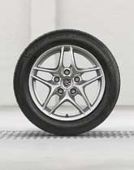{alt="Boxster III · 17-inch: catalogue wheel photograph."}

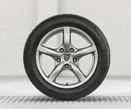{alt="Cayman II · 17-inch: catalogue wheel photograph."}

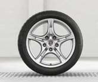{alt="Cayman S II · 18-inch: catalogue wheel photograph."}

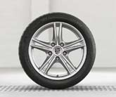{alt="Boxster S II · 18-inch: catalogue wheel photograph."}

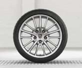{alt="Carrera S II · 19-inch: catalogue wheel photograph."}

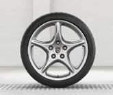{alt="Carrera Classic · 19-inch: catalogue wheel photograph."}

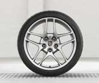{alt="SportDesign · 19-inch: catalogue wheel photograph."}

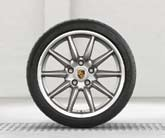{alt="Carrera Sport · 19-inch: catalogue wheel photograph."}

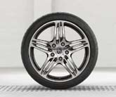{alt="911 Turbo · 19-inch: catalogue wheel photograph."}

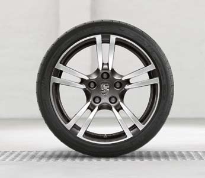{alt="911 Turbo II · 19-inch: catalogue wheel photograph."}

:::

## Seat atlas

The [baseline seat diagram](../15-cabin-seating-and-climate/index.md#a-seat-is-a-support-structure) explains the shared support and adjustment functions. This table starts with the standard seat before comparing the options; the photographs then show the three more specialised adjustment/shell families.[^seats]

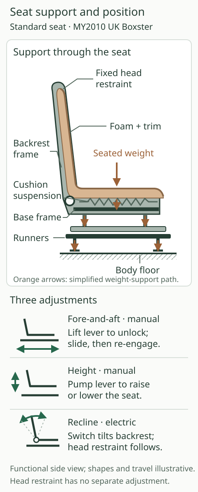

| Seat | Code/status on the 2010 UK 2.9 | Useful distinction |
| --- | --- | --- |
| Standard | Standard | Manual fore/aft and height; electric backrest; Alcantara centres |
| Sports | P77 · optional | Same basic adjustment pattern; firmer upholstery and larger bolsters |
| Comfort with driver memory | P15 · optional | Electric adjustment, lumbar support and driver/mirror memory |
| Adaptive sports with driver memory | P01 · optional | Comfort adjustments plus adjustable cushion/backrest side bolsters; bolster positions not memorised |
| Sports bucket | P03 · optional | Composite folding backrest shell, manual longitudinal adjustment; no ordinary height/recline adjustment, heating or ventilation |

Photographs: Porsche AG, *The Boxster*, UK 01/10, printed pp. 74–75. Seat choice, leather coverage, heating and ventilation are separate decisions; the [cabin option table](../15-cabin-seating-and-climate/index.md#options-on-the-2010-2.9) retains their prerequisites.

::: {.reference-atlas .seats}

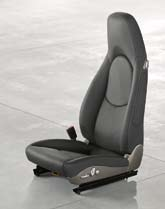{alt="Comfort seat · P15: catalogue seat photograph."}

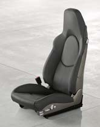{alt="Adaptive sports seat · P01: catalogue seat photograph."}

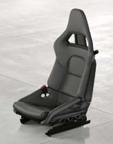{alt="Sports bucket seat · P03: catalogue seat photograph."}

:::

## Colours and trim

These are the **names and catalogue samples in the January 2010 UK brochure**, not a promise that every sample was orderable immediately. **†** marks Platinum Silver, Ice Blue and Amethyst, advertised from September 2010 **at the earliest**. Arctic Silver (printed “Artic”) and Atlas Grey are additionally listed through July 2010 but are not pictured on that spread. Factory-recommended combinations belong to the separate price list; a swatch alone does not establish an approved combination or an exact colour match.[^palette]

The samples below reproduce Porsche’s printed catalogue artwork. Screen, lighting and print reproduction alter their appearance. Paint name, upholstery colour and leather coverage are separate fields in an individual car’s record.

### Exterior palette

::: {.reference-atlas .swatches}

{alt="Black: catalogue colour sample."}

{alt="Guards Red: catalogue colour sample."}

{alt="Carrara White: catalogue colour sample."}

{alt="Speed Yellow: catalogue colour sample."}

{alt="Basalt Black Metallic: catalogue colour sample."}

{alt="Platinum Silver Metallic: catalogue colour sample."}

{alt="Dark Blue Metallic: catalogue colour sample."}

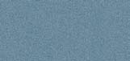{alt="Ice Blue Metallic: catalogue colour sample."}

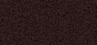{alt="Macadamia Metallic: catalogue colour sample."}

{alt="Meteor Grey Metallic: catalogue colour sample."}

{alt="Aqua Blue Metallic: catalogue colour sample."}

{alt="Porsche Racing Green Metallic: catalogue colour sample."}

{alt="Cream White: catalogue colour sample."}

{alt="GT Silver Metallic: catalogue colour sample."}

{alt="Amethyst Metallic: catalogue colour sample."}

{alt="Ruby Red Metallic: catalogue colour sample."}

:::

### Fabric roof colours

The ordinary roof’s fabric choices are independent of the body’s paint category. These small catalogue views show the roof colour in its real body context; they are not specifications for the owner’s reference car.[^palette]

::: {.reference-atlas .swatches}

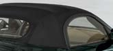{alt="Black: catalogue colour sample."}

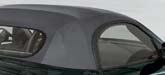{alt="Stone Grey: catalogue colour sample."}

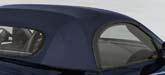{alt="Metropole Blue: catalogue colour sample."}

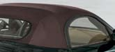{alt="Cocoa: catalogue colour sample."}

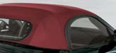{alt="Red: catalogue colour sample."}

:::

### Interior colours and materials

The first four entries are standard interior colour families; that does not make every leather package standard. The remaining entries distinguish special colours, two-tone and natural-leather families. The swatches show the named trim material, not the complete carpet/lining specification.[^palette]

::: {.reference-atlas .swatches}

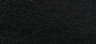{alt="Black: catalogue colour sample."}

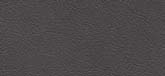{alt="Stone Grey: catalogue colour sample."}

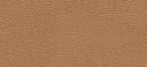{alt="Sand Beige: catalogue colour sample."}

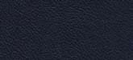{alt="Ocean Blue: catalogue colour sample."}

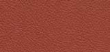{alt="Terracotta: catalogue colour sample."}

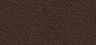{alt="Cocoa: catalogue colour sample."}

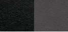{alt="Black / Stone Grey: catalogue colour sample."}

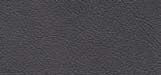{alt="Dark Grey: catalogue colour sample."}

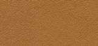{alt="Natural Brown: catalogue colour sample."}

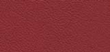{alt="Carrera Red: catalogue colour sample."}

:::

| Coverage or trim choice | What the catalogue adds |
| --- | --- |
| Partial leather · 946 | Seat trim choice; separate from the full interior package |
| Leather interior | Seats, upper/lower dashboard and door panels in smooth-finish leather; colour-specific ordering |
| Two-tone · 970 / natural leather · 998 | Particular interior-package families, rather than different seat adjustment mechanisms |
| Soft ruffled seats · 982 | Requires the leather interior package |
| Macassar · 801 | Dark wood interior package; wheel finish 847 separately listed |
| Carbon · 803 | Carbon interior package; wheel finish 845 separately listed |
| Aluminium Look | Separate finish choices, including multifunction wheel XPU |

Material and finish do not establish heated/ventilated seats, memory or PDK controls. The [cabin chapter](../15-cabin-seating-and-climate/index.md) describes those mechanisms.[^trim]

## Audio capabilities

These are original January 2010 UK capabilities. Present device, software and mobile-network compatibility require separate checks.[^audio]

| Layer | Reference detail |
| --- | --- |
| Standard CDR-30 | Four speakers; two 25 W output stages; radio/MP3-compatible CD |
| Sound Package Plus · 490 | Seven speakers, 185 W; separate analogue amplifier; CDR or PCM |
| BOSE · 680 | Eleven speakers, seven-channel digital amplifier, 385 W; CDR or PCM |
| Recorded DVD 5.1 | PCM + BOSE; integral PCM CD/DVD drive suffices |
| Centerpoint / SurroundStage | Derive surround from stereo / distribute the resulting presentation; do not change the original recording’s channel count |
| AudioPilot | Cabin-noise microphone helps adapt playback; separate from telephone speech capture |
| Interface · 870 with CDR | AUX audio; external player retains track control |
| Interface · 870 with PCM | AUX plus compatible USB/iPod integration and PCM control |
| Phone preparation · 619 / 618 | HFP hands-free link; phone retains the cellular radio; 618 adds mounting arrangement |
| PCM telephone · 666 | Car GSM radio with direct SIM or compatible SAP; HFP mode retains the phone’s cellular role |
| Cordless handset · 669 | For PCM telephone module; unavailable for HFP calls |

A telephone Bluetooth link does not establish music streaming. The [signal-path chapter](../17-audio-navigation-and-communication/index.md) explains these layers and its diagram checks the equipment dependencies.

## Option-code index

This index covers the identifiers used in the book and its atlases. Unless the scope column says otherwise, entries refer to optional equipment in **UK 01/10 for the ordinary 2.9**. It is not a universal Porsche decoder: production identifiers, country codes and replacement-part numbers are different records. Dependencies remain in the linked component explanation.[^codes]

| Code | Meaning and link | Scope / dependency |
| --- | --- | --- |
| 191 | [Lightweight lithium-ion battery](../16-lighting-electrical-systems-and-security/index.md) | Spyder comparison only |
| 220 | [Mechanical locking rear differential](../10-differential-driveshafts-and-mounts/index.md) | 18/19-inch wheels; launch manual-only qualifier |
| 250 | [PDK](../09-pdk-transmission/index.md) | Separate from Sport Chrono |
| 342 | [Seat heating](../15-cabin-seating-and-climate/index.md) | Compatible seats; not buckets |
| 345 | [Heated steering wheel](../15-cabin-seating-and-climate/index.md) | Heated seats; excludes paddle sports wheel |
| 399 | [17-inch Cayman II wheels](../12-steering-wheels-and-tyres/index.md) | Alternative to baseline Boxster III |
| 404 | [19-inch 911 Turbo wheels](../12-steering-wheels-and-tyres/index.md) | UK 01/10 catalogue option |
| 405 | [19-inch Carrera Classic wheels](../12-steering-wheels-and-tyres/index.md) | UK 01/10 catalogue option |
| 407 | [19-inch SportDesign wheels](../12-steering-wheels-and-tyres/index.md) | UK 01/10 catalogue option |
| 408 | [18-inch Boxster S II wheels](../12-steering-wheels-and-tyres/index.md) | Standard on S, optional on 2.9 |
| 409 | [18-inch Cayman S II wheels](../12-steering-wheels-and-tyres/index.md) | UK 01/10 catalogue option |
| 419 | [19-inch Carrera S II wheels](../12-steering-wheels-and-tyres/index.md) | UK 01/10 catalogue option |
| 421 | [19-inch 911 Turbo II wheels](../12-steering-wheels-and-tyres/index.md) | UK 01/10 catalogue option |
| 446 | [Full-colour wheel centres](../12-steering-wheels-and-tyres/index.md) | Appearance choice |
| 450 | [PCCB](../13-brakes-and-stability-systems/index.md) | Unavailable on ordinary 2.9; S option |
| 454 | [Cruise control](../15-cabin-seating-and-climate/index.md) | Separate stalk |
| 475 | [PASM](../11-suspension-and-wheel-geometry/index.md) | Adaptive damping and fixed 10 mm reduction |
| 482 | [Tyre Pressure Monitoring](../12-steering-wheels-and-tyres/index.md) | Wheel sensing and learning state |
| 490 | [Sound Package Plus](../17-audio-navigation-and-communication/index.md) | Separate analogue amplifier; CDR or PCM |
| 498 | [Deletion of model designation](../04-body-structure-and-packaging/index.md) | No-cost catalogue choice |
| 534 | [Alarm/interior surveillance](../16-lighting-electrical-systems-and-security/index.md) | Base option; S exterior alarm status differs |
| 541 | [Seat ventilation](../15-cabin-seating-and-climate/index.md) | Seat, leather, heating and climate prerequisites |
| 550 | [Hardtop](../14-roof-glass-seals-and-drainage/index.md) | Mounting preparation required |
| 551 | [Wind deflector](../14-roof-glass-seals-and-drainage/index.md) | Catalogue combination with storage box or BOSE |
| 573 | [Automatic climate control](../15-cabin-seating-and-climate/index.md) | Different from standard manual A/C |
| 608 | [HomeLink](../16-lighting-electrical-systems-and-security/index.md) | Compatible external equipment |
| 618 | [Phone preparation with mounting arrangement](../17-audio-navigation-and-communication/index.md) | HFP / compatible cradle distinction |
| 619 | [Phone preparation](../17-audio-navigation-and-communication/index.md) | Hands-free calling |
| 635 | [Rear ParkAssist](../16-lighting-electrical-systems-and-security/index.md#parkassist-and-distance-sensing) | Ultrasonic distance warning; driver controls the manoeuvre |
| 639 | [Sport Chrono](../18-occupant-protection-and-system-integration/index.md) | Equipment-dependent functions |
| 640 | [Sport Chrono Plus](../18-occupant-protection-and-system-integration/index.md) | Requires PCM |
| 641 | [Electronic logbook](../17-audio-navigation-and-communication/index.md) | PCM |
| 666 | [Telephone module](../17-audio-navigation-and-communication/index.md) | PCM; SIM/SAP/HFP modes differ |
| 669 | [Cordless telephone handset](../17-audio-navigation-and-communication/index.md) | PCM module; not HFP calls |
| 671 | [Voice control](../17-audio-navigation-and-communication/index.md) | PCM |
| 674 | [Tracking-system preparation](../16-lighting-electrical-systems-and-security/index.md) | Alarm; later tracker installation separate |
| 680 | [BOSE](../17-audio-navigation-and-communication/index.md) | CDR or PCM |
| 692 | [CDR-30 six-disc changer](../17-audio-navigation-and-communication/index.md) | CDR-30 |
| 693 | [PCM CD/DVD changer](../17-audio-navigation-and-communication/index.md) | PCM |
| 695 | [CDR-30 radio](../17-audio-navigation-and-communication/index.md) | Spyder reinstatement code; Plus required |
| 801 | [Macassar interior package](../15-cabin-seating-and-climate/index.md) | Interior finish |
| 803 | [Carbon interior package](../15-cabin-seating-and-climate/index.md) | Interior finish |
| 840 | [Sports steering wheel with PDK paddles](../09-pdk-transmission/index.md) | PDK; no steering-wheel heating |
| 844 | [Multifunction steering wheel](../15-cabin-seating-and-climate/index.md) | Functions depend on connected equipment |
| 845 | [Carbon multifunction wheel](../15-cabin-seating-and-climate/index.md) | Interior finish |
| 847 | [Macassar multifunction wheel](../15-cabin-seating-and-climate/index.md) | Interior finish |
| 870 | [Universal audio interface](../17-audio-navigation-and-communication/index.md) | CDR AUX; PCM AUX/USB/iPod |
| 946 | [Partial leather seats](../15-cabin-seating-and-climate/index.md) | Separate from full interior leather |
| 970 | [Two-tone leather interior](../15-cabin-seating-and-climate/index.md) | Interior package |
| 982 | [Soft ruffled leather seats](../15-cabin-seating-and-climate/index.md) | Leather interior package |
| 998 | [Natural-leather interior](../15-cabin-seating-and-climate/index.md) | Interior package |
| P01 | [Adaptive sports seats with memory](../15-cabin-seating-and-climate/index.md) | Adjustable bolsters not memorised |
| P03 | [Sports bucket seats](../15-cabin-seating-and-climate/index.md) | Heating/ventilation unavailable |
| P12 | [Dimming mirrors and rain sensor](../16-lighting-electrical-systems-and-security/index.md) | Separate from mirror heating |
| P15 | [Comfort seats with driver memory](../15-cabin-seating-and-climate/index.md) | UK 01/10 catalogue option |
| P23 | [PCM with navigation](../17-audio-navigation-and-communication/index.md) | Head unit, not speaker package |
| P74 | [Bi-xenon/dynamic cornering](../16-lighting-electrical-systems-and-security/index.md) | Spyder comparison only |
| P75 | [Bi-xenon/dynamic cornering/LED DRLs](../16-lighting-electrical-systems-and-security/index.md) | Ordinary-model package |
| P77 | [Sports seats](../15-cabin-seating-and-climate/index.md) | UK 01/10 catalogue option |
| XAL | [SportDesign package](../04-body-structure-and-packaging/index.md) | Exterior styling equipment |
| XCZ | [Short shifter](../08-manual-transmission-and-clutch/index.md) | North American Exclusive/Tequipment evidence; exact UK factory ordering unresolved |
| XLF | [Sports exhaust system](../07-lubrication-cooling-and-exhaust/index.md) | Switchable silencing; not merely tailpipes |
| XLS | [Sports tailpipe](../07-lubrication-cooling-and-exhaust/index.md) | Later PET identifier; original UK orderability not established |
| XPU | [Aluminium Look multifunction wheel](../15-cabin-seating-and-climate/index.md) | Interior finish |
| XRR | [19-inch Carrera Sport wheels](../12-steering-wheels-and-tyres/index.md) | Includes full-colour centres in catalogue |

## Glossary

These short definitions point back to the chapters which own the explanation. They do not introduce additional equipment on the reference car.

| Term | Meaning in this book | Read more |
| --- | --- | --- |
| ABS | Anti-lock braking; regulates wheel slip under braking | [Chapter 13](../13-brakes-and-stability-systems/index.md) |
| ABD | Automatic brake differential; applies a driven-wheel brake to manage traction | [Chapter 10](../10-differential-driveshafts-and-mounts/index.md) |
| ASR | Anti-slip regulation; limits driven-wheel spin | [Chapter 13](../13-brakes-and-stability-systems/index.md) |
| Blow-by | Combustion gases passing the piston rings into the crankcase | [Chapter 6](../06-air-fuel-ignition-and-engine-control/index.md) |
| Bore / stroke | Cylinder diameter / piston travel | [Chapter 5](../05-engine-construction-and-valve-gear/index.md) |
| Camber | Wheel inclination from vertical in front/rear view | [Chapter 11](../11-suspension-and-wheel-geometry/index.md) |
| Caster | Fore/aft inclination of the front steering axis | [Chapter 11](../11-suspension-and-wheel-geometry/index.md) |
| CAN | Controller Area Network; messages between controllers, not a motor-power supply | [Chapter 16](../16-lighting-electrical-systems-and-security/index.md) |
| Compression ratio | Largest enclosed cylinder volume divided by smallest | [Chapter 5](../05-engine-construction-and-valve-gear/index.md) |
| Compliance | Controlled elastic movement under force | [Chapter 11](../11-suspension-and-wheel-geometry/index.md) |
| CV joint | Constant-velocity joint; transmits torque through a changing angle | [Chapter 10](../10-differential-driveshafts-and-mounts/index.md) |
| DFI | Direct fuel injection into the cylinder; the 2.9 uses port injection | [Chapter 6](../06-air-fuel-ignition-and-engine-control/index.md) |
| DIN / EC weight | Different catalogue unladen-weight conventions; EC includes a nominal driver/luggage allowance | [Chapter 3](../03-the-2010-boxster-2-9-specification-and-options/index.md) |
| DME | Porsche engine-management electronics | [Chapter 6](../06-air-fuel-ignition-and-engine-control/index.md) |
| Dual-mass flywheel | Two coupled rotating masses that damp torsional oscillation | [Chapter 8](../08-manual-transmission-and-clutch/index.md) |
| ET / offset | Rim centre-plane to mounting-face distance | [Chapter 12](../12-steering-wheels-and-tyres/index.md) |
| Final drive | Fixed reduction before the differential outputs | [Chapter 10](../10-differential-driveshafts-and-mounts/index.md) |
| HFP / SAP | Bluetooth hands-free / SIM-access profiles; different telephone roles | [Chapter 17](../17-audio-navigation-and-communication/index.md) |
| Integrated dry sump | Oil collection and scavenging with a reservoir inside the engine assembly | [Chapter 7](../07-lubrication-cooling-and-exhaust/index.md) |
| Lambda | Air/fuel ratio relative to stoichiometric proportions | [Chapter 6](../06-air-fuel-ignition-and-engine-control/index.md) |
| MAF | Mass-air-flow sensor | [Chapter 6](../06-air-fuel-ignition-and-engine-control/index.md) |
| Monocoque | Load-carrying body shell | [Chapter 4](../04-body-structure-and-packaging/index.md) |
| Monobloc caliper | Fixed caliper body made as one main piece | [Chapter 13](../13-brakes-and-stability-systems/index.md) |
| MOST | Multimedia data connection in the documented PCM digital-audio architecture | [Chapter 17](../17-audio-navigation-and-communication/index.md) |
| MPI / port injection | Fuel metered upstream of inlet valves | [Chapter 6](../06-air-fuel-ignition-and-engine-control/index.md) |
| Nm / kW / PS | Torque / power / metric horsepower units | [Chapter 5](../05-engine-construction-and-valve-gear/index.md) |
| Overrun | Wheels driving the powertrain when engine drive is reduced | [Chapter 10](../10-differential-driveshafts-and-mounts/index.md) |
| PASM | Porsche Active Suspension Management; variable damping | [Chapter 11](../11-suspension-and-wheel-geometry/index.md) |
| PCCB | Porsche Ceramic Composite Brake; not an ordinary-2.9 factory option here | [Chapter 13](../13-brakes-and-stability-systems/index.md) |
| PCM | Porsche Communication Management | [Chapter 17](../17-audio-navigation-and-communication/index.md) |
| PDK | Porsche Doppelkupplung; seven-speed dual-clutch option | [Chapter 9](../09-pdk-transmission/index.md) |
| POSIP | Porsche Side Impact Protection; seat thorax and door head airbags | [Chapter 18](../18-occupant-protection-and-system-integration/index.md) |
| PSM | Porsche Stability Management | [Chapter 13](../13-brakes-and-stability-systems/index.md) |
| Purge | Controlled transfer of stored tank vapour to the intake | [Chapter 6](../06-air-fuel-ignition-and-engine-control/index.md) |
| Scavenging | Collecting used oil and returning it towards the reservoir | [Chapter 7](../07-lubrication-cooling-and-exhaust/index.md) |
| Slip angle | Angle between a tyre’s wheel plane and its travel direction | [Chapter 12](../12-steering-wheels-and-tyres/index.md) |
| Sport Chrono / Plus | Equipment-dependent response functions; Plus adds PCM display/memory | [Chapter 18](../18-occupant-protection-and-system-integration/index.md) |
| Toe | Wheel directions relative to each other in plan view | [Chapter 11](../11-suspension-and-wheel-geometry/index.md) |
| Transaxle | Gearbox and final drive combined in one assembly | [Chapter 10](../10-differential-driveshafts-and-mounts/index.md) |
| Unsprung mass | Mass following wheel movement more directly than the sprung body | [Chapter 11](../11-suspension-and-wheel-geometry/index.md) |
| VarioCam Plus | Variable inlet-cam timing and two-stage inlet-valve lift | [Chapter 5](../05-engine-construction-and-valve-gear/index.md) |
| Yaw | Rotation about the car’s vertical axis | [Chapter 13](../13-brakes-and-stability-systems/index.md) |

[^annual]: Porsche, *The new Boxster*, UK 08/08, [original](https://porschecarshistory.com/wp-content/old/brochures5/26/2009%20987%20Boxster%20UK.pdf), printed pp. 52–67, 107 and 126–127; *The Boxster*, UK 01/10, [original](https://mrsportscars.com/wp-content/uploads/2019/11/Porsche-Boxster-987-Gen-2-Sales-Brochure-UK-US-2010-2011.pdf), corresponding system and option tables. Porsche *2009 Technik Introduction*, [original technical text](https://www.scribd.com/document/972719474/Boxster-2009), engine/chassis/seat-ventilation sections. Later US corroboration: [2012 specification sheet](https://newsroom.porsche.com/dam/jcr:f533d37f-82ef-4c9c-90cc-56b43185a8de/2012_Boxster_Specs.pdf), pp. 1–2; exact 2011 brake/suspension evidence is retained in those chapters’ notes. Roof filter production date: Porsche TI 29/09 ENU 5393, [original bulletin text in workshop archive](https://charm.li/Porsche/2011/Boxster%20%28987%29%20F6-2.9L/Repair%20and%20Diagnosis/Technical%20Service%20Bulletins/All%20Technical%20Service%20Bulletins/Body%20-%20Convertible%20Top%20Drain%20Information/). See chapter 2 for announcement/availability primary documents. U records missing annual UK evidence, not equipment absence.

[^palette]: Porsche, *The Boxster*, UK 01/10, printed pp. 100–104, [PDF pp. 47–48](https://mrsportscars.com/wp-content/uploads/2019/11/Porsche-Boxster-987-Gen-2-Sales-Brochure-UK-US-2010-2011.pdf#page=48). The footnote on printed p. 101 says starred colours available from 09/10 at earliest and Artic Silver/Atlas Grey up to 07/10. All swatch names, categories and material families transcribed from the original spread. Recommended combinations require its separate price list. No paint formula, colour code or screen calibration inferred.

[^variants]: Porsche UK ordinary 01/10; [Spyder UK 01/10](https://porschecarshistory.com/wp-content/old/brochures2/93/2010%20987%20Boxster%20Spyder.pdf), printed pp. 10–11, 30–35, 38–41; [Black Edition UK price list 03/2011](https://www.dropbox.com/scl/fi/gtavw6els2231u61qjomr/2011-987-Porsche-Boxster-Black-Edition-Price-List-UK.pdf?rlkey=7n0i52owbntdg7d17dfgyo7nw&dl=0), printed pp. 8–17 and 42. The component chapters retain exact local claims and eligibility qualifications. No inference that Spyder PASM was offered.

[^wheels]: Porsche, *The Boxster*, UK 01/10, printed pp. 52–53 and 108–109, [PDF pp. 24 and 50](https://mrsportscars.com/wp-content/uploads/2019/11/Porsche-Boxster-987-Gen-2-Sales-Brochure-UK-US-2010-2011.pdf#page=50). Embedded image objects extracted, matched against the labelled spread. Baseline image is shared with chapter 12. Images document design; they do not prove every wheel width or offset.

[^seats]: Porsche, *The Boxster*, UK 01/10, printed pp. 74–75 and 110–111, [PDF pp. 35 and 51](https://mrsportscars.com/wp-content/uploads/2019/11/Porsche-Boxster-987-Gen-2-Sales-Brochure-UK-US-2010-2011.pdf#page=35). Photo order was independently matched: comfort seat, adaptive sports seat, sports bucket. Original resolution is 165 × 209 pixels for each. Baseline drawing is original artwork shared with chapter 15.

[^trim]: Porsche, *The Boxster*, UK 01/10, printed pp. 112–116, [PDF pp. 52–54](https://mrsportscars.com/wp-content/uploads/2019/11/Porsche-Boxster-987-Gen-2-Sales-Brochure-UK-US-2010-2011.pdf#page=52). Distinguishes partial leather, leather-interior coverage, 970/998 families, 982 ruffled seats, 801/803 packages and 847/845/XPU wheel finishes. These are catalogue identifiers, not paint codes.

[^audio]: Porsche, *The Boxster*, UK 01/10, printed pp. 82–89 and 117–118, [PDF pp. 39–42 and 54–55](https://mrsportscars.com/wp-content/uploads/2019/11/Porsche-Boxster-987-Gen-2-Sales-Brochure-UK-US-2010-2011.pdf#page=39); *2009 Technik Introduction*, printed pp. 167–182, [original training text](https://www.scribd.com/document/972719474/Boxster-2009). Full provenance and restrictions are retained in chapter 17’s notes. No current phone/network compatibility promised.

[^codes]: Porsche UK ordinary 01/10, printed pp. 106–118, [original option tables](https://mrsportscars.com/wp-content/uploads/2019/11/Porsche-Boxster-987-Gen-2-Sales-Brochure-UK-US-2010-2011.pdf#page=49). Spyder-only entries use its UK 01/10 printed pp. 38–40. XCZ is supported by the contemporary North American Exclusive catalogue and Tequipment sources in chapter 8, not assumed UK factory availability; XLS is later PET service evidence retained in chapter 7. PCCB 450 is an S-only option in the ordinary catalogue. Index has no prices because a complete dated UK annual price series is unavailable.
